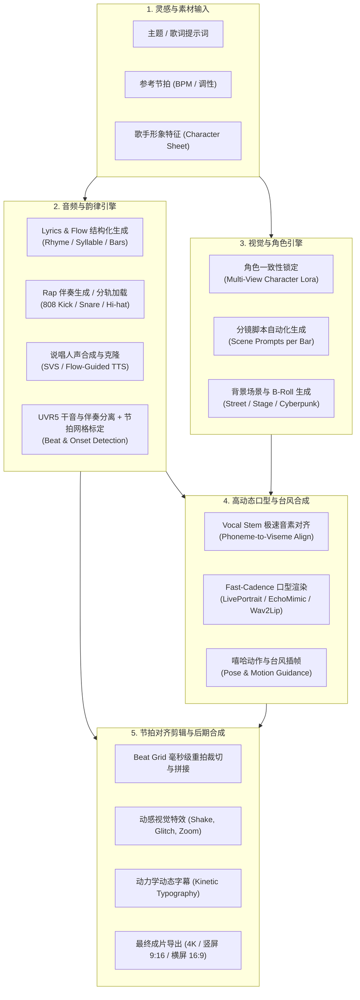

# 全网 AI Rap Video 核心平台、技术体系与生态调研报告 (42家全景剖析)

> **调研发起**：Antigravity Autonomous Research Team  
> **调研范围**：全球 AI Rap/Hip-Hop 音乐制作、人声合成、极速对口型、动态数字人、节拍驱动视频、全流程视频平台及开源架构  
> **入选标的**：42 家核心代表性产品与开源项目  
> **发布时间**：2026-10-23  

---

## 一、 宏观概览与技术全景 (Executive Summary)

AI Rap Video（AI 说唱音乐视频）是生成式 AI 在音视频多模态领域最具挑战性也最具商业爆发力的垂直赛道之一。不同于普通舒缓流行歌或口播演讲，**Rap 具有高 BPM（通常 80~160+ BPM）、密集多音节押韵（Multisyllabic Rhymes）、复杂切分节奏（Flow & Cadence）、强重拍重音（Downbeat & Transient Energy）以及强烈的肢体律动（Head Bobs, Arm Gestures & Swag）**。

当前全球 AI Rap 视频的产业实践已从早期的“粗糙拼接”演进为两大成熟范式：
1. **端到端一键生成平台（All-in-One Automated Pipeline）**：面向自媒体、短视频创作者，用户输入歌词/主题或上传音频，平台自动完成旋律生成、节拍网格检测、动态镜头剪辑与字幕动效合成。
2. **专业级模块化分层工坊（Modular Workflow Stacking）**：依托 ComfyUI、扩散模型与专业 DAW，将流程严格解耦为：
   - **分词与押韵层 (Lyrics & Flow Engine)**
   - **伴奏与人声层 (Beats & Vocal SVS/TTS)**
   - **高帧率极速口型驱动层 (Fast-Cadence Lip-Sync & Avatar Animation)**
   - **全身体态与姿态律动层 (Pose & Swagger Generation)**
   - **重拍对齐与特效渲染层 (Beat-Synced Cut & Kinetic Typography)**

---

## 二、 42 家核心平台与技术方案全景深度剖析

本调研系统梳理了全球 42 家领先产品与前沿开源项目，按 6 大核心支柱进行归类与深度测评：

### 维度一：AI 说唱人声、伴奏与全曲生成平台 (AI Rap Music & Beats)

1. **Suno AI**
   - **官网**: [https://suno.com](https://suno.com)
   - **核心定位**: 全球领先的多模态 AI 音乐生成平台。
   - **Rap 特性**: 支持在 Prompt 中指定 Boom-Bap、Trap、Drill、East Coast、West Coast、Melodic Rap 等流派，能自动匹配极度自然的押韵与 Flow 韵律。
   - **商业模式**: 免费体验 + 订阅制（Pro/Premier）。

2. **Udio**
   - **官网**: [https://udio.com](https://udio.com)
   - **核心定位**: 前 Google DeepMind 团队打造的高音质 AI 音乐生成器。
   - **Rap 特性**: 在人声质感、齿音咬字、极速快嘴以及人声复调方面表现极其突出，支持通过上下文 Extend 分段定制说唱 Verse/Chorus/Bridge。
   - **商业模式**: 免费体验 + 阶梯订阅制。

3. **Rapchat**
   - **官网**: [https://rapchat.com](https://rapchat.com)
   - **核心定位**: 专为说唱歌手与嘻哈爱好者打造的移动音乐工作站与 AI 创作生态。
   - **Rap 特性**: 内置 AI Lyric Generator、Rhyme Finder、Auto-Tune 与数万首正版 Hip-Hop Beat 伴奏库，支持直接在手机端录制与混音。
   - **商业模式**: 免费基础版 + Gold 会员订阅。

4. **LyricStudio (WaveAI)**
   - **官网**: [https://lyricstudio.net](https://lyricstudio.net)
   - **核心定位**: 专业级 AI 歌词与押韵辅助创作工具。
   - **Rap 特性**: 专为 Hip-Hop 优化的双押、三押、尾押推荐引擎，可根据既定节拍速度与 Flow 结构实时推荐下一句 Bars。
   - **商业模式**: 付费订阅（月付/年付）。

5. **Freebeat.ai (Rap Generator Suite)**
   - **官网**: [https://freebeat.ai](https://freebeat.ai)
   - **核心定位**: 垂直于短视频与社交媒体的 AI 说唱歌词与视频一体化生成器。
   - **Rap 特性**: 包含 Drill Generator、Diss Track Generator 与 Punchline 扩写工具，提供一键将歌词与伴奏渲染为可视视频的能力。
   - **商业模式**: Freemium 增值服务。

6. **Soundverse AI**
   - **官网**: [https://soundverse.ai](https://soundverse.ai)
   - **核心定位**: AI 原生音频与音乐制作平台。
   - **Rap 特性**: 提供精准的 Rap Music Generator，支持独立导出纯伴奏（Instrumentals）或整首带 AI 人声的说唱音轨，可调整能量曲线与和弦。
   - **商业模式**: 免费试用 + 点数充值/订阅。

7. **Neume AI**
   - **官网**: [https://neume.io](https://neume.io)
   - **核心定位**: 面向专业内容制作的高质量 AI 说唱合成平台。
   - **Rap 特性**: 针对 Hip-Hop 亚流派提供重鼓点 808 与快速切分节奏算法，可输出广播级混音效果。
   - **商业模式**: 商业许可与 API 接入。

8. **Boomy**
   - **官网**: [https://boomy.com](https://boomy.com)
   - **核心定位**: 零门槛 AI 原创音乐生成与全网发行平台。
   - **Rap 特性**: 具备 Rap Beats 自动编曲机制，几秒内生成符合工业标准的 808 贝斯与 Trap 鼓组。
   - **商业模式**: 免费分成模式 + 高级创作者订阅。

9. **Soundful**
   - **官网**: [https://soundful.com](https://soundful.com)
   - **核心定位**: 算法驱动的高保真无版权商用伴奏生成器。
   - **Rap 特性**: 提供专门的 Hip-Hop/Trap/Drill 风格预设，可精准锁定 BPM、调性（Key）并导出多轨 Stems（分轨干音）。
   - **商业模式**: 创作者版与企业商用授权订阅。

10. **Loudly**
    - **官网**: [https://loudly.com](https://loudly.com)
    - **核心定位**: AI 音乐协作与伴奏生成引擎。
    - **Rap 特性**: 拥有庞大的实录 Hip-Hop 采样库支持，AI 基于真实乐器 Loops 进行动态编曲组合。
    - **商业模式**: 免费版 + 创作者专业版。

11. **Beatoven.ai**
    - **官网**: [https://beatoven.ai](https://beatoven.ai)
    - **核心定位**: 基于情绪与段落的自适应背景音乐生成平台。
    - **Rap 特性**: 允许用户在不同时间戳切分不同情绪，为说唱叙事视频（Storytelling Rap）定制起承转合的伴奏背景。
    - **商业模式**: 按分钟计费或月度订阅。

12. **Somio AI**
    - **官网**: [https://somio.ai](https://somio.ai)
    - **核心定位**: 专注于 Trap、Boom-Bap 与 Lo-Fi Hip-Hop 的伴奏生成器。
    - **Rap 特性**: 界面极简，可快速微调踢鼓（Kick）、军鼓（Snare）及滚奏踩镲（Hi-hat rolls）的紧凑度。
    - **商业模式**: 订阅制。

---

### 维度二：AI 人声克隆、说唱歌声合成 (SVS) 与音轨分离

13. **ACE Studio (Timedomain)**
    - **官网**: [https://acestudio.ai](https://acestudio.ai)
    - **核心定位**: 商业级 AI 歌声与多语种声音合成工作站。
    - **Rap 特性**: 支持通过导入 MIDI 与音素直接控制音高线、呼吸音与声门张力。通过细化音素时长与滑音微调，可精确还原硬核快嘴说唱。
    - **商业模式**: 个人会员与商业工坊许可。

14. **DiffSinger**
    - **代码库/官网**: [https://github.com/openvpi/DiffSinger](https://github.com/openvpi/DiffSinger)
    - **核心定位**: 基于扩散概率模型（Denoising Diffusion）的开源 SVS 歌声合成框架。
    - **Rap 特性**: 开源社区（如 OpenUtau）大量微调了说唱专用声学模型，能完美模拟说唱中的气泡音、沙哑摩擦音与极速音素切换。
    - **商业模式**: 开源（Apache-2.0），社区自建部署。

15. **GPT-SoVITS**
    - **代码库/官网**: [https://github.com/RVC-Boss/GPT-SoVITS](https://github.com/RVC-Boss/GPT-SoVITS)
    - **核心定位**: 强大的少样本（Few-shot）TTS 与语音克隆开源项目。
    - **Rap 特性**: 输入 5 秒参考说唱音频，即可高保真克隆目标歌手的说唱音色、腔调与咬字重音，是目前自制 AI 虚拟说唱歌手的王牌底座。
    - **商业模式**: 开源免费（MIT 协议）。

16. **RVC (Retrieval-based Voice Conversion)**
    - **代码库/官网**: [https://github.com/RVC-Project/Retrieval-based-Voice-Conversion-WebUI](https://github.com/RVC-Project/Retrieval-based-Voice-Conversion-WebUI)
    - **核心定位**: 基于检索的低延迟音色转换系统。
    - **Rap 特性**: 创作者自己录制或引导说唱干音（Guide Vocal），通过 RVC 一键无缝转换为指定虚拟歌手或偶像的声线，完美保留 Flow 与节奏细节。
    - **商业模式**: 开源免费（MIT 协议）。

17. **Kits.ai**
    - **官网**: [https://kits.ai](https://kits.ai)
    - **核心定位**: 专为音乐制作人打造的合法授权 AI 人声工作室。
    - **Rap 特性**: 汇聚了海量经过官方授权的 Hip-Hop/Rap 歌手模型，提供极佳的干音转换、去噪与模型微调功能。
    - **商业模式**: 按量月度订阅。

18. **Weights.gg (原 Voicify.ai)**
    - **官网**: [https://weights.gg](https://weights.gg)
    - **核心定位**: 全球最大的 AI 音乐模型社区与在线变声平台。
    - **Rap 特性**: 拥有数万个社区训练的知名说唱歌手模型，支持直接输入音频或 YouTube 链接一键替换主唱说声音轨。
    - **商业模式**: 免费体验 + 积分订阅。

19. **Uberduck**
    - **官网**: [https://uberduck.ai](https://uberduck.ai)
    - **核心定位**: 开创性的 AI 说唱人声与文本转语音（Text-to-Rap）平台。
    - **Rap 特性**: 率先推出商业级 AI Rap Generator API，输入节拍、歌词与指定 Flow 模板即可自动渲染说唱音轨。
    - **商业模式**: 开发者 API 按调用计费 + 创作者月费。

20. **Ultimate Vocal Remover (UVR5)**
    - **官网**: [https://ultimatevocalremover.com](https://ultimatevocalremover.com)
    - **核心定位**: 业界公认顶级的人声音轨分离与伴奏提取开源工具。
    - **Rap 特性**: 依托 MDX-Net、Demucs v4 等核心算法，能完美剥离 Hip-Hop 歌曲中的沉重 808 贝斯与主唱干音，为后续口型对齐提供绝对纯净的 Vocal Stem。
    - **商业模式**: 开源免费。

---

### 维度三：极速说唱对口型与音频驱动数字人 (Fast-Cadence Lip-Sync & Avatars)

21. **Hedra (Hedra Studio / Character-3)**
    - **官网**: [https://hedra.com](https://hedra.com)
    - **核心定位**: 业界顶尖的基础多模态虚拟人视频生成平台。
    - **Rap 特性**: 具备惊人的音频-视觉对齐能力，在面临 140+ BPM 的高速连续音节时依然能保持嘴型不崩塌，且自发产生自然的头部晃动与说唱神态。
    - **商业模式**: 免费试用 + Pro/Enterprise 订阅。

22. **LivePortrait (KwaiVGI)**
    - **代码库/官网**: [https://github.com/KwaiVGI/LivePortrait](https://github.com/KwaiVGI/LivePortrait)
    - **核心定位**: 快手开源的高效高保真肖像动作迁移框架。
    - **Rap 特性**: 具备极速计算与极限面部表情捕捉，通过真人说唱表演视频（Driving Video）作为运动源，可无缝将说唱时的夸张口部动作、挑眉、歪头等 Swag 特征迁移到任意 2D/3D 头像上。
    - **商业模式**: 开源免费（非商用学术开源 / ComfyUI 生态标配）。

23. **EchoMimic (Ant Group)**
    - **代码库/官网**: [https://github.com/antgroup/echomimic](https://github.com/antgroup/echomimic)
    - **核心定位**: 蚂蚁集团开源的音频+关键点双重驱动肖像动画扩散模型。
    - **Rap 特性**: 专为解决强节奏音频对口型发飘抖动的问题设计，即便在 Rap 伴奏存在重低音轰鸣的情况下，通过人脸 Landmark 约束，嘴型依然极度稳固。
    - **商业模式**: 开源免费（Apache-2.0）。

24. **OmniHuman (ByteDance)**
    - **官网/主页**: [https://omnihuman1.org](https://omnihuman1.org)
    - **核心定位**: 字节跳动出品的弱条件全身体态数字人生成模型。
    - **Rap 特性**: 打破了以往“仅能晃动头部”的局限，根据说唱歌词音频的重音和激昂程度，自主生成半身乃至全身的说唱手势、身体前倾与摇摆姿态。
    - **商业模式**: 阶段性内测 / 开放学术演示。

25. **EMO (Emote Portrait Alive - Alibaba)**
    - **论文/主页**: [https://humanaigc.github.io/emote-portrait-alive](https://humanaigc.github.io/emote-portrait-alive)
    - **核心定位**: 阿里智能计算研究院推出的端到端 Audio2Video 扩散模型。
    - **Rap 特性**: 其官方演示的 Eminem《Rap God》快嘴对口型震惊业界，不依赖中间 3DMM，直接通过弱音频特征映射高动态表情与大角度头部俯仰。
    - **商业模式**: 学术开源研究。

26. **Hallo / Hallo2 (Fudan Generative Vision)**
    - **代码库/官网**: [https://github.com/fudan-generative-vision/hallo](https://github.com/fudan-generative-vision/hallo)
    - **核心定位**: 复旦大学开源的长时音频驱动人像动画模型。
    - **Rap 特性**: 能够处理超长单音轨输入，配合阶梯式时间自注意力机制，保证整首说唱歌曲（3-4分钟）角色面部不走形、口型持续同步。
    - **商业模式**: 开源免费（MIT 协议）。

27. **AniPortrait (Tencent / Zhenglin Zhou)**
    - **代码库/官网**: [https://github.com/ZhenglinZhou/AniPortrait](https://github.com/ZhenglinZhou/AniPortrait)
    - **核心定位**: 音频驱动的高保真肖像生成框架。
    - **Rap 特性**: 先将音频转换为 3D 姿态与表情网格，再由扩散模型渲染高分辨率画面，在可控性与节奏一致性上表现优秀。
    - **商业模式**: 开源免费。

28. **SadTalker**
    - **代码库/官网**: [https://github.com/OpenTalker/SadTalker](https://github.com/OpenTalker/SadTalker)
    - **核心定位**: CVPR 经典音频驱动单图口型动画模型。
    - **Rap 特性**: 部署极其轻量，支持在消费级显卡（如 RTX 3060）本地快速推理，适合自动化批处理批量生成低成本说唱试听片。
    - **商业模式**: 开源免费。

29. **Wav2Lip / Wav2Lip-HD**
    - **代码库/官网**: [https://github.com/Rudrabha/Wav2Lip](https://github.com/Rudrabha/Wav2Lip)
    - **核心定位**: 音素级对口型基准算法与高分辨率改进版。
    - **Rap 特性**: 即使在极度快速的说唱场景下，其判别器损失能强制唇形在当前帧闭合或咧开，是所有口型修补工作流中的硬核兜底模型。
    - **商业模式**: 开源免费。

30. **SyncLabs**
    - **官网**: [https://synclabs.so](https://synclabs.so)
    - **核心定位**: 面向企业的超低延迟无缝对口型 API 平台。
    - **Rap 特性**: 允许将任意说唱音轨实时替换到已有说唱 MV 视频中，无需重新渲染整个场景与光影，仅微调嘴唇与下颌区域。
    - **商业模式**: 开发者 API 按秒计费。

---

### 维度四：嘻哈肢体动作、舞蹈与姿态置换 (Motion & Swagger Replacement)

31. **Viggle AI**
    - **官网**: [https://viggle.ai](https://viggle.ai)
    - **核心定位**: 基于 JST-1 可控物理运动模型的角色动作替换引擎。
    - **Rap 特性**: 用户只需提供一张角色正面图和一个经典的 Hip-Hop 舞蹈/说唱台风视频，Viggle 即可完美将角色套入该动作模版中，生成带有地道 Swag 的全身表演视频。
    - **商业模式**: Discord 免费点数 + Web 端 Pro 订阅。

32. **MimicMotion (Tencent)**
    - **代码库/官网**: [https://github.com/Tencent/MimicMotion](https://github.com/Tencent/MimicMotion)
    - **核心定位**: 腾讯开源的高质量置信度感知人体姿态动作引导模型。
    - **Rap 特性**: 解决人体大幅度晃动手势与肢体遮挡时的撕裂问题，能够稳定再现 Hip-Hop MV 中常见的快速手指结印、胸口捶击等复杂手势。
    - **商业模式**: 开源免费。

33. **Champ (Fudan Generative Vision)**
    - **代码库/官网**: [https://github.com/fudan-generative-vision/champ](https://github.com/fudan-generative-vision/champ)
    - **核心定位**: 引入 3D 参数化人体的可控人物动画模型。
    - **Rap 特性**: 结合 SMPL-X 骨骼数据，能准确渲染宽松连帽衫、金项链等 Hip-Hop 标志性服饰在说唱跳跃时的自然布料动力学。
    - **商业模式**: 开源免费。

34. **DomoAI**
    - **官网**: [https://domoai.app](https://domoai.app)
    - **核心定位**: 风格化视频转换（Video-to-Video）AI 平台。
    - **Rap 特性**: 创作者录制一段真实的地下说唱对战视频，DomoAI 可在保留 100% 动作韵律的前提下，将其转绘为美式暗黑漫画风、日系动漫风或 3D 赛博朋克风。
    - **商业模式**: 订阅积分制。

---

### 维度五：节拍响应式视觉、动效与自动化剪辑引擎 (Beat-Synced Visualizers & Montage)

35. **Kaiber**
    - **官网**: [https://kaiber.ai](https://kaiber.ai)
    - **核心定位**: 专为音乐人和视觉艺术家打造的音频反应式（Audio-Reactive）AI MV 平台。
    - **Rap 特性**: 其核心的“Beat Sync”功能可直接分析说唱音轨的鼓点重音与能量曲线，在低音爆炸瞬间触发镜头拉伸、画面反转或风格突变，曾被 Linkin Park 等知名乐队官方 MV 采用。
    - **商业模式**: 创作者月费与年费套餐。

36. **Noisee.ai**
    - **官网**: [https://noisee.ai](https://noisee.ai)
    - **核心定位**: 一键全曲转 MV 的 AI 视频生成器。
    - **Rap 特性**: 原生集成 Suno/Udio 链接直连，自动根据说唱歌词的情绪转折分段构思分镜脚本，生成极具视觉冲击力的全曲长视频。
    - **商业模式**: 社区免费配额 + 付费订阅。

37. **Neural Frames**
    - **官网**: [https://neuralframes.com](https://neuralframes.com)
    - **核心定位**: 基于频率分频的音画联动脉冲生成器。
    - **Rap 特性**: 支持将说唱音频分离为 Bass/Drums/Vocals/Other 四条通道，让视觉相机的缩放严格跟随 808 踢鼓震动，色彩饱和度跟随人声音量起伏。
    - **商业模式**: 免费版 + 创作者阶梯计费。

38. **BeatViz AI**
    - **官网**: [https://beatviz.ai](https://beatviz.ai)
    - **核心定位**: 专为电子音乐与说唱单曲设计的动态声谱可视化平台。
    - **Rap 特性**: 擅长在竖屏短视频场景下，将说唱节奏转化为动态频段粒子与脉冲波形，并与背景动态插画实时同步。
    - **商业模式**: 单曲渲染买断或订阅。

39. **AirMusic**
    - **官网**: [https://airmusic.ai](https://airmusic.ai)
    - **核心定位**: 自动化社交媒体音乐视频发布引擎。
    - **Rap 特性**: 提供多款适合 Hip-Hop 发行的模板，包含动态唱片机旋转、动态歌词滚动以及自动生成 YouTube/TikTok 专属分流尺寸。
    - **商业模式**: 订阅制。

40. **Atlabs**
    - **官网**: [https://atlabs.ai](https://atlabs.ai)
    - **核心定位**: 面向故事叙事与音乐视觉化的 AI 视频工作台。
    - **Rap 特性**: 能精准理解叙事型说唱（Storytelling Rap）的歌词含义，自动拆解每个 4-bar 的隐喻意象并生成电影质感的分镜背景。
    - **商业模式**: 团队订阅制。

---

### 维度六：电影级视频大模型与资产基底 (Cinematic Video Foundation Models)

41. **Kling AI (可灵 AI - 快手)**
    - **官网**: [https://klingai.com](https://klingai.com)
    - **核心定位**: 电影级高清视频生成基础大模型。
    - **Rap 特性**: 支持高帧率与极具真实感的物理运动模拟，在生成说唱歌手在街头、废弃厂房、聚光灯舞台下的运镜推拉方面极为震撼，并支持首尾帧控制与运镜路径自定义。
    - **商业模式**: 免费每日赠分 + 付费订阅。

42. **RunwayML (Gen-3 Alpha / Gen-4)**
    - **官网**: [https://runwayml.com](https://runwayml.com)
    - **核心定位**: 全球好莱坞级 AI 影视制作标杆工具。
    - **Rap 特性**: 具备业界最精密的 Camera Control（轨道、升降、平摇），配合 Motion Brush，可将静态虚拟说唱歌手周围的喷漆、烟雾、霓虹灯单独赋予剧烈的动态特效。
    - **商业模式**: 阶梯订阅制 + 企业服务。

---

## 三、 核心技术横向对比矩阵 (Technical Benchmark Matrix)

| 类别 / 核心维度 | 典型代表工具/模型 | 核心优势 (Pros) | 局限性与挑战 (Cons) | 在 AI Rap 视频流中的最佳定位 |
| :--- | :--- | :--- | :--- | :--- |
| **全流程一键生成** | Noisee, Freebeat, AirMusic | 出片速度极快（几分钟），学习成本低，开箱即用 | 镜头多为抽卡拼接，难以保持虚拟说唱歌手长时一致性，口型难以严丝合缝 | 社交平台快速铺量、灵感 Demo 预览 |
| **极速咬字对口型** | Hedra, LivePortrait, EchoMimic | 能抗住 140+ BPM 高速连珠炮，咬字精准，下颌运动自然 | LivePortrait 依赖优质驱动视频；扩散类模型单次推理较慢 | **核心特写镜头、快嘴 Verse 关键帧必选** |
| **体态与台风生成** | Viggle AI, MimicMotion, OmniHuman | 赋能说唱专属 Swag、手势、身体前倾与节拍点摆动 | 快速大幅度动作偶有肢体交叠穿模伪影 | 中景说唱表演、副歌舞台大动作 |
| **音频响应与声谱** | Kaiber, Neural Frames | 完美卡点重拍与 808 贝斯，音画一体感极强，视觉冲击震撼 | 多为风格化抽象噪波渐变，难以做精细拟真叙事 | 过渡转场、伴奏空拍 Drop、高潮合成 |
| **开源底座自主控制** | ComfyUI + DiffSinger + LivePortrait + UVR5 | 100% 本地自主可控，零 API 成本，画风与音色可无限微调 | 部署门槛高，显存要求高（需 16GB+ VRAM），工程链路复杂 | **企业级 / 工业级自主生产系统标准架构** |

---

## 四、 工业级 AI Rap Video 系统端到端架构蓝图

基于上述 42 家平台的技术优缺点分析，要打造一个具备商业竞争力的全自主 AI Rap Video 系统，必须构建闭环的微服务与流水线：

---

## 五、 结论与后续全自主开发行动指引

当前 AI 说唱视频的技术天花板已不再是“生成一段音乐”或“生成一张动图”，而是**“极致的节奏紧密性（Tight Cadence）+ 角色形象与光影的高度一致性（Visual Identity）+ 视听重拍的瞬间共振（Audiovisual Transient Sync）”**。

后续系统研发将以该架构蓝图为基准，在本地工作区依托 Git Worktree 并行拆解各独立子模块，全面落地工业化 AI Rap Video 生成系统！
