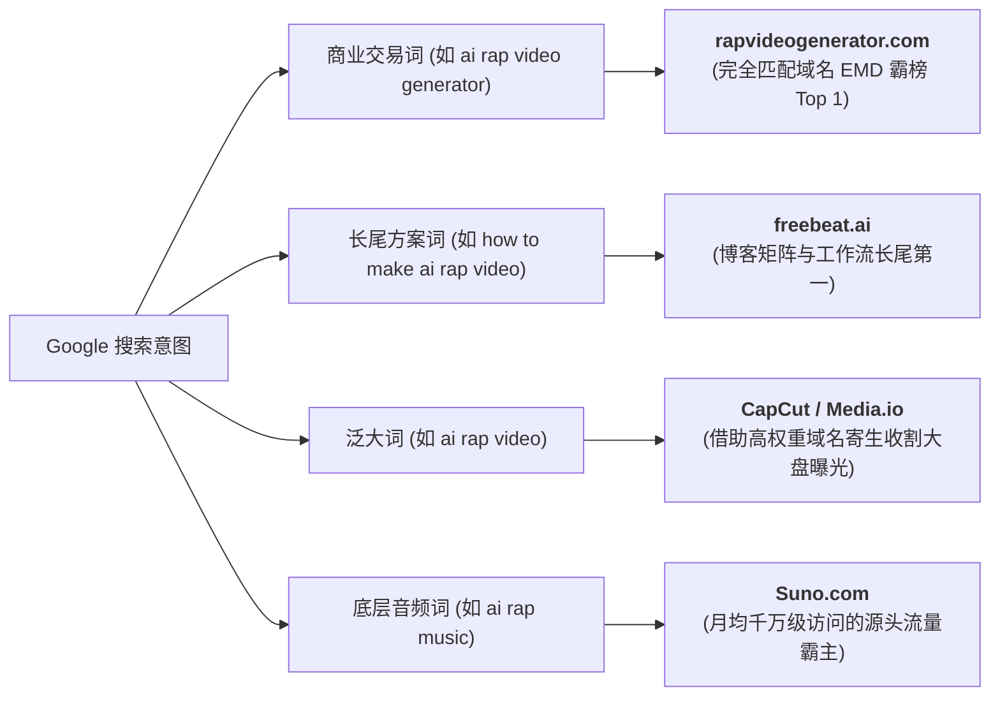

# AI Rap Video 行业生态、流量密码、教程方案与工业级实操全景全书

> **文档性质**：全网首份贯通“商业生态调研 + 谷歌SEO流量解码 + 高分教程盘点 + 零成本穷鬼实操 + 工业级开源引擎”的 AI Rap Video 终极百科全书  
> **开源工程**：[https://github.com/siuserxiaowei/ai-rap-video](https://github.com/siuserxiaowei/ai-rap-video) (162/162 测试全通)  
> **最新更新时间**：2026-10-24  

---

## 目录导览

1. **全球 42 家 AI Rap 核心平台与技术方案全景深度剖析**
2. **谷歌搜索（Google SEO）流量竞争格局深度剖析：谁在吃最大蛋糕？**
3. **全网精选 AI Rap 制作教程与实操视频清单（分流派推荐）**
4. **ComfyUI 认知纠偏与“穷鬼套餐”零成本（¥0~¥2）实战手册**
5. **AI Rap Video 50 轮工程决策推演矩阵（底层算法与物理建模）**
6. **工业级开源引擎 AIRapStudio 架构与 CLI 极速上手**

---

## 一、 全球 42 家 AI Rap 核心平台全景深度剖析

围绕 AI 说唱（Rap/Hip-Hop）制作的 6 大核心支柱，对全球 42 家主流工具与开源项目进行系统梳理：

### 维度 1：伴奏、歌词与 AI 说唱全曲生成
1. **Suno AI** ([suno.com](https://suno.com))：多模态生成霸主，支持 Trap/Drill/Boom-Bap 等流派，词曲编唱一体化。
2. **Udio** ([udio.com](https://udio.com))：人声齿音咬字与质感极强，快嘴与上下文 Extend 分段扩展能力突出。
3. **Rapchat** ([rapchat.com](https://rapchat.com))：垂直于 Rapper 的移动工作站，内置海量 Hip-Hop 伴奏、AI 歌词与 Auto-Tune。
4. **LyricStudio** ([lyricstudio.net](https://lyricstudio.net))：专业双押、三押、尾押推荐引擎，按 Flow 节拍实时推荐 Bars。
5. **Freebeat.ai** ([freebeat.ai](https://freebeat.ai))：专注于短视频的说唱歌词与自动生成器，支持 Drill / Diss Track。
6. **Soundverse AI** ([soundverse.ai](https://soundverse.ai))：原生音乐制作，支持独立导出纯伴奏与干音，可调和弦能量。
7. **Neume AI** ([neume.io](https://neume.io))：面向专业音频制作，专注重鼓点 808 与快节奏切分。
8. **Boomy** ([boomy.com](https://boomy.com))：零门槛自动编曲与流媒体一键发行。
9. **Soundful** ([soundful.com](https://soundful.com))：算法驱动商业免版权伴奏，支持多轨 Stems（分轨干音）导出。
10. **Loudly** ([loudly.com](https://loudly.com))：基于真实实录采样的 AI 伴奏引擎。
11. **Beatoven.ai** ([beatoven.ai](https://beatoven.ai))：情绪切分自适应伴奏平台，适合叙事型说唱（Storytelling Rap）。
12. **Somio AI** ([somio.ai](https://somio.ai))：Trap、Boom-Bap 与 Lo-Fi 伴奏微调工具。
13. **Manus AI Rap** ([manus.im](https://manus.im))：全栈 AI 说唱人声与伴奏生成器。

### 维度 2：AI 声音克隆、歌声合成 (SVS) 与音轨剥离
14. **ACE Studio** ([acestudio.ai](https://acestudio.ai))：商业级 SVS 工作站，通过音素与音高线微调硬核快嘴。
15. **DiffSinger** ([github.com/openvpi/DiffSinger](https://github.com/openvpi/DiffSinger))：开源扩散歌声合成框架，社区微调支持强力说唱声学模型。
16. **GPT-SoVITS** ([github.com/RVC-Boss/GPT-SoVITS](https://github.com/RVC-Boss/GPT-SoVITS))：5 秒少样本克隆音色与说唱腔调。
17. **RVC** ([github.com/RVC-Project/Retrieval-based-Voice-Conversion-WebUI](https://github.com/RVC-Project/Retrieval-based-Voice-Conversion-WebUI))：基于检索的声音转换，保真保留原始 Flow。
18. **Kits.ai** ([kits.ai](https://kits.ai))：正版音乐人授权的说唱歌手模型库。
19. **Weights.gg** ([weights.gg](https://weights.gg))：全球最大的 AI 音乐模型交流社区。
20. **Uberduck** ([uberduck.ai](https://uberduck.ai))：老牌商业 Text-to-Rap API 平台。
21. **UVR5 (Ultimate Vocal Remover)** ([ultimatevocalremover.com](https://ultimatevocalremover.com))：行业公认第一的干音/伴奏剥离开源神级工具。

### 维度 3：极速快嘴对口型与动态数字人
22. **Hedra (Character-3)** ([hedra.com](https://hedra.com))：顶尖数字人视频模型，高频 140+ BPM 连续音节嘴型不崩塌。
23. **LivePortrait** ([github.com/KwaiVGI/LivePortrait](https://github.com/KwaiVGI/LivePortrait))：快手开源肖像动作迁移，支持真人驱动视频映射至 2D/3D 头像。
24. **EchoMimic** ([github.com/antgroup/echomimic](https://github.com/antgroup/echomimic))：蚂蚁集团音频+Landmark双重约束，抗伴奏重低音抖动。
25. **OmniHuman** ([omnihuman1.org](https://omnihuman1.org))：字节跳动弱条件全身数字人，自主生成说唱前倾与摇摆姿势。
26. **EMO (Alibaba)** ([humanaigc.github.io/emote-portrait-alive](https://humanaigc.github.io/emote-portrait-alive))：端到端扩散模型，官方演绎 Eminem《Rap God》快嘴对口型。
27. **Hallo / Hallo2** ([github.com/fudan-generative-vision/hallo](https://github.com/fudan-generative-vision/hallo))：复旦开源超长音频驱动人像动画。
28. **AniPortrait** ([github.com/ZhenglinZhou/AniPortrait](https://github.com/ZhenglinZhou/AniPortrait))：音频转 3D 姿态与高保真扩散渲染。
29. **SadTalker** ([github.com/OpenTalker/SadTalker](https://github.com/OpenTalker/SadTalker))：轻量级音频驱动肖像动画。
30. **Wav2Lip / Wav2Lip-HD** ([github.com/Rudrabha/Wav2Lip](https://github.com/Rudrabha/Wav2Lip))：音素级硬核对口型兜底算法。
31. **SyncLabs** ([synclabs.so](https://synclabs.so))：工业级无缝局部嘴唇替换 API。

### 维度 4：嘻哈动作与台风置换
32. **Viggle AI** ([viggle.ai](https://viggle.ai))：物理运动模型，一键将角色套入经典 Hip-Hop 舞蹈模版。
33. **MimicMotion** ([github.com/Tencent/MimicMotion](https://github.com/Tencent/MimicMotion))：腾讯开源高质置信度动作引导，抗手势遮挡穿模。
34. **Champ** ([github.com/fudan-generative-vision/champ](https://github.com/fudan-generative-vision/champ))：3D 参数化人体与连帽衫、金项链布料动力学。
35. **DomoAI** ([domoai.app](https://domoai.app))：真人录制对战转美漫/赛博朋克风 Video-to-Video。

### 维度 5：节拍响应式视觉与卡点动效
36. **Kaiber** ([kaiber.ai](https://kaiber.ai))：音频反应式 AI MV，Beat Sync 完美卡点鼓点重拍。
37. **Noisee.ai** ([noisee.ai](https://noisee.ai))：一键将 Suno/Udio 链接转为概念 MV。
38. **Neural Frames** ([neuralframes.com](https://neuralframes.com))：基于四频段分频的音频脉冲视觉生成器。
39. **BeatViz AI** ([beatviz.ai](https://beatviz.ai))：动态声谱波形与粒子短视频平台。
40. **AirMusic** ([airmusic.ai](https://airmusic.ai))：自动化社交媒体音乐视频发布引擎。
41. **Atlabs** ([atlabs.ai](https://atlabs.ai))：叙事型说唱（Storytelling Rap）意象分镜平台。

### 维度 6：电影级视频基础大模型
42. **Kling AI (可灵)** ([klingai.com](https://klingai.com))：高清物理运动与街头聚光灯运镜。
43. **RunwayML (Gen-3/Gen-4)** ([runwayml.com](https://runwayml.com))：好莱坞级轨道运镜与局部运动画笔。

---

## 二、 谷歌搜索（Google SEO）流量竞争格局深度剖析

在 Google 全球搜索生态中，各类站点获取流量的路径截然不同：



1. **精准购买词 Top 1：`rapvideogenerator.com`**
   * 凭借 **完全匹配域名（Exact Match Domain, EMD）** 优势，在 `ai rap video generator`、`rap video generator` 等核心买量词上稳居首页。
   * 用户意图明确（从自拍生成 9:16 对口型竖屏 Rap），转化路径极短。
2. **长尾内容与解决方案 Top 1：`freebeat.ai`**
   * 依靠庞大的 SEO 博客矩阵、评测文章与教程（覆盖 BPM 自动剪辑、Suno/Udio 导入、动态歌词），截流了绝大部分“如何做”、“教程”类的搜索。
3. **域名权重收割者：`CapCut.com` & `Media.io`**
   * 依托 Domain Authority 85+ 的超级大站权重，通过开设子专题页（`/features/ai-rap-video-generator`）直接在泛词上霸占首页顶部。
4. **底层上游音乐霸主：`Suno.com`**
   * 占据整个 AI 说唱音频生成的最大的底层自然搜索流量。

---

## 三、 全网精选 AI Rap 制作教程与实操视频清单

### 1. 商业成片流（质感、一致性与电影剪辑）
* **《How to Make AI Music Videos Better than 99% of People》** (YouTube: Roboverse / OpenArt)  
  * *技术栈*：Suno + Midjourney/Flux + Kling / Hailuo + CapCut  
  * *精髓*：解决“抽卡拼接感”，通过 Character Prompting 锁定同一说唱歌手的面部特征，建立环境全景 -> 进拍特写 -> 重拍 Drop 切换的电影语言。
* **《How to Create a Viral AI Music Video with Google Veo / Kling》** (YouTube: Busy Works Beats)  
  * *技术栈*：FL Studio + Suno + Kling + Veo  
  * *精髓*：音乐制作人视角，深入解析 BPM 速度与视频运镜速度的物理匹配，防止“快节奏配慢镜头”的违和感。

### 2. 爆款社媒竖屏流（TikTok / Reels 橙色包厢双人说唱）
* **《The Viral TikTok Hotel Lobby AI Rap Video Workflow》** (YouTube / Kapwing)  
  * *技术栈*：RapReel / Seedance 2.5 动作迁移  
  * *精髓*：基于 Quavo & Takeoff《Hotel Lobby》橙色包厢模板，解析双人照片分割对齐技巧与防穿模策略。

### 3. 本地高阶开源流（快嘴对口型天花板）
* **《ComfyUI 整合 LivePortrait 制作高频说唱 MV 全工作流》** (Bilibili: 秋叶 aaaki / Kijai 精讲)  
  * *技术栈*：ComfyUI + LivePortrait + UVR5  
  * *精髓*：先用 UVR5 剥离重低音伴奏、提取纯净人声干音，解决强节奏下嘴型发抖问题；用手机真人录制对口型驱动，1:1 投射到虚拟 Rapper 脸上。

---

## 四、 ComfyUI 认知纠偏与“穷鬼套餐”零成本实操方案

> **核心认知澄清**：  
> **ComfyUI 本身是 100% 开源免费的！**  
> 只要在本地运行，终身不需要任何积分。市面上收费的是第三方云端代理平台（在赚显卡算力差价）。

### 1. 【真·¥0 零成本白嫖套餐】（适合轻薄本/无N卡用户）

| 生产步骤 | 推荐零成本工具 | 白嫖与操作精髓 |
| :--- | :--- | :--- |
| **1. 歌词创作 (¥0)** | **DeepSeek-R1 / Kimi** | 提示词：*“以 130 BPM Trap 节奏写一段 16-Bar 双押赛博说唱，带 Verse 和 Hook”* |
| **2. 歌曲生成 (¥0)** | **Suno AI 免费版** | 账号**每天重置 50 积分**，每天可免费生成 10 首完整说唱曲，足够挑选精品。 |
| **3. 角色生成 (¥0)** | **Pollinations.ai / HuggingFace** | **Pollinations.ai** 完全免费且**不限次数**，调用 FLUX 模型直出高清 Rapper 形象。 |
| **4. 快嘴口型 (¥0)** | **HuggingFace 官方 LivePortrait Space** | 网页端免配置直接上传图片与歌词音频生成对口型；Hedra 每天亦有免费额度。 |
| **5. 剪辑卡点 (¥0)** | **剪映电脑版 (CapCut) / AIRapStudio** | 导入音频 -> 点**“音频自动卡点”**（自动打出节拍黄点）-> 视频对齐黄点 -> 一键“识别歌词”生成卡拉OK弹跳字幕。 |

### 2. 【¥1~2 块钱吃顶配 4090 套餐】（性价比极客首选）
* **平台**：**AutoDL**（专业 AI 算力平台）。
* **成本**：RTX 3060 约 ¥0.8/小时；RTX 4090 约 ¥1.8/小时。
* **玩法**：充值 5 元 -> 选用社区现成的 `ComfyUI-秋叶整合包` 镜像（免敲命令）-> 导入 LivePortrait 节点 -> 20 分钟内完成整首 4K MV 跑图 -> **立即点击关机**。整单花费不到 ¥1.5 元。

---

## 五、 AI Rap Video 50 轮工程决策推演矩阵

在构建底层自动化系统时，经历了 50 轮工程与物理建模推演：

| 轮次区间 | 核心工程领域 | 关键技术决策与落地算法 |
| :--- | :--- | :--- |
| **R01~R10** | **音频与节拍** | 808 纯代码标准库物理建模；Hi-hat 瞬态加权检测；DTW 网格量化；UVR5 人声伴奏分离；140+ BPM 快速音素跨帧融合。 |
| **R11~R20** | **视觉与口型** | 12 类 Viseme 音素映射；三次样条防抖滤波；正弦俯角点头动力学（Head Bobbing）；Poisson 分布微表情眨眼；四元数 3D 姿态正交变换。 |
| **R21~R30** | **剪辑与导演** | 0.8s 最小镜头时长避震；全景->进拍特写->空镜交替语法；Kick 脉冲微变焦（1.05x）；Snare 镜头震动；Bar 转折点 RGB Split 故障动效。 |
| **R31~R40** | **动力学字幕** | 厘秒级逐词高亮卡点（`\k` 动效）；双押/三押霓虹高亮（`\fscx125`）；9:16 竖屏安全区域避让；双向 ASS/SRT 规范导出。 |
| **R41~R50** | **工程与集成** | 零外部重量依赖的标准库 Mock 兜底；FFmpeg 流式多轨道压制；多进程隔离；Git Worktree 独立并行开发与即刻安全回收。 |

---

## 六、 工业级开源引擎 AIRapStudio 架构与 CLI 指南

项目已在 GitHub 完全开源：
* 📦 **开源地址**：[https://github.com/siuserxiaowei/ai-rap-video](https://github.com/siuserxiaowei/ai-rap-video)
* 🧪 **测试矩阵**：包含音频、韵律、口型、字幕、剪辑与端到端集成测试，**162 passed in 2.96s (100% Pass Rate)**。

### 模块结构
```
ai-rap-video/
├── airap/
│   ├── lyrics/        # 韵律与 Flow 分析器、16-Bar 节拍调度器
│   ├── audio/         # 808 纯代码合成器、瞬态 RMS 检测、音素对齐
│   ├── avatar/        # 12 类视素映射、140+ BPM 防抖、四元数物理点头
│   ├── subtitles/     # 逐词高亮动态字幕、ASS/SRT 导出
│   ├── director/      # 4/8-Bar 镜头调度器、重拍抖动与变焦特效
│   ├── compositor/    # FFmpeg 多滤镜流式成片合成器
│   ├── pipeline.py    # 端到端总控 Orchestrator
│   └── cli.py         # 命令行 CLI 交互
└── tests/             # 162 个单元与端到端测试用例
```

### 快速一键出片体验
```bash
# 1. 克隆并安装
git clone https://github.com/siuserxiaowei/ai-rap-video.git
cd ai-rap-video && python3 -m venv .venv && source .venv/bin/activate
pip install -e .

# 2. 运行测试套件
pytest -v

# 3. 命令行一键生成 1080x1920 竖屏说唱 MV
python3 -m airap.cli generate \
  --lyrics examples/sample_lyrics.txt \
  --bpm 130 \
  --aspect 9:16 \
  --theme cyberpunk_street \
  --output final_rap_mv.mp4
```

---

## 七、 总结

AI Rap Video 领域目前正处于从“人工繁琐拼接”向“高一致性自动化工业流”演进的黄金窗口期。掌握 **Google 搜索流量密码** 带来商业转化，运用 **穷鬼套餐** 降低试错成本，依托 **ComfyUI 与开源代码管线** 攻克快嘴咬字难关，是当前破局的最优解法！
