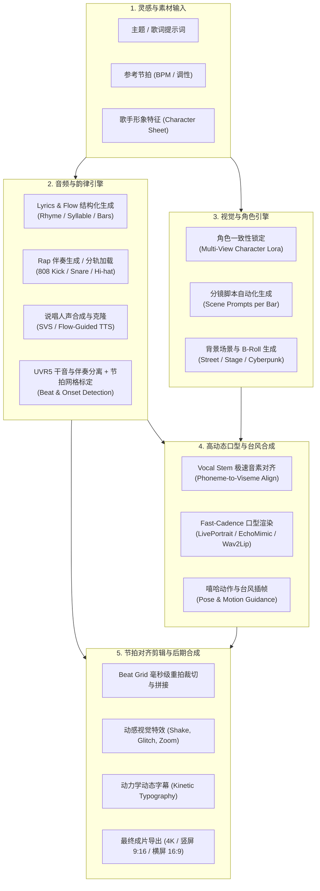

# AI Rap Video 调研与开发交付总纲（合并校验版）

## 统一摘要与版本口径

本页合并原总纲、42项生态详本、46站出处研究与后续工程验收，并核对公开GitHub。此后以本页作为统一阅读入口。合并日期：2026-10-24；价格、功能与模型仍以各条原始采集日期为准，不把材料合并当作重新生成实测。

| 项目 | 统一口径 |
| --- | --- |
| 研究索引 | 78条去重入口/项目记录＝46条已建出处记录＋32条未独立核验候选；不是已验证78站。 |
| 46站证据 | 42 full_page、4 partial；160个既有市场源文件。full_page表示相关官网正文已读，不表示生成质量、付款或下载通过。 |
| 旧42/43差异 | 42详本实际42条；旧总纲实际43条，多出Manus。两份并集43，与46目录重叠11，额外候选32。 |
| 决策与任务 | 50条D01–D50；50个不同Codex任务交付，其中48完整验收、C44/C45待浏览器；50个成功独立Gemini会话。后续复用原agent，不新增计数。 |
| 本地最新验收 | 529 passed，441引擎＋88工作台；393个subtests另记，0失败/错误/跳过。此为既有本地日志，本次合并未重跑。 |
| 真实已测输出 | 程序化短视频、实际ASS中文字幕样本、两种全高清画幅与完整解码；没有生成AI人声、人物动画或口型。 |
| 公开与本地 | 公开main仍4e37d76旧快照；本地f0623e8包含后续新工作台/Sync/字幕能力，尚未在所核对公开main中出现。 |
| 当前门槛 | 真实浏览器的桌面/390px/键盘/下载仍未验收；真实供应商质量、下载与费用阶段仍需配置和样本。 |

公开代码入口：[siuserxiaowei/ai-rap-video](<https://github.com/siuserxiaowei/ai-rap-video>)；当前已核对的公开提交：[4e37d76](<https://github.com/siuserxiaowei/ai-rap-video/commit/4e37d762037196df2eb044d0240ec8b602b44b67>)。不要将之后的本地529项结果归到这个公开旧提交。

| 来源或版本 | 内容与证据范围 |
| --- | --- |
| [原总纲／本统一入口](<https://vi8r050ecuz.feishu.cn/docx/YzORdyPJroCrXZxCoBKceiZ3nUb>)（合并前revision 3） | 保留仓库入口、43项生态线索、六项工程机制与旧版运行说明，按当前证据修订措辞。 |
| [42项生态详本](<https://vi8r050ecuz.feishu.cn/docx/AQqCdG2Q3ogetUxgdFxcwKFgnah>)（源revision 3） | 补充声音/开源人物/动作研究与原生架构图；旧稿性能与许可主张不作为本轮验证。 |
| [46站与开发验收来源](<https://vi8r050ecuz.feishu.cn/docx/TiqGd7dHWoAqBex3KCvcnzpVnKc>)（源revision 14） | 46站逐条出处、价格/API/限制、50决策以及Sync、预览与字幕分阶段验收。 |
| [公开代码 4e37d76](<https://github.com/siuserxiaowei/ai-rap-video/tree/4e37d762037196df2eb044d0240ec8b602b44b67>) | 494个文件、37份site JSON、旧airap与早期目录模块；162个测试定义可数，只有8项目录测试原始日志，未找到完整162运行或公开CI证据。 |
| 本地已验收 f0623e8 | 529原始日志与受测文件哈希匹配；其应用/测试与受测基线de7871e一致。文档提交本身不代表重新跑测试，也不表示已推送。 |

## 生态分层与创作路径

两组材料共同覆盖歌词与音乐、声音处理、人物与口型、姿态动作、音乐视觉、通用视频和剪辑。先区分原创Rap、模板换人、已有歌曲做MV与现成视频对口型，再选择工具；这些路径不能只用模型名称混为一类。

| 路径 | 输入与目标 | 核查重点 |
| --- | --- | --- |
| 新Rap短片 | 主题/歌词＋形象→音乐与视频 | 音乐是否新生成、人物数量、时长、音轨权利与失败规则 |
| 替换参考表演人物 | 模板/参考视频＋照片→角色替换 | 是否保留原音、模板使用边界与人物一致性 |
| 已有歌曲制作MV | 音频→结构/分镜→镜头→剪辑与字幕 | 分段修改、长曲一致性与最终输出规格 |
| 口型处理 | 现成视频＋音轨→口型重绘 | 不预设接口会创作歌词/伴奏，快Rap质量另行验收 |
| 音乐视觉与发布 | 音频/短片＋画幅/字幕/音效 | 抽象视觉与人物演唱分开，文件导出与链接分享分开 |

## 46条有出处研究记录：比较、价格与API

以下是按独立主域建立的研究样本，按编号排列，非质量排名。所有官网效果属于供应商宣称；API documented只表示找到相关公开资料，覆盖范围逐条核对。完整输入、输出、限制及来源在文末46条档案。

| 编号与名称 | 类别 | 入口 | 页面所述流程 | 证据/API |
| --- | --- | --- | --- | --- |
| 01 RapVideoGenerator | Rap与照片专站 | [官网/产品页](<https://rapvideogenerator.com/>) | 官网宣称可从主题或自写歌词生成原创 rap 歌曲，再以单人自拍生成对口型竖屏 rap 视频；歌曲提供两个版本。本次只读取公开页面，未实测生成。来源：https://rapvideogenerator.com/ | full_page / not_found |
| 02 RapVideo.ai | Rap与照片专站 | [官网/产品页](<https://rapvideo.ai/>) | 官网宣称以双人照片生成 5–30 秒 rap 对口型短视频：可用 Hotel Lobby 模板、自备歌曲，或按主题生成原创 rap；本次仅查阅页面，未实测生成。 | full_page / not_found |
| 03 RapReel | Rap与照片专站 | [官网/产品页](<https://rapreel.com/>) | 官网将 RapReel 定位为照片转竖屏 AI 说唱视频：先免费预览舞台静图，再按条购买带 AI 人声和节拍的短片。未实测生成。（https://rapreel.com/） | full_page / not_found |
| 04 AIRapVideo | Rap与照片专站 | [官网/产品页](<https://airapvideo.io/>) | 面向双人合照或两张自拍的短说唱视频工具；供应商称可生成原创英文歌词、节拍、歌声与双人口型同步表演。 | full_page / not_found |
| 05 RapVideoAI | Rap与照片专站 | [官网/产品页](<https://rapvideoai.com/>) | 面向 Hotel Lobby 等说唱热点的照片转短视频产品；官网宣称可由单人照或双人照生成原创歌词、节拍、演唱及口型同步，亦提供原曲复刻模式。未实测生成。 | full_page / not_found |
| 06 Airapvid | Rap与照片专站 | [官网/产品页](<https://airapvid.com/>) | 面向照片变说唱舞台短片的模板工具；官网宣称自动生成歌词、节拍、歌声及口型同步，提供双人、生日吐槽与宠物模板。公开价格按积分、模型、分辨率和时长区分；免费方案明确不含视频。未实际生成验证。 | full_page / not_found |
| 07 CapCut | 剪辑与视觉制作 | [官网/产品页](<https://www.capcut.com/features/ai-rap-video-generator>) | AI Rap 营销页指向通用 Video Studio；官方流程为自备音轨、提示词或参考图生成短镜头，再剪辑、调整歌词字幕和导出。未验证一键端到端生成。 | full_page / not_found |
| 08 Media.io AI Rap Video Generator | Rap与照片专站 | [官网/产品页](<https://www.media.io/ai/explore/zone/ai-rap-video-generator>) | 说唱表演视觉专题，提供单人、双人、街头 freestyle 等提示词与图片/参考视频思路；音频、人声与精确口型均取决于模型或另配工具，未实测一站式成片。 | full_page / not_found |
| 09 OctoScale | Rap与照片专站 | [官网/产品页](<https://octoscale.ai/ai-rap-video-generator>) | 官网宣称从主题生成可编辑说唱歌词、伴奏和人声，再生成可审阅分镜并渲染为竖屏音乐视频；属于明确的端到端营销定位，未实测。首页公开年付积分套餐，未找到公开 API 文档。 | full_page / not_found |
| 10 TryH3 | Rap与照片专站 | [官网/产品页](<https://tryh3.com/generator/ai-rap-video>) | 官网提供以 rap 表演片段为参考、用照片替换一位或两位表演者的短视频编辑流程；成片保留源音频，不生成新歌词。以下均为供应商说明，未实际生成验证。 | full_page / not_found |
| 11 DuoRap AI | Rap与照片专站 | [官网/产品页](<https://duorapai.com/>) | 以两张照片制作双人说唱表演，官网宣称自动生成原创歌词、人声与口型同步；围绕 Hotel Lobby 舞台及生日、宠物、diss 等用途提供入口。未实测生成。 | full_page / not_found |
| 12 AI-Rap.Video | Rap与照片专站 | [官网/产品页](<https://ai-rap.video/>) | 以双人照片、舞台和可选主题生成含说唱人声及节拍的短视频。官网初始配置为 12 秒、720p、84 credits，支持带声 MP4 下载。以下为官网声明，未实际生成。 | full_page / not_found |
| 13 AIRapVideos | Rap与照片专站 | [官网/产品页](<https://airapvideos.com/>) | 两张独立人物照片生成双人说唱短视频；固定橙色录音棚、动作与音轨自动加入，用户选择模型和清晰度。属于预设歌曲表演模板，未实测生成效果。 | full_page / not_found |
| 14 AITuber | Rap与照片专站 | [官网/产品页](<https://aituber.app/tools/ai-rap-video-generator/>) | 说唱音乐视频工具：上传音乐或描述风格生成词曲，再选动态图片、AI 视频或单封面，配歌词字幕输出。功能为官网宣称，未实际生成验证。 | full_page / documented |
| 15 Musicful | 音乐视频 | [官网/产品页](<https://www.musicful.ai/>) | 综合音乐创作平台，首页列出 Rap 音频生成入口，同时提供独立 AI 音乐视频工具。视频页可选歌曲、人物、视频概念和片段，支持 Singing、Narrative、Abstract 类型；未实测生成。 | partial / not_found |
| 16 Pollo AI | 通用视频 | [官网/产品页](<https://pollo.ai/>) | 多模型 AI 创作平台，聚合视频/图像模型并提供独立口型工具。已核实的口型流程是上传视频配音频或文字转语音；未找到足以证明一键创作 Rap 歌词、伴奏、人声并精准口型的证据。 | full_page / documented |
| 17 GoEnhance AI | 口型与人物 | [官网/产品页](<https://www.goenhance.ai/>) | 综合视频平台，已核实上传现有视频与新音轨进行口型重动画；另有照片头像、视频风格转换及音乐生成入口。不能将对口型、人物替换或视频模型列表视为原创 Rap 歌曲生成能力。 | full_page / documented |
| 18 Freebeat | 音乐视频 | [官网/产品页](<https://freebeat.ai/>) | 音乐优先的 MV 工作流：音乐上传或链接输入，生成按节拍编排的故事、表演、舞蹈及歌词视频；另有专用 lyric-video、dance-video 与 lip-sync-video 路径。供应商宣称自动分镜、角色一致性与歌词同步，未实际生成验证。 | full_page / documented |
| 19 Neural Frames | 音乐视频 | [官网/产品页](<https://www.neuralframes.com/>) | 面向音乐人的音频反应式 AI 音乐视频平台；官网宣称可把歌曲生成全曲视频，并提供逐场景、逐帧及时间线编辑。 | full_page / not_found |
| 20 BeatViz | 音乐视频 | [官网/产品页](<https://beatviz.ai/>) | 音乐视频平台，提供 Chat 对话导演、Workflow 分步制作及 Editor 时间线编辑三个入口。可上传音乐，或按提示词生成原创配乐、音效与对白；同步精度和效果仅为官网宣称，未生成实测。 | full_page / not_found |
| 21 Revid | 音乐视频 | [官网/产品页](<https://www.revid.ai/>) | 面向短视频创作者的生成、编辑与发布平台；音乐视频工具以现成歌曲生成节拍或歌词同步画面，可叠加歌词字幕和动态声波。功能与价格为官方公开文档陈述，未实测。 | full_page / documented |
| 22 Banger.Show | 音乐视频 | [官网/产品页](<https://banger.show/>) | 面向音乐人的音频响应可视化与视频编辑工具，支持 2D/3D 场景、模板和同步歌词；另有免费短宣传片入口。未找到人物对口型或 Rap 人声生成的公开证据，未生成实测。 | full_page / not_found |
| 23 Kaiber | 音乐视频 | [官网/产品页](<https://kaiber.ai/>) | 面向音乐视觉创作的工具套件；当前官网展示 Canvas、Beat Sync 和 Editor。可将现有音乐与图片/视频素材制作成节拍同步视频，价格页还列出歌词识别与文字叠加。未证实自动创作歌曲、说唱人声或人物对口型。 | full_page / not_found |
| 24 OpenArt | 音乐视频 | [官网/产品页](<https://openart.ai/>) | 综合 AI 创作平台，以 Director 音乐视频入口、可复用角色和音视频编辑覆盖 MV 工作流；官方宣称可将音轨自动同步到视频，并提供口型同步。未进行生成实测。 | full_page / documented |
| 25 DomoAI | 通用视频 | [官网/产品页](<https://domoai.app/>) | 视频生成、转绘和人物动画平台；口型工具以角色图片配现成音频、录音或文字转语音生成说话角色，不能据此认定可创作原创说唱歌曲。 | full_page / documented |
| 26 Hedra | 通用视频 | [官网/产品页](<https://www.hedra.com/>) | 当前官网主打视觉模型推理优化、模型训练与基础设施，开发平台仍提供视频、图像、音频等模型推理。v3 文档确认文生视频与图片驱动视频，价格页仍列出 Avatar / lip-sync 和音乐生成；未核实独立的一键说唱或人物唱歌流程。 | full_page / documented |
| 27 HeyGen | 口型与人物 | [官网/产品页](<https://www.heygen.com/>) | 以说话数字人、播客与业务视频为主的 AI 视频平台；官方提供音频驱动头像或单人照片的口型生成及公开 API。可作为已有 Rap 音频的人物表演候选，但未验证快速 Rap 口型、节拍或完整 MV 效果。 | full_page / documented |
| 28 Sync | 口型与人物 | [官网/产品页](<https://sync.so/>) | 以已有视频和目标音频生成匹配口型的视频，提供网页 Studio 与开发者 API。官方主推 sync-3，并宣称适应多人、遮挡和快速对白；不是原创歌曲或完整 Rap MV 的生成引擎。 | full_page / documented |
| 29 Runway | 通用视频 | [官网/产品页](<https://runwayml.com/>) | 通用视频、图像和音频创作平台，另有公开开发者API。当前模型包括Gen-4.5文生/图生视频、Act-Two动作捕捉及音频或脚本驱动的Characters；这些能力不能直接视作原创Rap歌曲到完整MV的一站式流程。 | full_page / documented |
| 30 Kling AI（可灵） | 通用视频 | [官网/产品页](<https://klingai.com/>) | 通用 AI 视频与图像平台；官网展示 Canvas 脚本、分镜和后期工作区，开放平台列出对口型、数字人及音效能力。可用于 Rap MV 的画面和表演环节，未核实从原创歌词、节拍、人声到成片的一站式 Rap 流程。 | partial / documented |
| 31 PixVerse | 音乐视频 | [官网/产品页](<https://pixverse.ai/>) | 通用 AI 视频平台，同时提供上传音乐生成 VibeMV、独立口型同步及 V6 原生音频。VibeMV 可将已有 Hip Hop 音轨配成带歌词和人物口型的音乐视频；未核实从提示词原创 Rap 歌曲。 | full_page / documented |
| 32 Pika | 口型与人物 | [官网/产品页](<https://pika.art/>) | Pika 当前是视频、图片及音频多模型创作平台。开发者文档明确提供第三方 Kling Lipsync 的视频加音频口型同步接口；旧 Pikaformance 入口仅返回登录页，本次未确认其现行图片唱歌或说唱能力。 | partial / documented |
| 33 Luma | 通用视频 | [官网/产品页](<https://lumalabs.ai/>) | 当前官网定位为跨视频、图像、音频与文本的创意 Agent 平台，展示 Ray 3.2。适合制作 Rap MV 的视觉镜头；价格表虽列音乐生成和对口型，也不能据此认定支持原创 Rap 或一键完成整首 MV。 | full_page / documented |
| 34 Suno | 音乐创作 | [官网/产品页](<https://suno.com/>) | 从文字描述或自写歌词创作含人声和伴奏的歌曲，并提供音频上传、编辑和分轨工具；适合作为 Rap 视频流程的音轨创作环节（推断），本次未实测生成。 | full_page / not_found |
| 35 Udio | 音乐创作 | [官网/产品页](<https://www.udio.com/>) | Udio 是文字与自定义歌词驱动的歌曲生成和编辑平台，支持上传音频、延长、重混和风格参考。当前官方帮助说明音频、视频及分轨下载已停用，可通过 Udio 链接分享；不能作为已核实可导出的 Rap MV 工具。 | full_page / not_found |
| 36 FineShare Singify | 音乐创作 | [官网/产品页](<https://singify.fineshare.com/>) | 以文字／歌词生成歌曲、AI 翻唱和自定义歌手为主，另有独立照片唱歌工具，可将照片与音频合成口型视频。Rap 专页已核实为歌词生成器；未实际生成。 | partial / not_found |
| 37 VEED | 剪辑与视觉制作 | [官网/产品页](<https://www.veed.io/>) | 面向社交内容的 AI 视频平台和在线编辑器。已证实可导入歌曲、做动态歌词与音乐可视化；口型 API 接受单人视频与新音轨。不能据此认定会原创生成完整 rap 歌曲。 | full_page / documented |
| 38 InVideo | 剪辑与视觉制作 | [官网/产品页](<https://invideo.io/>) | InVideo 是带 AI 智能体的时间线视频编辑平台；官方音乐视频页宣称可由提示词编排脚本、库存素材、生成画面、音乐、配音和字幕。当前另公开 MCP 远程编辑连接；未核实专用 rap 演唱、歌手口型同步或原生音乐生成模型。 | full_page / documented |
| 39 Renderforest | 音乐视频 | [官网/产品页](<https://www.renderforest.com/>) | 提供上传已有音乐后制作响应节奏的模板可视化视频，并集成通用 AI 视频与编辑工具。适合单曲、专辑与频道宣传；本次证据不能确认人物 Rap 演唱、自动口型同步或原创说唱生成。 | full_page / not_found |
| 40 Rotor Videos | 音乐视频 | [官网/产品页](<https://rotorvideos.com/>) | 以现有音乐与所选视频素材为输入，分析音轨后自动剪辑，提供音乐响应视觉风格、歌词同步和发行宣传视频。适合已有 Rap 音轨的视觉包装；本次没有人物说唱、自动口型或原创 Rap 音乐生成的证据。 | full_page / not_found |
| 41 HotelLobbyAI.art | Rap与照片专站 | [官网/产品页](<https://hotellobbyai.art/>) | 两张照片生成橙色录音棚双人 Rap 短片，可选舞台、画质与时长。首页对音频来源同时声称原创合成和保留 Hotel Lobby 原音，需先澄清。 | full_page / not_found |
| 42 HotelLobby.net | Rap与照片专站 | [官网/产品页](<https://hotellobby.net/>) | 展示照片、参考视频或自有音频驱动双人表演与剪辑工作流。FAQ 多次写明在 generation opens 前才公布规则，当前上线及可用范围待核。 | full_page / not_found |
| 43 HotelLobbyVideo | Rap与照片专站 | [官网/产品页](<https://hotellobbyvideo.com/>) | 两张人物或宠物照片生成双人视频；参考模式保留原片运动和音轨，自由模式为无声，提供 5–30 秒、最高 1080P。 | full_page / not_found |
| 44 RapDuo.video | Rap与照片专站 | [官网/产品页](<https://rapduo.video/>) | 照片和可选主题生成原创双人 Rap 视频，提供八种舞台。免费首条为固定 5 秒、带水印且只可观看，下载需付费。 | full_page / not_found |
| 45 Rapduo.net | Rap与照片专站 | [官网/产品页](<https://rapduo.net/>) | 两张照片或双人合照生成12秒双人原创英文 Rap：可输入一句笑话或主题，轮流演唱并提供无水印 MP4。 | full_page / not_found |
| 46 HotelLobbyAI.best | Rap与照片专站 | [官网/产品页](<https://hotellobbyai.best/>) | 两张照片生成橙棚双人表演 MP4，可选10/15秒、9:16或16:9；称每条带原创 beat 和人声，可另在社交平台叠加趋势原曲。 | full_page / not_found |

计费比较先对齐时长、分辨率、音频来源、画幅、付款周期及积分规则。各站credits不相加；年付折月不等于逐月付款，免费静图/歌曲/预览也不等于可下载视频。以下为采集快照，不是结账金额或本系统成本。

| 网站 | 计费观察 | 免费范围 | 原来源 |
| --- | --- | --- | --- |
| 01 RapVideoGenerator | USD 计价。视频按分辨率每秒计费：480p 10 credits、720p 20 credits、1080p 40 credits（后者限 Pro/Studio）；10 秒 720p 为 200 credits。文本歌曲 30/60/120 秒分别为 10/20/40 credits，合资格 30 秒歌曲可使用付费计划额度。月付与年付折月价分别记录，未将年付折月视作月付。来源：https://rapvideogenerator.com/pricing | 注册一次性赠送 10 credits，可生成一首 30 秒歌曲、两个版本，无需信用卡；视频最低 100 credits，故赠送额度不足以生成视频。歌词、rap 名称和 lyric videos 标为免费。来源：https://rapvideogenerator.com/pricing | [价格来源](<https://rapvideogenerator.com/pricing>) |
| 02 RapVideo.ai | 一次性积分包 9.99 USD/10 积分起；Basic 月付 29.90 USD/100 积分。Wan 3.0 标准 12 秒 480p 为 6 积分、720p 为 10、1080p 为 20。套餐金额来自官网 JSON-LD，未验证结账。 | 官网称 Hotel Lobby 和 Bulin 47 各有一次 2 秒预览：每 Google 账号一次、480p、有水印、仅站内；完整视频需积分。https://rapvideo.ai/pricing | [价格来源](<https://rapvideo.ai/pricing>) |
| 03 RapReel | 按视频一次性收费；币种 USD 来自价格页 HTML 的 JSON-LD。仅记录官网标价，未付款核验。 | 免费静态舞台预览；未发现免费成片承诺（https://rapreel.com/pricing） | [价格来源](<https://rapreel.com/pricing>) |
| 04 AIRapVideo | 按生成积分收费。标准 12 秒、720p 为 10 credits；模型、清晰度、时长决定消耗，画幅不加价。月订阅与一次性积分包并存。 | 官网明确视频生成不免费，未见免费视频额度。首页另列免费的双人艺名生成器，不能视为免费视频。 | [价格来源](<https://airapvideo.io/pricing>) |
| 05 RapVideoAI | 按积分消费；12 秒 Standard 480p/720p 分别 5/10 积分，Fast 8/17，Pro 480p/720p/1080p 为 10/20/50，Ultra 为 17/37/93。时长增加费用，画幅不影响费用。套餐视频数按约 12 积分一条展示，与标准 10 积分口径有差异。 | FAQ 明确否认 rap 视频免费；未发现免费生成额度。失败不扣费属于积分退款，并非免费视频。 | [价格来源](<https://rapvideoai.com/pricing>) |
| 06 Airapvid | 月付 Light $29.90/200 积分、Pro $49.90/400、Deep $99.90/800。标准视频是 Seedance 2.0 Mini 720p 12 秒，10 积分；Ultra Seedance 2.5 同规格为 37 积分。另有 $9.99 的单条 Ultra 720p 12 秒成片，与同价 12 积分包交付不同。年付开关标 -10%，未切换核实年付金额。 | Free $0，20 积分欢迎赠送；方案表与 FAQ 明确不支持视频、不可商用。表列至多一张 Nano Banana Pro，FAQ 却写仅 Nano Banana；计算器亦列 20 积分可算一次 Sora 2，均不能证明免费账户可生成视频。 | [价格来源](<https://airapvid.com/pricing>) |
| 08 Media.io AI Rap Video Generator | 通用平台价格，不能等同于本专题每种模型的单次成本。抓取页同时显示促销年付折月价和其他月价文本，按明确年账单记录。税费另计，具体以购买页为准。 | Free Trial：每日签到 3 积分；页列最多 1 视频/1 图片/1 音频、720p 带水印；次数重置周期及是否足够生成指定 rap 模式未确认。 | [价格来源](<https://www.media.io/pricing.html>) |
| 09 OctoScale | 首页显示年付 Starter $239、Growth $588、Pro $1,188（均未税），每月分别 1,600、4,200、10,000 积分。页面同时展示 $19.95/$49/$99 每月数字，但明确按年收费，不能当逐月套餐。独立 /pricing 为 404。 | 未找到明确免费额度或免费方案；Start Growing 仅链接注册，不能证明免费生成。 | [价格来源](<https://octoscale.ai/>) |
| 10 TryH3 | 付费积分制；下列为一次性积分包，无自动续费，有效期 12 个月。Rap 页 720p、两张照片、5 秒示例为 21–195 积分，依模型而异，最终看生成器报价。网站也提供月付/年付切换，本次未核实其价格。 | 价格页提及一次性注册欢迎积分，仅用于评估，具体数量和有效期未明确；Rap 页要求已购买的模型权限和足够积分，不能据此保证该流程可免费生成。 | [价格来源](<https://tryh3.com/pricing>) |
| 11 DuoRap AI | 按积分包或月订阅计费；标准720p、12秒视频10 credits。积分包永久有效；订阅每次付款后发放积分，取消后停止续费且保留已发积分。美元/条按标准视频额度计算。 | 公开页未列免费生成额度；有公开示例可预览。首条优惠仍须支付4.99美元/10 credits；未注册核验是否赠送积分。 | [价格来源](<https://duorapai.com/pricing>) |
| 12 AI-Rap.Video | 12 秒、720p 含音频视频的起始费用为 84 credits。单次包 $9.90 / 84 credits；另有月付与一次性积分包，具体配置可能改变报价。 | 首页明确：注册不包含免费 credits，未列免费生成额度。 | [价格来源](<https://ai-rap.video/pricing>) |
| 13 AIRapVideos | 一次性积分包或订阅；每条15秒消耗8–100积分。Mini 480p/720p为8/15；Seedance 2.0为12/25/65；Seedance 2.5为25/50/100（480p/720p/1080p）。画幅不影响积分。 | 可免费浏览生成器和示例；生成须登录并使用积分，未列免费生成额度。 | [价格来源](<https://airapvideos.com/pricing>) |
| 14 AITuber | 美元月付从 $39/2,500 credits 起。说唱页估计每视频 80–100 credits，列出 AI 音乐 30、视频基础 50，另加视觉费用，不能视作固定报价。年付一次收取，勿把折月价当逐月价。 | API 官网页称注册赠 100 credits、无需信用卡；是否足够特定说唱配置待核。 | [价格来源](<https://aituber.app/pricing/>) |
| 18 Freebeat | 2026-10-23价格页显示按1个月计费的 Pro/Ultimate/Creator，分别同时出现 $26.99/$34.99、$39.99/$49.99、$199/$249，并标 Limited 30%OFF；未进入结账，前者仅记促销显示价。页脚称周付/月付自动续订。首页 FAQ 的 Basic $4.99/周、Standard $9.99/月、Pro $24.99/月与该页冲突，不能作为当前可购价。 | 首页声明 Free $0 可试用基础功能；具体积分、免费水印/导出权限未明确。价格页付费套餐列 Watermark removal，不能据此确认免费导出细则。 | [价格来源](<https://freebeat.ai/pricing>) |
| 19 Neural Frames | 月付 $39/$99/$299；年付总额 $312/$792/$2388，分别折合 $26/$66/$199 每月。额度按月发放，模型与时长影响消耗。 | 首页有免费开始入口；本次两页未明确核心视频生成免费额度或免费导出范围。免费工具不等同免费全曲视频套餐。 | [价格来源](<https://www.neuralframes.com/pricing>) |
| 28 Sync | 月订阅叠加视频用量费用，按模型、帧数和套餐变化。页面的 $0.05/秒是 lipsync-2 在 25 FPS 的价格，不能代表 sync-3。sync-3 的 Hobbyist/Creator 标价 $0.00534/帧，页面折算 25 FPS 为 $0.13340/秒；Growth 为 $0.12660/秒，Scale 为 $0.10660/秒。 | Quickstart：免费账户每月 3 次、每次最多 20 秒；其中 sync-3 最多 1 次、15 秒，无需信用卡。 | [价格来源](<https://sync.so/pricing>) |
| 34 Suno | 当前价格页显示 Free $0；Pro $8/月、Premier $24/月均为年付折月价，不能当作逐月价格。官网首页 FAQ 仍写逐月 $10/$30，可能与当前方案同步不一致，逐月现价待结账页核验。 | 每天 50 credits；上传最长 8 分钟音频；无每月歌曲下载、无商业使用权、无分轨。 | [价格来源](<https://suno.com/pricing>) |
| 41 HotelLobbyAI.art | 首页标示 $29.90/月含 10 songs，或 $100/年含 40 songs；当前设置显示 5 credits。songs 与具体视频规格的对应待核；$ 币种待核。 | 首页未明确免费生成额度。 | [价格来源](<https://hotellobbyai.art/>) |
| 42 HotelLobby.net | 标准 720p/12秒为 10 credits。月订阅 $9.90/10、$29.90/100、$49.90/300、$99.90/800 credits；另有一次性包。价格为官网展示，服务上线待核，$ 币种待核。 | 宣称可先预览再解锁；未确认免费生成额度或预览收费条件。 | [价格来源](<https://hotellobby.net/>) |
| 43 HotelLobbyVideo | 单片 $4.99：10秒/480P/9:16；3-generation pack $12。另有 $9.90–199 一次性包及 $29.90–99.90 月订阅；$ 币种待核。720P/10秒表格列17 credits，与宣传参考短片估算不同。 | 注册赠 welcome credits 可试预览；具体额度和免费可导出范围未明确。 | [价格来源](<https://hotellobbyvideo.com/>) |
| 44 RapDuo.video | 一次性包：$9.99/10、$29/50、$99/400、$199/1000、$499/3300 credits；有效180天。12秒 Lite/720p 为10 credits，模型/画质影响消耗；$ 币种待核。 | Google 登录赠3 credits；仅够固定480×864/9:16/5秒、水印、只可观看首条；下载需订阅或购买。 | [价格来源](<https://rapduo.video/>) |
| 45 Rapduo.net | 一次性视频包：1条 $6.98，2条 $9.90，5条 $19.90；无订阅、次数永不过期，失败返还次数；$ 币种待核。 | Google 注册免费、不需信用卡；未见免费完整视频承诺，全文12秒片需购买。 | [价格来源](<https://rapduo.net/>) |
| 46 HotelLobbyAI.best | 10秒/768p为1650 credits，15秒/768p为2000。公开正文仅列年付每月发放2000/7500/28000 credits，未取得套餐名称与现金价；不能推算单条美元价。 | 注册赠50 credits，明确不足一条完整视频；首片需套餐或购买credits。 | [价格来源](<https://hotellobbyai.best/>) |

| 网站 | 公开接口范围与限制 | 文档 |
| --- | --- | --- |
| 14 AITuber | 通用视频 API 公开了 Bearer key、POST /api/v1/videos/generate 与轮询 GET /videos/{id} 示例，输出 MP4；未核实音乐上传或 AI 说唱的 API 参数。 | [接口来源](<https://aituber.app/api/ai-video-creation/>) |
| 16 Pollo AI | 已找到并读取官方 Pollo API 文档；支持多模型视频/图像任务并有认证、回调、任务状态和积分导航。API有独立价格入口；未验证口型或Rap专用端点，也未发出生成请求。 | [接口来源](<https://docs.pollo.ai/>) |
| 17 GoEnhance AI | 官方 API 文档可公开阅读，介绍账号、API key、购买 token、异步任务成本；包含视频转换、图片、换脸、特效与图生视频。未核验 lip sync 或 Rap 专用端点。 | [接口来源](<https://docs.goenhance.ai/>) |
| 18 Freebeat | 已找到官方 MCP 产品与接入说明：免费账户在 profile 创建 key，加入客户端连接设置，可上传音频/链接并后台渲染。所读页面未给出可复制的服务器端点、REST API schema、限流或API价格；只确认官方MCP集成入口，不代表已验证可编程接口。导航写 MCP &amp; CLI，但本页未提供CLI命令。 | [接口来源](<https://freebeat.ai/mcp>) |
| 21 Revid | 官方 Public API v3 文档可访问；支持 key 请求头、异步项目 id、webhook 或轮询。Music to video 输入 source.url；每次渲染收 10 credits 加生成成本，可先免费估算。生成要求有效订阅。另有 MCP 与 CLI。 | [接口来源](<https://www.revid.ai/docs>) |
| 24 OpenArt | 官方已公开 MCP / CLI 接入与能力说明：Streamable HTTP、OAuth 登录、共用账户点数，支持图像/视频、Smart Shot、参考文件与项目管理；Character 仍列路线图。未核实通用 REST API 或 Director 音乐视频专用 API。 | [接口来源](<https://openart.ai/mcp/>) |
| 25 DomoAI | 已找到公开DomoAI Enterprise API文档，概览明确提供REST视频生成API，涵盖文本、图片、模板、Talking Avatar和视频转绘。具体口型端点、API费用和配额未核实。 | [接口来源](<https://docs.domoai.app/>) |
| 26 Hedra | 当前 v3 API 文档公开。API key 与预付 USD 钱包开通后，向 /v3/models/{model} 提交异步任务，查询 job 状态并下载输出；/estimate 可预估费用。视频示例为 veo-3，支持 start_image；字段和限制应查各模型 OpenAPI schema。 | [接口来源](<https://www.hedra.com/docs/pages/developer/v3/quickstart>) |
| 27 HeyGen | 官方 Audio to Video 文档明确使用 POST /v3/videos：audio_url 或 audio_asset_id 与 script 互斥；type 为 avatar（avatar_id）或 image。异步返回后轮询 GET /v3/videos/{video_id} 或使用 webhook。接口音频最长 30 分钟，上传 MP3/WAV 最大 32 MB；本次仅核实该口型流程，未调用接口。 | [接口来源](<https://developers.heygen.com/audio-to-video>) |
| 28 Sync | 官方文档给出 Python/TypeScript SDK。generations.create 接收 video/image 与 audio、model、sync_mode，返回 id；generations.get(id) 轮询，终态为 COMPLETED/FAILED/REJECTED，成功后读 output_url/outputUrl。Quickstart 明示 POST /v2/generate 的图片加音频示例。Introduction 和 Quickstart 明确支持 webhook 完成/状态通知，但本次未核对具体事件载荷、签名和重试策略。价格页记录按模型帧数用量收费，订阅费另计。 | [接口来源](<https://sync.so/docs/quickstart>) |
| 29 Runway | 官方Dev模型目录与API计价文档公开可读，列出图生/文生视频、视频编辑、Act-Two的character_performance、Characters及语音模型。API按Dev项目积分消费；未调用端点，未核实原声Rap快速口型与整曲拼接效果。 | [接口来源](<https://docs.dev.runwayml.com/guides/models/>) |
| 30 Kling AI（可灵） | 官网直接链接 API Guides 和开放平台价格页，后者公开模型与能力计费；API 概览抓取仅返回导航，未核实鉴权、请求参数、端点或口型音频输入限制。 | [接口来源](<https://klingai.com/document-api/quickStart/productIntroduction/overview>) |
| 31 PixVerse | 官方公开 REST API：音乐 MV 为 /openapi/v2/video/music_mv_agent/generate，需先上传并审核音频；独立口型为 /openapi/v2/video/lip_sync/generate。文档提供 API-KEY、Ai-trace-id 和结果查询流程；本次没有调用生成接口。 | [接口来源](<https://docs.platform.pixverse.ai/one-click-vibemv-44144151e0>) |
| 32 Pika | 官方 llms.txt 提供鉴权、异步任务、实时目录及 OpenAPI 链接；Kling Lipsync 已有具体请求参数和 MP4 输出说明。未确认存在 Pikaformance 专用 API；第三方模型接口不能视为 Pikaformance 的同一能力。网页版积分包不可用于 API。 | [接口来源](<https://dev.pika.art/llms.txt>) |
| 33 Luma | 官方 Video Generation 文档公开 Bearer key 鉴权及 POST /dream-machine/v1/generations，列 ray-2、ray-flash-2，并演示查询、回调与视频 URL。不能从首页 Ray 3.2 推定其已在该 API 开放；API 价格与音乐/对口型接口未在本次文档中核实。 | [接口来源](<https://docs.lumalabs.ai/docs/video-generation>) |
| 37 VEED | 有公开 Lipsync 2.0 文档：POST /v1/lipsync-2.0；输入单人视频和新音轨，异步返回处理状态及视频。API 计费在端点页列示。 | [接口来源](<https://api.veed.io/docs/api/post-v1-lipsync-2-0>) |
| 38 InVideo | 官方公开 Remote Agents MCP 接口，Streamable HTTP 端点为 https://mcp.invideo.io/mcp；使用 InVideo 账户登录，无需 API key。属于时间线编辑工具接口；独立 REST 视频生成 API 的文档、定价及批处理限制未核实。仅阅读说明，未安装或连接。 | [接口来源](<https://invideo.io/remote-agents/>) |

重叠产品采用现有出处记录：旧Hedra价格不能覆盖当前独立API钱包；Udio下载限制不以旧稿高音质评价替代；未找到官方公开API不能由第三方接口补成官方。完整限制保留在各站档案。

## 32条补充候选与11条旧名映射

这一批继承旧生态稿的研究方向，保留原链接与GitHub仓库路径，尚未独立核对当前功能、可用性、API、价格、模型或使用许可。它们没有因合并自动成为新增已核查网站。Neume、Somio和Manus的产品身份或专用Rap定位尤其需要再核。

| 候选 | 原稿名称/别名 | 原入口 | 待核用途方向 | 出处 |
| --- | --- | --- | --- | --- |
| B01 | Rapchat | [原稿入口](<https://rapchat.com>) | 录音、歌词辅助与移动制作工作流 | 42详本＋旧总纲 |
| B02 | LyricStudio；LyricStudio (WaveAI) | [原稿入口](<https://lyricstudio.net>) | 歌词与押韵辅助 | 42详本＋旧总纲 |
| B03 | Soundverse AI | [原稿入口](<https://soundverse.ai>) | 音乐生成与音轨组织 | 42详本＋旧总纲 |
| B04 | Neume AI | [原稿入口](<https://neume.io>) | 原稿归入伴奏类，产品身份与Rap关联待核 | 42详本＋旧总纲 |
| B05 | Boomy | [原稿入口](<https://boomy.com>) | 编曲与发行工作流 | 42详本＋旧总纲 |
| B06 | Soundful | [原稿入口](<https://soundful.com>) | 伴奏与分轨用途，授权范围待核 | 42详本＋旧总纲 |
| B07 | Loudly | [原稿入口](<https://loudly.com>) | 配乐与循环片段工作流 | 42详本＋旧总纲 |
| B08 | Beatoven.ai | [原稿入口](<https://beatoven.ai>) | 情绪配乐与段落组织 | 42详本＋旧总纲 |
| B09 | Somio AI | [原稿入口](<https://somio.ai>) | 原稿归入伴奏类，当前产品与能力待核 | 42详本＋旧总纲 |
| B10 | Manus AI Rap | [原稿入口](<https://manus.im>) | 通用创作自动化线索，不能确认为独立Rap生成服务 | 旧总纲新增Manus |
| B11 | ACE Studio；ACE Studio (Timedomain) | [原稿入口](<https://acestudio.ai>) | 歌声合成与编辑工作站线索 | 42详本＋旧总纲 |
| B12 | DiffSinger | [原稿入口](<https://github.com/openvpi/DiffSinger>) | 歌声合成研究与部署线索 | 42详本＋旧总纲 |
| B13 | GPT-SoVITS | [原稿入口](<https://github.com/RVC-Boss/GPT-SoVITS>) | 声音合成与说话人适配线索 | 42详本＋旧总纲 |
| B14 | RVC；RVC (Retrieval-based Voice Conversion) | [原稿入口](<https://github.com/RVC-Project/Retrieval-based-Voice-Conversion-WebUI>) | 声音转换工作流线索 | 42详本＋旧总纲 |
| B15 | Kits.ai | [原稿入口](<https://kits.ai>) | 音色与声音处理工具线索 | 42详本＋旧总纲 |
| B16 | Weights.gg；Weights.gg (原 Voicify.ai) | [原稿入口](<https://weights.gg>) | 社区模型与音色资源线索 | 42详本＋旧总纲 |
| B17 | Uberduck | [原稿入口](<https://uberduck.ai>) | 文本到歌声/说唱工作流线索 | 42详本＋旧总纲 |
| B18 | UVR5；Ultimate Vocal Remover (UVR5) | [原稿入口](<https://ultimatevocalremover.com>) | 人声与伴奏分离工作流线索 | 42详本＋旧总纲 |
| B19 | LivePortrait；LivePortrait (KwaiVGI) | [原稿入口](<https://github.com/KwaiVGI/LivePortrait>) | 肖像动作迁移线索 | 42详本＋旧总纲 |
| B20 | EchoMimic；EchoMimic (Ant Group) | [原稿入口](<https://github.com/antgroup/echomimic>) | 音频/条件驱动人像线索 | 42详本＋旧总纲 |
| B21 | OmniHuman；OmniHuman (ByteDance) | [原稿入口](<https://omnihuman1.org>) | 音频驱动人物/全身生成研究线索 | 42详本＋旧总纲 |
| B22 | EMO；EMO (Emote Portrait Alive - Alibaba) | [原稿入口](<https://humanaigc.github.io/emote-portrait-alive>) | 音频驱动人像研究线索 | 42详本＋旧总纲 |
| B23 | Hallo / Hallo2；Hallo / Hallo2 (Fudan Generative Vision) | [原稿入口](<https://github.com/fudan-generative-vision/hallo>) | 音频驱动肖像与长时处理线索 | 42详本＋旧总纲 |
| B24 | AniPortrait；AniPortrait (Tencent / Zhenglin Zhou) | [原稿入口](<https://github.com/ZhenglinZhou/AniPortrait>) | 音频与姿态引导人像线索 | 42详本＋旧总纲 |
| B25 | SadTalker | [原稿入口](<https://github.com/OpenTalker/SadTalker>) | 音频驱动肖像线索 | 42详本＋旧总纲 |
| B26 | Wav2Lip / Wav2Lip-HD | [原稿入口](<https://github.com/Rudrabha/Wav2Lip>) | 对口型基线与变体核查线索 | 42详本＋旧总纲 |
| B27 | Viggle AI | [原稿入口](<https://viggle.ai>) | 参考动作与角色运动迁移线索 | 42详本＋旧总纲 |
| B28 | MimicMotion；MimicMotion (Tencent) | [原稿入口](<https://github.com/Tencent/MimicMotion>) | 人体动作迁移研究线索 | 42详本＋旧总纲 |
| B29 | Champ；Champ (Fudan Generative Vision) | [原稿入口](<https://github.com/fudan-generative-vision/champ>) | 姿态条件人物视频研究线索 | 42详本＋旧总纲 |
| B30 | Noisee.ai | [原稿入口](<https://noisee.ai>) | 音乐可视化与MV组织线索 | 42详本＋旧总纲 |
| B31 | AirMusic | [原稿入口](<https://airmusic.ai>) | 音乐相关创作/发布线索，当前定位待核 | 42详本＋旧总纲 |
| B32 | Atlabs | [原稿入口](<https://atlabs.ai>) | 叙事视频与分镜组织线索 | 42详本＋旧总纲 |

两份旧稿的其余11项已经包含在46目录，作为别名映射保留。SyncLabs官方旧入口本次返回301到sync.so，现有官方introduction正文也自称Sync Labs，因此合并到28号；这不证明其任何性能或实时性主张。

| 旧稿名称/别名 | 旧入口 | 统一研究记录 |
| --- | --- | --- |
| Suno AI | [旧入口](<https://suno.com>) | 34 Suno |
| Udio | [旧入口](<https://udio.com>) | 35 Udio |
| Freebeat.ai；Freebeat.ai (Rap Generator Suite) | [旧入口](<https://freebeat.ai>) | 18 Freebeat |
| Hedra；Hedra (Hedra Studio / Character-3) | [旧入口](<https://hedra.com>) | 26 Hedra |
| SyncLabs | [旧入口](<https://synclabs.so>) | 28 Sync |
| DomoAI | [旧入口](<https://domoai.app>) | 25 DomoAI |
| Kaiber | [旧入口](<https://kaiber.ai>) | 23 Kaiber |
| Neural Frames | [旧入口](<https://neuralframes.com>) | 19 Neural Frames |
| BeatViz AI | [旧入口](<https://beatviz.ai>) | 20 BeatViz |
| Kling AI (可灵 AI)；Kling AI (可灵 AI - 快手) | [旧入口](<https://klingai.com>) | 30 Kling AI（可灵） |
| RunwayML (Gen-3/Gen-4)；RunwayML (Gen-3 Alpha / Gen-4) | [旧入口](<https://runwayml.com>) | 29 Runway |

去重使用普通站点主机名与明确别名；GitHub按owner/repo保留11个不同仓库。Hallo/Hallo2和Wav2Lip/Wav2Lip-HD各按给定的一条仓库入口计，不据名字拆成已验证的多个版本。代码、权重、数据与素材的使用条件仍需分别核对。

## 工程架构、算法机制与原目标蓝图

工程由研究工作台和独立airap本地合成路径组成。旧稿六项机制保留为模块能力描述：808合成、运动数据滤波、姿态数学、分小节镜头调度、节拍特效和逐词字幕；它们不能一起推导出已完成AI人物演唱。

| 模块 | 当前实现或用途 | 验收边界 |
| --- | --- | --- |
| rap_workbench / web | 研究检索、比较、来源、导出；SQLite brief、文字分镜、历史价格参考 | HTTP与数据已测，桌面/390px交互与浏览器下载待验。网页provider_render仍503。 |
| airap/lyrics | 中英音节/词、韵律与小节时间规划，保留全部有效歌词 | 规则分析，不是已接入AI歌词创作。最多64KiB UTF-8、40–300BPM、本地预览120秒；上限不等于全时长压力验收。 |
| airap/audio | wave/struct/math合成808、snare、hi-hat；节拍/瞬态数值与规则对齐 | 合成器乐或提供音频；规则对齐不是读取真实语音的强制对齐，mock/分离适配器不是专业分离模型质量证明。 |
| airap/avatar | 12类视素映射、CoArticulationFilter、HeadBobber四元数/点头状态 | 规划数据；MockLipSyncRenderer状态没有进入最终画面，人物图片当前明确拒绝。没有140BPM真实口型效果基准。 |
| airap/subtitles | KineticSubtitleBuilder逐词厘秒标签、押韵强调、ASS/SRT | 已验证所选实际中文字幕烧录与帧时序；厘秒参数不等于通用实测音画误差，字体名仍为请求。 |
| airap/director | 4/8-Bar等乐句边界调度，Zoom/Shake/Glitch滤镜规划 | 真实双色源片切点样本为24fps第6帧/0.25秒；其他切点受帧率量化。 |
| airap/compositor | FFmpeg多轨道合成、每cut裁剪、流/尺寸/FPS/实测时长校验、原子替换 | 失败保留旧输出。完整解码在所列样本执行，不宣称每个未来输出都已人工观看。 |
| pipeline / CLI | preview首选，generate兼容；显式工具与字幕模式；缺失媒体拒绝 | procedural_placeholder、未生成AI人声/口型，主题仅requested，未应用到视觉。 |
| Sync客户端 / journal / CLI | REST create/get/estimate、原请求与幂等键持久化、本地plan/show、门禁GET refresh | 默认不联网，CLI无submit；本机契约服务器不是真实供应商质量、下载或账单验证。 |

下面保留[42详本的原架构画板](<https://vi8r050ecuz.feishu.cn/docx/AQqCdG2Q3ogetUxgdFxcwKFgnah#doxcnXi5NPWHxHnJJDktW2PyIFc>)。它是目标蓝图，含尚未交付的SVS、人像/LoRA和4K节点；各节点的当前状态以紧随其后的表格为准。



| 原图节点 | 保留的目标 | 当前状态 |
| --- | --- | --- |
| A1 | 主题/歌词提示词 | 已有文字输入；AI歌词生成未接入 |
| A2 | BPM/调性参考 | BPM与beat grid已有；自动调性分析/应用未验 |
| A3 | Character Sheet | 规划；当前人物图片拒绝 |
| B1 | Rhyme/Syllable/Bars | 规则分析与调度已有；新词生成未接入 |
| B2 | 伴奏/分轨 | 合成节拍/提供音频已有；专业生成与分轨质量未验 |
| B3 | SVS/Flow-Guided TTS | 未接入、未生成 |
| B4 | UVR5＋Beat/Onset | 数值与mock/适配层；不能视为真实UVR5已验 |
| C1 | Multi-View LoRA | 规划，未训练/渲染 |
| C2 | Scene Prompts per Bar | brief、模板分镜与cut已有；语义画面生成未验 |
| C3 | 背景/B-roll | 当前程序图案，theme_applied=false |
| D1 | Phoneme-to-Viseme | 规则估计与规划，非真实语音强制对齐 |
| D2 | LivePortrait/EchoMimic/Wav2Lip渲染 | 尚未挂载进最终视频 |
| D3 | Pose/Motion Guidance | 规划与数学状态，未渲染人物表演 |
| E1 | 节拍裁剪/拼接 | 已测所列切点，仍受FPS量化 |
| E2 | Shake/Glitch/Zoom | 滤镜路径存在，未做通用审美/人物质量验收 |
| E3 | 动力学字幕 | 所选中文字幕实际烧录通过 |
| E4 | 最终文件/4K/画幅 | 只实测两种1080p方向的短样本；4K为未验证目标 |

| 旧稿路线 | 保留的组织方式 | 仍需验收 |
| --- | --- | --- |
| 一键平台 | 低步骤创作/灵感演示路线 | 速度、角色一致性、文件输出逐产品实测 |
| 人物口型 | 特写镜头单独选择口型/人物方案 | 快Rap、多人、遮挡、中文音画质量 |
| 动作迁移 | 参考动作与中景表演分层 | 肢体/服饰/身份一致性，不能假定消除所有伪影 |
| 音频响应视觉 | 音频视觉与人物演唱分开设计 | 节拍对齐与真实图像控制范围 |
| 开源组合 | ComfyUI、歌声、人像、分离模块可作为研究方向 | 许可、模型安装、显存/延迟与维护成本逐项验证；未部署 |

## 50项产品与技术决策

这是D01–D50可审查的结论、依据和验收条件，承接50轮评估要求；不是声称50项建议全部实现。状态来自当前docs/decisions.json，引用编号对应46站档案。

| 编号/主题 | 结论与依据摘要 | 验收条件 | 当前状态 | 来源站点 |
| --- | --- | --- | --- | --- |
| D01 定位 | 先支持短 Rap 创作 brief。区分音频创作与视频生成，页面分别说明输出。 | 创建页显示当前仅保存 brief。 | 已实现，浏览器待验 | 01 |
| D02 场景 | 首发生日、好友与团队庆祝。通过场景选择减少空白输入。 | 三类场景均能保存完整 brief。 | 已实现，浏览器待验 | 03 |
| D03 双人 | 提供 solo 与 duo 模式。人物数量是用户可理解的参数。 | 切换后保留其余设置。 | 已实现，浏览器待验 | 02 |
| D04 输出 | 默认竖屏，可选方形和横屏。画幅作为导出参数独立保存。 | 三种画幅均通过参数校验。 | 按引用证据验证 | 12 |
| D05 时长 | 提供10/12/15秒的原型参数。不把短片流程宣传成完整歌曲 MV。 | 超出允许值返回具体错误。 | 按引用证据验证 | 05 |
| D06 价格 | 将单次套餐作为可比示例。有明确单次价格时再展示对比金额。 | 8/12/15秒规格各匹配正确套餐。 | 按引用证据验证 | 03 |
| D07 免费 | 分开记录歌词、歌曲与视频免费额度。免费音频不能标成免费视频。 | 目录明确显示免费内容范围。 | 按引用证据验证 | 01 |
| D08 试用 | 记录预览是静图还是视频。预览不等于完整无水印成片。 | 详情面板显示预览边界。 | 按引用证据验证 | 02 |
| D09 点数 | 跨站 credits 不合并。只有同一供应商和规格内能换算。 | 成本计算拒绝无计量依据的总和。 | 按引用证据验证 | 04 |
| D10 年付 | 区分月付和年付折月。付款周期作为数据字段保留。 | 导出包含 billing_period。 | 按引用证据验证 | 06 |
| D11 冲突 | 保留营销与价格页的冲突。同站不一致内容作为待核证据。 | 详情显示具体冲突来源。 | 按引用证据验证 | 06 |
| D12 原声 | 模板音频与原创音轨分开。使用路径与授权范围需要分辨。 | brief 音频来源字段可扩展。 | 下一阶段 | 10 |
| D13 剪辑 | 目录区分编辑器和端到端工具。按输出能力安排下一步。 | 分类筛选能独立找到编辑器。 | 按引用证据验证 | 07 |
| D14 模型 | 功能按所选模型核实。专题营销页不足以证明所有模型能力。 | 限制字段随站点显示。 | 按引用证据验证 | 08 |
| D15 API | 只以公开文档支持 documented 状态。未发现文档只标待核。 | API 筛选不把 unknown 当 false。 | 按引用证据验证 | 28 |
| D16 源证 | 每个条目绑定来源原文。后续更新可重复核查。 | 每个 full_page 条目至少一份有效主来源文件。 | 按引用证据验证 | 19 |
| D17 采集 | 保留采集日期与页面变化。过期资料不覆盖最新定位。 | 每条记录显示 checked_at。 | 按引用证据验证 | 26 |
| D18 强度 | 官网功能始终标为供应商宣称。没有生成测试就不作效果评分。 | 页面不显示实测排名或画质得分。 | 已实现，浏览器待验 | 20 |
| D19 比较 | 最多并排比较3站。控制移动端信息量。 | 比较数量上限和清空均可用。 | 已实现，浏览器待验 | 03 |
| D20 筛选 | 按用途而非笼统AI类别筛选。帮助用户匹配创作任务。 | 六类筛选与数量一致。 | 按引用证据验证 | 18 |
| D21 搜索 | 搜索名称、描述与能力字段。保留中英文查询。 | 关键词大小写与中文均可检索。 | 按引用证据验证 | 14 |
| D22 导出 | 提供JSON、CSV与Markdown。研究记录可以被后续脚本使用。 | 三种导出均含日期和来源。 | 按引用证据验证 | 39 |
| D23 注入 | 外部字段只作为文本呈现。抓取内容不成为可执行界面代码。 | 特殊HTML输入不能执行。 | 已实现，浏览器待验 | 08 |
| D24 CSV | CSV字段防公式注入。导出到电子表格仍保持数据用途。 | =、+、-、@开头恶意字段被中和。 | 按引用证据验证 | 37 |
| D25 响应式 | 390px可完成查询与brief保存。手机是短视频创意的常见入口。 | 小屏无横向溢出，触控控件可用。 | 已实现，浏览器待验 | 02 |
| D26 键盘 | 控件有标签与可见焦点。研究流程应无需鼠标也能操作。 | Tab顺序与弹窗关闭正确。 | 已实现，浏览器待验 | 07 |
| D27 状态 | 加载、空结果和错误各有文案。避免将网络失败显示为空目录。 | 模拟异常可重试并恢复。 | 已实现，浏览器待验 | 21 |
| D28 照片 | 原型照片仅本地预览。未接入供应商前不上传人物媒体。 | 网络请求中没有照片字节。 | 已实现，浏览器待验 | 03 |
| D29 持久化 | SQLite保存用户brief。刷新后能继续查看创意。 | 重开store可读取已保存记录。 | 按引用证据验证 | 05 |
| D30 ID | 使用随机ID而非用户文件路径。URL只暴露已分配资源。 | 无法通过路径读取任意文件。 | 按引用证据验证 | 02 |
| D31 队列 | 任务与brief分开保存。后续加入视频渲染不影响研究数据。 | 每个任务绑定有效输入。 | 按引用证据验证 | 18 |
| D32 幂等 | 相同请求键复用任务。重试不会创建多份任务或费用。 | 重复payload同ID，不同payload冲突。 | 按引用证据验证 | 03 |
| D33 未接入 | 真实渲染未配置就明确拒绝。不能以示例文件假装视频生成成功。 | provider_render返回明确不可用状态。 | 按引用证据验证 | 28 |
| D34 重试 | 有限重试与退款分开建模。技术重试不自动成为收费结论。 | 状态机不重复完成或重复退款。 | 部分实现，真实供应商待验 | 01 |
| D35 费用 | 本地估算不称供应商实时报价。展示来源与假设。 | 响应含 is_vendor_quote=false。 | 按引用证据验证 | 06 |
| D36 范围 | 服务只绑定本机地址。本地可验收后再决定托管。 | 默认监听127.0.0.1。 | 按引用证据验证 | 38 |
| D37 静态 | 静态目录限定在web。不暴露仓库、日志或环境文件。 | .git及路径穿越请求被拒绝。 | 按引用证据验证 | 29 |
| D38 请求 | 限制JSON请求大小并返回字段错误。失败能让用户修正输入。 | 超限返回413，非法JSON返回400。 | 按引用证据验证 | 27 |
| D39 代码边界 | 模块在独立worktree开发。合并前能逐个验收。 | 每个任务有提交hash和验收记录。 | 按引用证据验证 | 19 |
| D40 回收 | 任务验收后回收干净worktree。防止并行工作长期占用。 | 台账记录回收结果。 | 按引用证据验证 | 22 |
| D41 测试 | 验证HTTP到SQLite完整往返。模块单测不能代替用户流程。 | 创建后GET和重启读取均通过。 | 按引用证据验证 | 28 |
| D42 独立复核 | Gemini做独立分析并留会话ID。同一来源语料的结论仍需主来源复核。 | 50个有效会话ID互不重复。 | 按引用证据验证 | 11 |
| D43 样本 | 独立域名按站点计数。同一站多页不重复凑样本量。 | 至少30个不同主域通过验收。 | 按引用证据验证 | 16 |
| D44 不可达 | 错误页面不算全文研究。采集成功状态不足以证明正文有效。 | 错误/登录/挑战页被列为partial。 | 按引用证据验证 | 10 |
| D45 授权 | 素材授权范围只按来源说明。不由无水印推断商业使用权。 | 条目保留personal/commercial边界。 | 按引用证据验证 | 01 |
| D46 质量 | 快Rap口型需要专项样本。通用对话演示无法证明快嘴能力。 | 后续测试含快语速和多人场景。 | 下一阶段 | 28 |
| D47 分镜 | 先确认分镜再进入高成本渲染。原型先让创意可检查。 | brief_preview返回可读分镜和参数。 | 按引用证据验证 | 20 |
| D48 供应商 | adapter以当前官方文档为准。模型名称和端点不靠记忆补造。 | 接入前保存文档URL、请求和错误约定。 | 契约实现已测，真实供应商待验 | 33,28 |
| D49 发布 | 飞书只创建一次并回读。远端保存结果需内容验证。 | 标题、网站数、来源与决策均可回查。 | 按引用证据验证 | 12 |
| D50 后续 | 用backlog和明确验收推动迭代。持续开发以可审查产物为单位。 | 每个任务有依赖、输出和完成标准。 | 按引用证据验证 | 40 |

## 并行开发、验收与回收记录

先有PLAN和契约，再按文件边界在独立worktree提交、整合、复核。原50个Codex任务与50个独立Gemini会话保留原始台账，不把后续复用算作新50个。C44/C45未做真实浏览器验收，仍不记完整通过，原两个干净worktree保留。

| 阶段 | 工作与交付 | 验收/回收 |
| --- | --- | --- |
| 最初研究/功能 | C01–C40网站研究；C41–C50数据、采集、API、目录UI、创建、任务、报价、导出与复核 | 50交付；48完整验收，C44/C45待验 |
| Sync迭代 | 复用C48客户端/C49提交记录/C50本地CLI，保存官方协议 | 工作台88项含本机HTTP契约；3树回收，无供应商调用 |
| 引擎修复 | 复用三agent修输入回退/歌词截断/镜头裁剪/假成功与文件校验 | 合并387项；两画幅程序化视频解码；3树回收 |
| 字幕迭代 | 复用三agent作模式/工具/字体与真实ASS路径 | 合并529项、7真实ASS路径、4全高清CLI、3中文帧；3树回收 |
| 本次资料合并 | 三位旧agent只读复核覆盖、公开版本和声明；主线程整合发布 | 不改产品代码、旧任务登记或供应商/UI验收状态 |

## 测试证据、实际字幕图与版本边界

| 结果 | 实际范围 | 证据口径 |
| --- | --- | --- |
| 旧162 | 154个引擎＋8个早期目录测试定义 | 旧稿162 passed/2.96s缺对应完整原始公开日志；公开只找到8项日志。未找到Actions/Checks成功证据，不能称CI已过。 |
| 后续154复测 | 继承六份引擎模块在本地154 passed/2.49s | baseline-tests.txt；不能冒充旧162那次原始运行。 |
| 首版54 / Sync88 | 研究工作台、HTTP、SQLite、导出及Sync本机契约 | 历史阶段/子集，不与后来总数累计。 |
| 引擎合并387 | 299引擎＋88工作台 | 程序化媒体与切点检查；当时默认工具没有ASS，字幕未烧录。 |
| 最新本地529 | 441引擎＋88工作台；393子测试另记 | 529 passed in13.29s、0失败/错误/跳过，原始日志与受测代码哈希一致；本次合并只核对既有证据。 |

本地证据：artifacts/iterations/subtitle-burnin-20261024/final-tests.txt、real-caption-smoke.json和toolchain-build.json；受测应用基线de7871e，随后f0623e8的应用/测试未变。公开main仍4e37d76，因此不能把529及新模块当成公开旧代码的通过记录。

实际中文事件为0.25–0.75秒；同源视频字幕开/关在0.1/0.5/0.9秒差异为0/2996/0像素。主线程查看受控、竖屏、横屏三个0.5秒样本，“中文烧录预览”可辨；四次全高清CLI覆盖required/auto/off，均1秒、30fps且完整音视频解码。只对这些样本作此结论，字体面匹配、所有帧与所有文字排版未独立验证。

[实际字幕采样图](<https://vi8r050ecuz.feishu.cn/docx/TiqGd7dHWoAqBex3KCvcnzpVnKc#doxcnEO9dNt3JC8o5yL1jLxDn0c>)

上图为真实视频解码帧，[原采样图与验收出处](<https://vi8r050ecuz.feishu.cn/docx/TiqGd7dHWoAqBex3KCvcnzpVnKc#doxcnEO9dNt3JC8o5yL1jLxDn0c>)。它不证明AI人物演唱或网页交互通过。

项目内FFmpeg8.1.1/libass0.17.5由校验过的源码构建，实际有ASS，原全局FFmpeg路径和哈希保持一致；新装pkgconf及libunibreak。二进制、字体与生成媒体不在Git内，复制源码不等于拥有该本机工具链。

## 分版本启动与复现指南

公开旧版：可克隆固定4e37d76检查历史源码。本次没有推送代码；其旧CLI只有generate/version，不能运行新preview参数或完整工作台。旧成功文案不构成AI人声/口型证明。

```bash
git clone https://github.com/siuserxiaowei/ai-rap-video.git
cd ai-rap-video
git checkout 4e37d762037196df2eb044d0240ec8b602b44b67
# Python3.10+、pytest、FFmpeg/FFprobe准备好后，历史入口为：
python3 -m pytest -q
python3 -m airap.cli generate --lyrics examples/sample_lyrics.txt --bpm 130 --output legacy-preview.mp4
```

下列新命令只适用于本机已验收f0623e8工作区，或以后确实发布并核对过的新版本；新克隆的当前公开main不包含这些文件。工作台仅绑定本机，8788已有本项目服务时直接访问；新实例另选空闲端口。

```bash
cd /Users/xiaowei/work/ai-rap-video-20261023
.venv/bin/python -m rap_workbench.server --port 8788
# 浏览研究与brief： http://127.0.0.1:8788/ 和 /create.html
```

实际字幕预览需要已构建的本机ASS工具与已安装字体。preview是程序化合成；generate为兼容别名。显式缺失音频/工具报错，图片输入暂不支持，主题只作请求记录；默认PATH工具仍可能没有ASS。

```bash
.venv/bin/python -m airap.cli preview \
  --lyrics "中文烧录预览" --bpm 240 --aspect 9:16 \
  --ffmpeg .workbench/toolchains/ass-ffmpeg-8.1.1/bin/ffmpeg \
  --ffprobe .workbench/toolchains/ass-ffmpeg-8.1.1/bin/ffprobe \
  --subtitle-mode required --subtitle-font "Arial Unicode MS" \
  --output subtitle-preview.mp4 --output-dir output --json
```

复现完整529项须有新源码、测试和ASS工具链，并设置下列测试变量；否则7个可选真实ASS用例会跳过。当前应用最低Python3.10+，构建助手另需Python3.12+，归档验收环境为Python3.15。构建配方与版本哈希见docs/iterations/subtitle-burnin-20261024/TOOLCHAIN.md。

```bash
AIRAP_TEST_FFMPEG="$PWD/.workbench/toolchains/ass-ffmpeg-8.1.1/bin/ffmpeg" \
AIRAP_TEST_FFPROBE="$PWD/.workbench/toolchains/ass-ffmpeg-8.1.1/bin/ffprobe" \
.venv/bin/python -m pytest -q
```

Sync命令行仅plan/show和有门禁的GET refresh；没有提交生成功能。refresh还需已知远端ID、--allow-network、RAP_ENABLE_SYNC_CLIENT=1与环境中的专用SYNC_API_KEY。费用预估使用填写时长，不证明真实计费时长或硬预算。

## 下一阶段路线与未关闭验收

| 阶段 | 工作 | 关闭条件 |
| --- | --- | --- |
| 现有必要验收 | C44/C45实际桌面、390px、键盘焦点与浏览器下载 | 需要允许访问的浏览器环境；当前页面访问策略终止过会话，未用替代工具绕过。 |
| 真实供应商 | 专用配置、授权样本、真实请求/媒体回读与下载 | 中文快Rap、双人/遮挡、人物一致性、延迟、实际费用与失败对账，均不能由本机契约代替。 |
| 补充研究 | 对32线索核当前官网/仓库、模型、许可与部署 | 取得相关一手资料后再升级证据等级；不把线索数量当完成量。 |
| 扩展架构 | ComfyUI节点、LivePortrait/其他人物渲染、角色LoRA、私有存储/队列/监控 | 这些保留为规划；逐项验证模型权利、运行资源与端到端输出，不预称工业级。 |
| 公开同步 | 将适合公开的后续版本审查后发布到现有仓库 | 实际推送/远端树和日志回读后再更新公开版本行；本次只做资料合并。 |

当前真实供应商生成和付费生成为0，本地程序化视频及所选字幕样本已测；整体产品验收仍未完成。文档整合不改变这些状态，不把GitHub公开、代码存在、单测通过或媒体帧查看互相替代。

## 附录A：46站逐条证据与限制

### 01 RapVideoGenerator

[https://rapvideogenerator.com/](<https://rapvideogenerator.com/>)；类别：Rap与照片专站；采集：2026-10-23；正文：full_page

官网宣称可从主题或自写歌词生成原创 rap 歌曲，再以单人自拍生成对口型竖屏 rap 视频；歌曲提供两个版本。本次只读取公开页面，未实测生成。来源：https://rapvideogenerator.com/

输入：主题描述或自写歌词（官网宣称）。https://rapvideogenerator.com/；单人正面照片，支持 JPG、PNG、WebP，需本人或获同意的成年人（官网要求）。https://rapvideogenerator.com/；节拍风格、声音、时长、画质及自定义场景；页面列出 Trap、Boom Bap、Drill、Melodic、Lo-fi、Hyperpop 六种节拍（官网宣称）。https://rapvideogenerator.com/。输出：歌曲可下载 MP3，每个音乐请求含两个版本；文本歌曲时长选项 30/60/120 秒（官网宣称）。https://rapvideogenerator.com/ ; https://rapvideogenerator.com/pricing；含 rap 音轨的 9:16 MP4，视频长度 10 或 15 秒；480p、720p，以及需 Pro/Studio 的 1080p（官网宣称）。https://rapvideogenerator.com/

页面所述功能：免费预览并编辑歌词；随后生成原创节拍、rap 人声和照片表演（官网宣称）。https://rapvideogenerator.com/；先听两个歌曲版本、选取喜欢的片段，再添加照片生成视频（官网工作流）。https://rapvideogenerator.com/；所有视频分辨率支持自定义场景；页面明确提示场景结果及对口型准确度可能变化。https://rapvideogenerator.com/；官网称视频通常需 5–10 分钟，完成后保存在 My Studio；失败的视频自动退回积分。https://rapvideogenerator.com/；价格页还列出 demo cover、demo extend、免费 lyric videos 等入口或计费项目，具体质量未测试。https://rapvideogenerator.com/pricing

价格：USD 计价。视频按分辨率每秒计费：480p 10 credits、720p 20 credits、1080p 40 credits（后者限 Pro/Studio）；10 秒 720p 为 200 credits。文本歌曲 30/60/120 秒分别为 10/20/40 credits，合资格 30 秒歌曲可使用付费计划额度。月付与年付折月价分别记录，未将年付折月视作月付。来源：https://rapvideogenerator.com/pricing；免费范围：注册一次性赠送 10 credits，可生成一首 30 秒歌曲、两个版本，无需信用卡；视频最低 100 credits，故赠送额度不足以生成视频。歌词、rap 名称和 lyric videos 标为免费。来源：https://rapvideogenerator.com/pricing

API：not_found；本次读取的官网首页与价格页未发现公开 API 文档或开发者入口；未尝试推测 API 路径，不能据此认定无 API。检查范围：https://rapvideogenerator.com/ ; https://rapvideogenerator.com/pricing

适用场景（研究推断）：推断：适合愿意先用免费歌曲验证歌词与声音，再为生日祝福、团队喊话或短 rap 内容购买自拍视频的人；推广用途需核对许可证。依据官网工作流与案例：https://rapvideogenerator.com/；限制：本次仅核查公开页面；未注册、未播放或验证演示视频、未提交生成、未检验音质或对口型效果。核查范围：https://rapvideogenerator.com/ ; https://rapvideogenerator.com/pricing；免费赠送额度不够生成视频；视频只列出 10/15 秒，1080p 需 Pro/Studio。https://rapvideogenerator.com/pricing；官网禁止未成年人、公众人物及未经同意的他人照片，并声明不允许模仿真实艺人的声音或歌曲。https://rapvideogenerator.com/；官网提示表演及对口型会变化，场景生成结果可能与描述不同。https://rapvideogenerator.com/；官网称 Starter 与积分包视频仅供个人使用，Pro 视频含商业许可；Studio 的准确商业授权范围本次未进一步核实。https://rapvideogenerator.com/；价格页的 Jina 正文没有完整展示订阅价格卡；订阅金额取自官网首页，月付积分及月付歌曲额度待核。https://rapvideogenerator.com/ ; https://rapvideogenerator.com/pricing；价格页称税费或 VAT 可能在结账时添加；未进入结账核验实付总额。https://rapvideogenerator.com/pricing

原始来源：[AI Rap Video Generator: Turn Your Photo Into a Rap Video](<https://rapvideogenerator.com/>)（official）；[Pricing: Monthly and Yearly Plans in USD \| RapVideoGenerator](<https://rapvideogenerator.com/pricing>)（pricing）

研究附注：推断：免费双版本歌曲是视频付费前的体验入口；10-credit 注册赠送与 100-credit 视频门槛将听歌体验和视频购买分成两步。依据：https://rapvideogenerator.com/ ; https://rapvideogenerator.com/pricing；推断：统一积分余额和按分辨率每秒计费便于把音乐、cover/extend 和视频放入同一消费框架，但用户仍需同时理解套餐权限与积分。依据：https://rapvideogenerator.com/pricing；推断：将场景与对口型偏差直接写在生成表单附近，有助于在付费前设置预期；不能由此推断实际质量高低。依据：https://rapvideogenerator.com/

### 02 RapVideo.ai

[https://rapvideo.ai/](<https://rapvideo.ai/>)；类别：Rap与照片专站；采集：2026-10-23；正文：full_page

官网宣称以双人照片生成 5–30 秒 rap 对口型短视频：可用 Hotel Lobby 模板、自备歌曲，或按主题生成原创 rap；本次仅查阅页面，未实测生成。

输入：两张单人照或一张双人照；JPG/PNG/WebP/HEIC，单图上限 25 MB。https://rapvideo.ai/；自备歌曲 MP3/WAV/M4A/AAC/OGG，截取 2–15 秒；或最多 120 字符的 rap 主题。https://rapvideo.ai/。输出：官网宣称输出无水印 MP4，支持 9:16；时长和分辨率依模型与场景而异，最高列出 30 秒、1080p。https://rapvideo.ai/

页面所述功能：供应商宣称 Wan 3.0 支持模板原曲及自备歌曲对口型；Seedance 模型支持按主题写歌并生成表演。https://rapvideo.ai/；供应商宣称支持主唱加捧哏或双人轮流 rap；提供 Hotel Lobby、Luxury Lobby、Studio Booth、Street Cypher 舞台。https://rapvideo.ai/；官网还列出 34 种照片视频特效和个性化歌曲入口；本次未逐项核查。https://rapvideo.ai/

价格：一次性积分包 9.99 USD/10 积分起；Basic 月付 29.90 USD/100 积分。Wan 3.0 标准 12 秒 480p 为 6 积分、720p 为 10、1080p 为 20。套餐金额来自官网 JSON-LD，未验证结账。；免费范围：官网称 Hotel Lobby 和 Bulin 47 各有一次 2 秒预览：每 Google 账号一次、480p、有水印、仅站内；完整视频需积分。https://rapvideo.ai/pricing

API：not_found；在本次读取的首页和价格页中未找到公开 API 文档入口；未作专门 API 搜索，不能判断是否提供 API。

适用场景（研究推断）：希望用自己与朋友的照片快速做双人 rap、生日趣味或社交短视频的人；属于依据官网输入与输出作出的适用性推断。；限制：未登录、未上传照片、未生成或购买；画质、人物一致性、口型、排队时间均未实测。；价格页 Reader 未呈现套餐卡片；通过同页原始 HTML 的 JSON-LD 补充金额，部分订阅积分和结账价格待核。https://rapvideo.ai/pricing；官网要求照片人物同意；模板原曲权利归原权利人，不能据无水印输出推断音乐商用授权。https://rapvideo.ai/；官网称渲染失败退积分、上传照片/歌曲/片段在渲染后 7 天删除；均属供应商政策宣称，未独立验证。https://rapvideo.ai/

原始来源：[AI Rap Video From Two Photos, Hotel Lobby AI \| RapVideo.ai](<https://rapvideo.ai/>)（official）；[RapVideo Pricing: Credit Packs &amp; Plans From $9.99](<https://rapvideo.ai/pricing>)（pricing）；[RapVideo pricing 原始 HTML 与 JSON-LD Offer](<https://rapvideo.ai/pricing>)（pricing）

研究附注：推断：用双人照片、固定舞台和既定动作压缩创作决策，便于围绕社交热点建立单用途入口。依据：https://rapvideo.ai/；推断：把自备音轨与 AI 写 rap 分流到不同模型，同时按时长和分辨率收费，可作为 rap 产品套餐设计参考。依据：https://rapvideo.ai/ 和 https://rapvideo.ai/pricing

### 03 RapReel

[https://rapreel.com/](<https://rapreel.com/>)；类别：Rap与照片专站；采集：2026-10-23；正文：full_page

官网将 RapReel 定位为照片转竖屏 AI 说唱视频：先免费预览舞台静图，再按条购买带 AI 人声和节拍的短片。未实测生成。（https://rapreel.com/）

输入：两张人像或一张合照；支持 JPEG、PNG、WebP，页面标注每张上限 10 MB（https://rapreel.com/）；选择舞台，可选填写人物、名字或话题以影响歌词（https://rapreel.com/）。输出：竖屏 MP4：Lite 8 秒/480p，HD 12 秒/720p，Pro 15 秒/720p；官网称含 AI 说唱人声与节拍、无可见水印（https://rapreel.com/pricing）

页面所述功能：付费前免费静态舞台预览；页面列有四种场景（https://rapreel.com/）；按条支付，无订阅；官网称通常付款约 5 分钟交付，账户 My Creations 可下载（https://rapreel.com/pricing）

价格：按视频一次性收费；币种 USD 来自价格页 HTML 的 JSON-LD。仅记录官网标价，未付款核验。；免费范围：免费静态舞台预览；未发现免费成片承诺（https://rapreel.com/pricing）

API：not_found；所读首页与价格页未发现公开 API 文档链接；未做独立 API 搜索，不能据此断言没有 API。

适用场景（研究推断）：推断：适合伴侣、朋友、家人的一次性娱乐说唱短片，以及先看静图再决定购买的用户；依据照片输入、竖屏输出与按次收费。（https://rapreel.com/；https://rapreel.com/pricing）；限制：生成质量、口型、身份一致性及交付耗时均未实测；官网信息不代表实测表现（https://rapreel.com/）；官网称 MP4 含 C2PA AI 元数据，平台可能据此标记为 AI 生成（https://rapreel.com/pricing）；官网称成功交付后一般不因风格不满意退款；明显缺陷或账单问题可在收费后 14 天内申请，审核不保证通过（https://rapreel.com/pricing）

原始来源：[AI Rap Video Generator — Create Viral Rap Videos \| RapReel](<https://rapreel.com/>)（official）；[RapReel Pricing — Pay Per AI Rap Video, No Subscription](<https://rapreel.com/pricing>)（pricing）；[RapReel pricing original HTML](<https://rapreel.com/pricing>)（pricing）

研究附注：推断：免费舞台静图预览和每条固定价可作为减少购买犹豫的产品设计参考；实际转化效果未验证。（https://rapreel.com/；https://rapreel.com/pricing）；研究仅覆盖首页和价格页；无账户操作、照片上传、付费生成或 API 实测。

### 04 AIRapVideo

[https://airapvideo.io/](<https://airapvideo.io/>)；类别：Rap与照片专站；采集：2026-10-23；正文：full_page

面向双人合照或两张自拍的短说唱视频工具；供应商称可生成原创英文歌词、节拍、歌声与双人口型同步表演。

输入：两张正面人像，每人一张；也支持一张双人合照；可选说唱主题；舞台、模型、分辨率、时长和画幅选择。输出：带原创歌词、节拍与歌声的双人说唱短视频；默认竖屏 9:16；可选方形或宽屏；供应商称成片高清、无水印

页面所述功能：双人同台共用悬挂麦克风、轮流说唱；六种舞台，包括橙色录音间、屋顶和涂鸦巷；标准时长 12 秒；可选 5–15 秒，Ultra 最长 30 秒；供应商称多数任务 2–3 分钟完成；失败任务自动返还积分；可通过礼物链接分享积分

价格：按生成积分收费。标准 12 秒、720p 为 10 credits；模型、清晰度、时长决定消耗，画幅不加价。月订阅与一次性积分包并存。；免费范围：官网明确视频生成不免费，未见免费视频额度。首页另列免费的双人艺名生成器，不能视为免费视频。

API：not_found；读取的首页、价格页未见公开 API 文档；独立尝试 /api 得到目标站 404。仅表示本次未找到，不能断言无 API。

适用场景（研究推断）：朋友、情侣、家庭或同事的双人搞笑短视频、生日祝福及社交分享。；限制：仅支持英文说唱；其他语言的主题也输出英文歌词。；照片需清晰正面；使用他人照片需授权，未成年人需监护人同意。；清晰度和模型会显著影响单条成本，套餐歌曲数以标准规格为基准。；仅核验公开文案，未登录、付费或运行生成任务；画质、双人口型和速度未实测。

原始来源：[AI Rap Video Generator — Rap Duo Videos From Two Selfies](<https://airapvideo.io/>)（official）；[AI Rap Video Pricing — Credit Packs &amp; Plans, About $1 a Song](<https://airapvideo.io/pricing>)（pricing）；[API path attempt — target returned 404](<https://airapvideo.io/api>)（official）

研究附注：推断：将双人自拍、主题与舞台组合成单一流程，适合借助朋友关系促进分享。；推断：标准规格的歌曲数容易理解，但选择高阶模型与高清后可生成条数会明显减少。

### 05 RapVideoAI

[https://rapvideoai.com/](<https://rapvideoai.com/>)；类别：Rap与照片专站；采集：2026-10-23；正文：full_page

面向 Hotel Lobby 等说唱热点的照片转短视频产品；官网宣称可由单人照或双人照生成原创歌词、节拍、演唱及口型同步，亦提供原曲复刻模式。未实测生成。

输入：两张单人照片，或一张双人合照；也支持 Solo 单人自拍；可选姓名、场合和主题文本；舞台、模型、分辨率、时长和画幅选项。输出：含歌曲、演唱和口型同步的说唱短视频；付费 HD MP4 下载，无水印；默认 720p、12 秒、9:16，可选方形或横屏

页面所述功能：双人轮流说唱、单人表演和友好 rap battle；原创歌曲模式与使用真实 Hotel Lobby 录音及动作的 Original remake 模式；主题语言影响说唱语言；供应商称约 2–3 分钟完成；积分礼赠链接；失败、超时或安全过滤时退还积分

价格：按积分消费；12 秒 Standard 480p/720p 分别 5/10 积分，Fast 8/17，Pro 480p/720p/1080p 为 10/20/50，Ultra 为 17/37/93。时长增加费用，画幅不影响费用。套餐视频数按约 12 积分一条展示，与标准 10 积分口径有差异。；免费范围：FAQ 明确否认 rap 视频免费；未发现免费生成额度。失败不扣费属于积分退款，并非免费视频。

API：not_found；首页与价格页未找到开发者 API 文档；独立 Jina 探测 https://rapvideoai.com/api 返回 404。仅代表本次范围内未找到，不能推定服务没有 API。

适用场景（研究推断）：朋友、情侣双人热点说唱、生日祝福和社交短视频。；限制：不支持上传自己的歌曲或录音；官网称不进行声音克隆；默认 12 秒，普通选项 5–15 秒，Ultra 最长 30 秒；更长需更多积分；Original remake 使用真实录音，官网提示平台可能静音、限制或移除；须有照片人物同意；照片清晰正面、光线良好更适合；首页约 $2.99/首、价格卡约 $3.74/条及 About $1 宣传口径并存；应以实际选型积分与结账页为准，未核验年付或结账金额

原始来源：[AI Rap Video Generator: Turn Your Photos Into a Rap Video](<https://rapvideoai.com/>)（official）；[RapVideo AI Pricing: Credit Packs &amp; Plans, About $1 per Song](<https://rapvideoai.com/pricing>)（pricing）；[API 路径探测返回 404](<https://rapvideoai.com/api>)（official）

研究附注：推断：双人照片输入和预设舞台降低了朋友合拍的操作门槛，适合热点模板入口。；推断：套餐条数与标准模型积分的展示口径差异会增加成本理解难度，比较竞品时应统一分辨率和秒数。；本次仅阅读公开页面，未登录、付款或调用生成任务。

### 06 Airapvid

[https://airapvid.com/](<https://airapvid.com/>)；类别：Rap与照片专站；采集：2026-10-23；正文：full_page

面向照片变说唱舞台短片的模板工具；官网宣称自动生成歌词、节拍、歌声及口型同步，提供双人、生日吐槽与宠物模板。公开价格按积分、模型、分辨率和时长区分；免费方案明确不含视频。未实际生成验证。

输入：一至两张清晰正面人物或宠物照片；表单标注 JPG/PNG、每张至多 20 MB；模板选择：Classic Duo、Birthday Roast Rap、Pet Drops a Verse；视频描述及模型、画幅选择；首页未登录表单显示 Kling 3.0 / 5s / 720p / 16:9。输出：供应商宣称：含原创歌词、节拍和歌声的口型同步 rap 视频；供应商宣称：支持 9:16、16:9，下载无水印；教程称可至 30 秒，实际模型能力待核

页面所述功能：双人照片角色槽与舞台模板；单人配惊喜嘉宾、双人或宠物组合；自动构造多角度角色参考以保持身份（供应商宣称）；预设舞台、机位和动作顺序；通用图片/视频生成入口与积分包

价格：月付 Light $29.90/200 积分、Pro $49.90/400、Deep $99.90/800。标准视频是 Seedance 2.0 Mini 720p 12 秒，10 积分；Ultra Seedance 2.5 同规格为 37 积分。另有 $9.99 的单条 Ultra 720p 12 秒成片，与同价 12 积分包交付不同。年付开关标 -10%，未切换核实年付金额。；免费范围：Free $0，20 积分欢迎赠送；方案表与 FAQ 明确不支持视频、不可商用。表列至多一张 Nano Banana Pro，FAQ 却写仅 Nano Banana；计算器亦列 20 积分可算一次 Sora 2，均不能证明免费账户可生成视频。

API：not_found；本次主页与价格页未找到可调用的公开 API 文档；独立访问 /api 返回同一 rap 营销正文，没有认证、端点或请求示例。不能据此断言不存在 API。

适用场景（研究推断）：希望用一两张照片制作双人、生日吐槽或宠物说唱舞台短片的社交内容创作者；购买前需确认实际模型及扣费。；限制：官网功能、身份保持、出片速度及无水印均未实测；未注册、付款、上传或生成。；首页宣称 Seedance 2.5，静态 HTML 的未登录生成表单却显示 Kling / Kling 3.0；实际默认模型与 rap 模板路由待核。；首页结构化 FAQ 写 Seedance 2.5 在 720p 约 76 积分/秒，而价格页写 Ultra 720p 12 秒 37 积分；不能合并成可信报价，以生成前实际估价待核。；首页声称免费开始，价格页明确免费方案不支持视频；免费图片模型的表格与 FAQ 也不一致。；价格页 Kling 计费列的是 v2-5-turbo，首页表单是 Kling 3.0，后者计费未知。；/api 返回营销正文，不是开发文档；本次仅查三条公开路径。

原始来源：[AI Rap Video Generator（Jina 正文）](<https://airapvid.com/>)（official）；[首页公开 HTML 与非脚本文字提取](<https://airapvid.com/>)（official）；[Pricing Plans](<https://airapvid.com/pricing>)（pricing）；[/api 返回 AI Rap Video Generator 营销正文](<https://airapvid.com/api>)（official）

研究附注：推断：双照片角色槽与事件模板可降低用户写提示词的负担，值得作为 rap 视频工具的引导方式参考。；推断：同价成片与积分包、免费图片与付费视频若缺少显著区分，容易形成错误购买预期。；推断：宣传模型、默认表单与计价说明应统一显示，并在生成前给出当前配置的总积分估价。

### 07 CapCut

[https://www.capcut.com/features/ai-rap-video-generator](<https://www.capcut.com/features/ai-rap-video-generator>)；类别：剪辑与视觉制作；采集：2026-10-23；正文：full_page

AI Rap 营销页指向通用 Video Studio；官方流程为自备音轨、提示词或参考图生成短镜头，再剪辑、调整歌词字幕和导出。未验证一键端到端生成。

输入：原创或获许可的说唱音轨；场景提示词、参考图片；歌词文本与自有视频素材。输出：AI 视觉短镜头（官网宣称）；剪辑合成的说唱 MV 或预告片（官网工作流）

页面所述功能：短镜头生成后在时间线按节奏裁剪；歌词字幕需核对快速说唱与 ad-lib；支持混合自有素材与 AI 画面；落地页按钮进入通用 Video Studio 画布

价格：官方展示参考价；登录后价格、税费与优惠可能不同。Rap 页不承诺无限免费生成，模型和导出要求需在工作区查看。；免费范围：Free 为 USD 0，含基础编辑和免费模板；注册弹窗宣传赠送 200 credits，未核实领取资格及 Rap 可生成量。

API：not_found；所查 Rap 页、价格页及 Video Studio 入口未发现 Rap 生成公开 API 文档；不代表产品没有 API。

适用场景（研究推断）：已有说唱音轨、愿意手动剪辑的创作者，用于单曲预告、歌词画面和动画概念短片。；限制：未登录、未付费、未执行生成；效果和导出条件未实测。；官方提醒画面生成、身体动作、歌词时序分别检查，不能假定逐字口型同步。；具体模型、credit 消耗、输出时长和分辨率以账号工作区为准。；Video Studio 公开入口有 Sign in，抓取仅显示通用画布与素材导入引导。

原始来源：[AI Rap Video Generator: Create Music Videos \| CapCut](<https://www.capcut.com/features/ai-rap-video-generator>)（official）；[CapCut Pricing \| Choose the Right Plan](<https://www.capcut.com/pricing>)（pricing）；[CapCut Video Studio \| The all-in-one canvas for video creation](<https://www.capcut.com/ai-creator/agent>)（official）

研究附注：推断：该竞品更适合作为通用编辑与视觉素材工作流参照，不能据营销标题认定已提供自动作曲、演唱和精准口型一体化管线。；产品正文完整读取；工作区仅取得未登录可见部分，未将其视为完整功能测试。

### 08 Media.io AI Rap Video Generator

[https://www.media.io/ai/explore/zone/ai-rap-video-generator](<https://www.media.io/ai/explore/zone/ai-rap-video-generator>)；类别：Rap与照片专站；采集：2026-10-23；正文：full_page

说唱表演视觉专题，提供单人、双人、街头 freestyle 等提示词与图片/参考视频思路；音频、人声与精确口型均取决于模型或另配工具，未实测一站式成片。

输入：人物图片（单人、双人独立参考或合成图，依模式）；场景、动作与镜头文字提示；可选表演参考视频（依模式）；音频仅在兼容模式或后续编辑步骤使用。输出：说唱表演或 hip-hop 音乐视频视觉短片；9:16 与 5–10 秒是页面示例建议，须所选模型支持；音频与口型同步是否包含取决于模型/工作流

页面所述功能：官网提供 solo studio、rap duo、street freestyle、track teaser 提示词示例；官网描述图片转视频与参考表演工作流；提示词强调人物身份、左右角色及动作连续性；专题明确歌词视觉提示不保证唱出或说唱人声；平台另有音频与口型工具；专题未证明自动串联

价格：通用平台价格，不能等同于本专题每种模型的单次成本。抓取页同时显示促销年付折月价和其他月价文本，按明确年账单记录。税费另计，具体以购买页为准。；免费范围：Free Trial：每日签到 3 积分；页列最多 1 视频/1 图片/1 音频、720p 带水印；次数重置周期及是否足够生成指定 rap 模式未确认。

API：not_found；官方 developer.media.io 公布统一图像/视频 API 平台，包含文生视频、图生视频与多模型；本次仅取得平台介绍，未取得鉴权、请求 schema、可复制端点或 Rap 专用接口文档，因此记为本次未找到公开调用文档，不表示没有 API。

适用场景（研究推断）：已有角色图或表演参考、需要说唱短视频视觉片段并能检查模型能力及后期配音的人。；限制：仅公开页面研究，未登录、未生成、未付费；成功率、速度与精确口型未经验证。；专题主要是静态提示词与工作流说明，CTA 为 javascript 链接；未直接观察所选模型的完整生成表单。；不能将通用音频或 lip-sync 功能推定为 rap 专题默认输出。；双人角色稳定、手部、动作与场景连续性是页面要求用户检查的风险。；5–10 秒、9:16、导出分辨率与水印取决于模式和账户；编辑器最长导出不等于单次AI生成时长。；价格为2026-10-23公开页内容，促销与实际结账价格可能变化。

原始来源：[AI Rap Video Generator – Create Rap Music Videos \| Media.io](<https://www.media.io/ai/explore/zone/ai-rap-video-generator>)（official）；[Plans &amp; Pricing \| Media.io](<https://www.media.io/pricing.html>)（pricing）；[Media.io API \| One API for AI Video &amp; Image Generation](<https://developer.media.io/>)（official）；[Page Not Found - Media.io](<https://www.media.io/api.html>)（official）

研究附注：推断：该专题更像通用多模型平台上的说唱场景获客页，不能据标题认定它有独立端到端 rap 模型。；推断：产品应在选模或生成前展示音频输入、人声生成、单/双人口型、积分与水印条件，减少把视觉提示词误当音乐生成的预期。

### 09 OctoScale

[https://octoscale.ai/ai-rap-video-generator](<https://octoscale.ai/ai-rap-video-generator>)；类别：Rap与照片专站；采集：2026-10-23；正文：full_page

官网宣称从主题生成可编辑说唱歌词、伴奏和人声，再生成可审阅分镜并渲染为竖屏音乐视频；属于明确的端到端营销定位，未实测。首页公开年付积分套餐，未找到公开 API 文档。

输入：主题、产品或氛围提示；可选出镜角色；可逐段编辑歌词、审阅调整定时分镜。输出：供应商宣称：含歌词、AI 伴奏及人声的竖屏说唱音乐视频，通常 20–60 秒

页面所述功能：供应商宣称：主题→词曲与人声→定时分镜→动画及节拍同步视频；供应商宣称：重写或局部重新生成歌词；AI 提供品牌说唱创意；首页宣称自动发布和排期；未验证 rap 模式能否直接使用

价格：首页显示年付 Starter $239、Growth $588、Pro $1,188（均未税），每月分别 1,600、4,200、10,000 积分。页面同时展示 $19.95/$49/$99 每月数字，但明确按年收费，不能当逐月套餐。独立 /pricing 为 404。；免费范围：未找到明确免费额度或免费方案；Start Growing 仅链接注册，不能证明免费生成。

API：not_found；本次产品页与首页均未发现 API 文档、端点、认证或请求示例；只说明此次公开检索未找到，不能断言没有 API。

适用场景（研究推断）：希望由品牌或选题直接制作短篇说唱视频的社交营销创作者；目前适合评估产品流程，购买前应核对实际生成界面及 rap 扣费。；限制：未注册、付款或生成；词曲质量、口型、角色一致性、分镜编辑及最终交付均待验证。；产品页是营销正文，没有可核验的生成任务或输出文件；不能据此认定端到端链路已运行。；免版税及不会遭版权警告属于供应商宣称，未查到对应授权条款。；首页套餐是通用视频积分，rap 具体扣费、单条成本、分辨率和导出格式未披露。；独立 /pricing 返回 404；API 仅在已读公开页中未找到，未进行全站开发者路径穷举。

原始来源：[AI Rap Video Generator \| OctoScale.ai](<https://octoscale.ai/ai-rap-video-generator>)（official）；[AI Reel Generator \| OctoScale.ai](<https://octoscale.ai/>)（pricing）；[OctoScale.ai — 404](<https://octoscale.ai/pricing>)（official）

研究附注：推断：先确认歌词再确认分镜的双审核节点，有助于让端到端 rap 工具的修改成本更可控。；推断：通用视频积分不足以解释说唱成片成本，生成前应显示包含词曲、人声与视频的总扣费。

### 10 TryH3

[https://tryh3.com/generator/ai-rap-video](<https://tryh3.com/generator/ai-rap-video>)；类别：Rap与照片专站；采集：2026-10-23；正文：full_page

官网提供以 rap 表演片段为参考、用照片替换一位或两位表演者的短视频编辑流程；成片保留源音频，不生成新歌词。以下均为供应商说明，未实际生成验证。

输入：内置 rap 表演模板，或自有 MP4/MOV 视频及所选时间片段；一张照片替换第一位表演者，两张照片替换两位；可添加修改方向。输出：MP4；依源片段和模型支持 5–30 秒，最高 1080p；保持源画幅并加回选定原片音频；静音源输出仍静音

页面所述功能：街头 rap battle、生日录音棚、情侣 duet 等参考模板；Seedance 2.5 直接编辑源片段；其他模型参考表演动作生成；支持表演者、服装、产品、背景和风格修改；生成前按模型、时长、分辨率和照片数报价；失败任务退积分

价格：付费积分制；下列为一次性积分包，无自动续费，有效期 12 个月。Rap 页 720p、两张照片、5 秒示例为 21–195 积分，依模型而异，最终看生成器报价。网站也提供月付/年付切换，本次未核实其价格。；免费范围：价格页提及一次性注册欢迎积分，仅用于评估，具体数量和有效期未明确；Rap 页要求已购买的模型权限和足够积分，不能据此保证该流程可免费生成。

API：not_found；已读产品、首页和价格页未找到 TryH3 自身公开 API 文档。价格页的 direct API 对比链接指向 MiniMax，不能当作 TryH3 API。

适用场景（研究推断）：希望把自己或朋友放入现成 rap 表演，制作生日祝福、双人对唱或社交短片的人。；限制：不写新 verse，也不接收单独音乐文件；生成口型可能无法逐字吻合；时长受源视频与模型共同限制；街头模板为 5/10 秒，生日和情侣模板为 5 秒，30 秒限更长源片及 Seedance 2.5；素材须有编辑许可；真实人物须为同意被编辑的成年人；需要购买的模型权限及足够积分；实际质量、耗时和退款执行未实测

原始来源：[AI Rap Video Generator – Rap Templates &amp; Video Editing \| TryH3](<https://tryh3.com/generator/ai-rap-video>)（official）；[MiniMax H3 Pricing — Image &amp; Video Credits \| TryH3](<https://tryh3.com/pricing>)（pricing）；[TryH3 — Try Any Viral AI Video Trend With Your Photo](<https://tryh3.com/>)（official）

研究附注：推断：产品机会在于把参考视频选择、人物替换和逐次报价串成低门槛流程；其 rap 标签并不意味着具备歌词或歌曲创作能力。；初始共享 Jina 快照为失败页；本次重试产品页成功，并由 web open 读到对应正文，full_page 状态基于本次成功抓取。

### 11 DuoRap AI

[https://duorapai.com/](<https://duorapai.com/>)；类别：Rap与照片专站；采集：2026-10-23；正文：full_page

以两张照片制作双人说唱表演，官网宣称自动生成原创歌词、人声与口型同步；围绕 Hotel Lobby 舞台及生日、宠物、diss 等用途提供入口。未实测生成。

输入：两张人物或宠物照片；说唱主题；舞台、模型、画幅、分辨率、时长设置。输出：双人说唱视频；官网宣称包含原创歌词、伴奏、人声和口型同步；个人账户页播放及下载成片

页面所述功能：双人表演与舞台示例预览；Hotel Lobby 橙色舞台；生日、情侣、朋友、宠物及 rap battle 场景入口；付费成片宣称无水印；确认生成失败退回预留积分

价格：按积分包或月订阅计费；标准720p、12秒视频10 credits。积分包永久有效；订阅每次付款后发放积分，取消后停止续费且保留已发积分。美元/条按标准视频额度计算。；免费范围：公开页未列免费生成额度；有公开示例可预览。首条优惠仍须支付4.99美元/10 credits；未注册核验是否赠送积分。

API：not_found；已读首页和价格页未见公开API文档；尝试/api返回404，不能据此断言无API。

适用场景（研究推断）：希望把两个人或宠物照片变成短时长双人说唱祝福、玩梗或社交视频的用户。；限制：未注册、未生成或付款，画质、身份保真、口型及下载效果未验证。；每12秒：Standard 480p/720p为5/10积分，Fast为8/17，Pro 480p/720p/1080p为10/20/50，Ultra为17/37/93。；时长改变积分消耗，画幅不改变价格；高模型与高分辨率不能套用标准视频单价。；价格页提到年方案，但本次正文只返回月价，年付价格待核。；免费额度、商用许可具体范围、排队时长和API可用性待核。

原始来源：[Hotel Lobby AI Video Generator From Two Photos \| DuoRap AI](<https://duorapai.com/>)（official）；[Pricing \| DuoRap AI](<https://duorapai.com/pricing>)（pricing）；[Not Found（404）](<https://duorapai.com/api>)（official）

研究附注：推断：双人关系场景和固定舞台把照片转视频包装成可分享的社交梗，输入门槛较低。；推断：应在生成前显示所选模型、分辨率与时长的实际积分成本，避免把订阅标准视频单价误当所有规格单价。

### 12 AI-Rap.Video

[https://ai-rap.video/](<https://ai-rap.video/>)；类别：Rap与照片专站；采集：2026-10-23；正文：full_page

以双人照片、舞台和可选主题生成含说唱人声及节拍的短视频。官网初始配置为 12 秒、720p、84 credits，支持带声 MP4 下载。以下为官网声明，未实际生成。

输入：每人一张清晰人像照，或一张双人合照；JPG / PNG / WebP；单张上限 20 MB；舞台场景选择；可选说唱主题，上限 240 字符；9:16、1:1 或 16:9 画幅选择。输出：12 秒、720p 初始配置视频；含生成说唱人声及节拍的 MP4；账号历史中保存生成结果

页面所述功能：照片引导双人说唱表演；主题引导原创歌词、人声和节拍（供应商声明）；支持英语、中文、西班牙语、葡萄牙语、法语、意大利语；主题语言可引导说唱语言；生成前显示积分报价；确认生成失败后恢复预留积分

价格：12 秒、720p 含音频视频的起始费用为 84 credits。单次包 $9.90 / 84 credits；另有月付与一次性积分包，具体配置可能改变报价。；免费范围：首页明确：注册不包含免费 credits，未列免费生成额度。

API：not_found；所读公开首页和价格页未发现开发者 API 文档；独立访问 /api 返回 404。这不证明服务没有 API。

适用场景（研究推断）：希望用自己与朋友照片制作生日调侃、好友互动或庆祝主题双人说唱短片的个人用户。；限制：未付款或实际提交生成，无法评价生成质量、速度或稳定性。；官网提示面部、服装还原度、人声、歌词、口型同步可能变化。；需取得照片中人物同意与图片使用权；官网禁止成人内容、冒充或误导性代言。；照片会为任务存储并发送至其视频供应商。；供应商结果不确定时积分继续预留，待核对后处理；只有确认失败才恢复。；12 秒、720p 是初始配置；其他时长、分辨率或参考条件的可用性及费用未实测。

原始来源：[AI Rap Video Generator \| AI Rap Video](<https://ai-rap.video/>)（official）；[Pricing \| AI Rap Video](<https://ai-rap.video/pricing>)（pricing）；[404 - Page not found（探测路径）](<https://ai-rap.video/api>)（official）

研究附注：推断：将照片、场景、主题和固定长度报价放在同一入口，有助于个人用户快速理解单次双人娱乐创作的成本。；推断：明确披露口型及人物还原度可能变化，可作为同类产品在生成前设置预期的参考。；仅检查公开页面；未运行生成任务。

### 13 AIRapVideos

[https://airapvideos.com/](<https://airapvideos.com/>)；类别：Rap与照片专站；采集：2026-10-23；正文：full_page

两张独立人物照片生成双人说唱短视频；固定橙色录音棚、动作与音轨自动加入，用户选择模型和清晰度。属于预设歌曲表演模板，未实测生成效果。

输入：每人一张清晰照片，共两张；JPG/PNG/WebP，每张不超过10 MB；选择模型与分辨率；无需提示词，未见自定义歌词或上传音频入口。输出：15秒双人说唱视频；首页默认16:9、480p；浏览器预览与下载；价格表列480p、720p及1080p，依模型而定

页面所述功能：预设 Orange Booth 场景和动作；音轨自动加入；价格页称使用匹配的 Hotel Lobby 音轨和动作时间线，不提供声音克隆

价格：一次性积分包或订阅；每条15秒消耗8–100积分。Mini 480p/720p为8/15；Seedance 2.0为12/25/65；Seedance 2.5为25/50/100（480p/720p/1080p）。画幅不影响积分。；免费范围：可免费浏览生成器和示例；生成须登录并使用积分，未列免费生成额度。

API：not_found；所读公开页面未找到API文档；尝试/api返回404，不能证明不存在API。

适用场景（研究推断）：希望将自己与朋友照片做成固定歌曲、固定舞台的15秒双人玩梗视频的用户。；限制：未注册、付款或生成；身份保真、口型同步、画质及下载格式未验证。；Mini不支持1080p；首页仅展示默认16:9，其他可选画幅待核。；首页将 Starter 标为无订阅，价格页另外列月订阅和年订阅；不应解读为全站只有买断。；首页称 Orange Booth 音轨，价格页称 Hotel Lobby 音轨；具体音频版本待核。；取消只停止后续续费；已付周期一般不退款，例外按退款政策处理。

原始来源：[AI Rap Video Generator – Turn Two Photos Into Rap Videos](<https://airapvideos.com/>)（official）；[AI Rap Video Pricing – Credits for Seedance Mini, 2.0 &amp; 2.5](<https://airapvideos.com/pricing>)（pricing）；[404 — This page could not be found](<https://airapvideos.com/api>)（official）

研究附注：推断：双照片加预设歌曲缩短操作流程，但不适合需要原创歌词或自定义配乐的创作。；推断：生成前显示选定模型的积分报价，比仅展示最低档Starter价格更能表达实际成本。

### 14 AITuber

[https://aituber.app/tools/ai-rap-video-generator/](<https://aituber.app/tools/ai-rap-video-generator/>)；类别：Rap与照片专站；采集：2026-10-23；正文：full_page

说唱音乐视频工具：上传音乐或描述风格生成词曲，再选动态图片、AI 视频或单封面，配歌词字幕输出。功能为官网宣称，未实际生成验证。

输入：音乐上传：MP3、WAV、M4A、AAC、OGG，最长 10 分钟；AI 音乐提示：节拍风格、flow、主题；官网称每次两版；封面可 AI 生成或上传 JPG/PNG/WebP，最大 10MB。输出：音乐视频；9:16、16:9、1:1；歌词同步字幕；纯伴奏跳过歌词

页面所述功能：三种视觉模式：动态 AI 图片、同步 AI 视频片段、全程单封面；29 种视觉风格；图片档位每张 1/6/16/30 credits；多种歌词字幕样式及自动逐词同步；快嘴精度未经实测

价格：美元月付从 $39/2,500 credits 起。说唱页估计每视频 80–100 credits，列出 AI 音乐 30、视频基础 50，另加视觉费用，不能视作固定报价。年付一次收取，勿把折月价当逐月价。；免费范围：API 官网页称注册赠 100 credits、无需信用卡；是否足够特定说唱配置待核。

API：documented；通用视频 API 公开了 Bearer key、POST /api/v1/videos/generate 与轮询 GET /videos/{id} 示例，输出 MP4；未核实音乐上传或 AI 说唱的 API 参数。

适用场景（研究推断）：已有说唱音轨、想制作歌词短片，或希望从风格描述开始完成词曲与画面的独立创作者。；限制：未登录、未生成；节拍同步与快嘴字幕准确性均未实测。；音频上传上限 10 分钟；平台价格页另称长视频最长 20 分钟，不能据此提高说唱上传上限。；价格页的短视频数量按约 35 credits/30 秒 AI 图片视频估算，不等于说唱视频产量。；价格页称 credits 永不过期，API 营销页却称每月重置，规则存在冲突待核。；卢比方案的价格与配额不同；本记录计划表只列美元。；未查明音乐授权细则、水印及 AI 音乐生成时长。

原始来源：[AI Rap Video Generator \| AITuber](<https://aituber.app/tools/ai-rap-video-generator/>)（official）；[Pricing \| AITuber](<https://aituber.app/pricing/>)（pricing）；[AI Video Creation API \| AITuber](<https://aituber.app/api/ai-video-creation/>)（documentation）

研究附注：推断：音乐输入与视觉模式分步选择能服务已有歌曲和从零创作两类用户。；推断：基础费与按视觉质量加收的组合需要预估总额，避免把营销样例成本当承诺。

### 15 Musicful

[https://www.musicful.ai/](<https://www.musicful.ai/>)；类别：音乐视频；采集：2026-10-23；正文：partial

综合音乐创作平台，首页列出 Rap 音频生成入口，同时提供独立 AI 音乐视频工具。视频页可选歌曲、人物、视频概念和片段，支持 Singing、Narrative、Abstract 类型；未实测生成。

输入：音乐创作：文本、歌词或哼唱；首页列 Rap 为支持风格并提供 AI Rap Generator 入口；音乐视频：选择歌曲、填写最长5000字符的视频概念，可让AI生成概念；选择预设人物或上传人物图；界面要求至少512×512像素、最大10MB；选择歌曲片段与视频设置；页面默认展示5秒、16:9、720P。输出：AI歌曲；Rap属于音乐风格，不能将其直接等同于Rap表演视频；音乐驱动的视频；官方称按节奏匹配画面，视频页列Rap、Rock、Pop；API产品页宣称可导出MP3、WAV或MP4歌词视频；未验证实际接口和下载

页面所述功能：歌曲生成与音乐视频作为独立功能入口；音乐视频类型：Singing、Narrative、Abstract；人物预设、人物图片上传、视频概念生成及音频片段选择；另列歌词视频与音乐可视化工具入口

价格：官网提供免费开始入口并区分免费与付费权益。价格页正文未返回套餐金额与额度；音乐视频默认5秒设置显示28积分，不可外推所有视频价格。；免费范围：首页有Start for Free；Free与Basic计划生成歌曲限非商业使用。未核实免费积分、免费音乐视频次数或免费导出限制。

API：not_found；已找到官方AI Music API产品页，宣称REST API及Python、Node.js、Web SDK，并支持文本/歌词/哼唱生成歌曲。所读正文未出现端点、鉴权、可用SDK地址或请求示例，因此公开接口文档本次未找到；不能解读为没有API。未取得音乐视频生成API证据。

适用场景（研究推断）：希望先生成含Rap风格的原创音乐，再通过歌曲、人物和概念制作MV的创作者。；限制：未登录、付款或运行生成；画质、节奏匹配、人物一致性与口型同步效果未验证。；Singing类型不等于已证实口型同步；页面未明确技术实现。；价格页可能依赖动态加载；本次抓取未返回实际套餐价格和额度。；28积分仅为当前样例的默认5秒设置，不可推为统一每秒成本。；API页是官方能力介绍，未取得可调用文档；MP4歌词视频输出也不能证明存在完整音乐视频API。；首页商业使用说明不保证著作权保护或登记；此处仅记录供应商计划说明。

原始来源：[AI Music Generator &amp; AI Music Video Generator \| Musicful](<https://www.musicful.ai/>)（official）；[AI Music Video Generator \| Turn Songs into Music Videos Online](<https://www.musicful.ai/ai-music-video-maker/>)（official）；[Choose the Right AI Music Plan](<https://www.musicful.ai/pricing/>)（pricing）；[Musicful AI Music Generator API](<https://www.musicful.ai/api/ai-music/>)（official）

研究附注：推断：先创作歌曲再制作MV的分步流程，比单纯照片套Rap模板更适合原创内容生产。；推断：视频类型、人物与概念分别设置，为Rap MV提供创作控制，但不能据此认定支持自定义Rap口型同步。；推断：产品集成可先调查官方音乐API，视频API仍需单独核实。

### 16 Pollo AI

[https://pollo.ai/](<https://pollo.ai/>)；类别：通用视频；采集：2026-10-23；正文：full_page

多模型 AI 创作平台，聚合视频/图像模型并提供独立口型工具。已核实的口型流程是上传视频配音频或文字转语音；未找到足以证明一键创作 Rap 歌词、伴奏、人声并精准口型的证据。

输入：视频（口型工具：MP4/MOV，最高100MB，至少720p，正面清晰人脸）；预录音频（MP3/AAC/WAV/FLAC/M4A/OGG，最高20MB、最长30秒）；文字转语音脚本；平台其他工具可接收文本、图片和参考视频。输出：音画口型同步视频（供应商宣称，未生成验证）；多模型生成的视频和图像

页面所述功能：聚合 Veo、Sora、Kling 等视频模型；独立 Lip Sync AI：视频配音频或文字转语音；声音库与多语言口型（供应商宣称）；首页提供 Music Video 应用入口，具体音乐视频流程未读取；官方 API 与文档入口

价格：积分订阅制；页面年付卡片和比较表金额冲突，故不列成交金额。每次扣分随模型、工具、时长、数量和分辨率变化，口型单次积分未核实。；免费范围：价格比较表列 Free 20 credits；口型页称提供无需信用卡的免费试用。领取条件、是否重复发放未核实。

API：documented；已找到并读取官方 Pollo API 文档；支持多模型视频/图像任务并有认证、回调、任务状态和积分导航。API有独立价格入口；未验证口型或Rap专用端点，也未发出生成请求。

适用场景（研究推断）：已有短段 Rap 音频和人物视频，想尝试口型，或需要多模型生成 MV 画面素材的创作者。；限制：只读取公开资料，未登录、付费或运行生成；效果和速度均为官网宣称。；Lip Sync FAQ称目前仅支持视频转口型，不支持图片直接上传。；音频最长30秒，不能据此保证整首歌曲处理。；未验证快速Rap、押韵、伴奏、人声创作或歌词逐字口型质量。；价格页金额有冲突；订阅积分不结转，购买附加积分的规则应与订阅区分。；有API不等于所有网页功能都可API调用；Rap/口型端点待核。

原始来源：[Pollo AI: The Ultimate AI Creative Suite](<https://pollo.ai/>)（official）；[Lip Sync AI: Make Lip Syncing Videos for Free](<https://pollo.ai/lip-sync>)（official）；[Plans &amp; Pricing](<https://pollo.ai/pricing>)（pricing）；[Pollo API](<https://api.pollo.ai/>)（official）；[API Documentation \| Pollo API](<https://docs.pollo.ai/>)（documentation）

研究附注：推断：其主要竞争优势是模型聚合和多种创作入口；面向Rap产品仍需把歌曲创作、人物视频与口型对齐串成明确流程。；推断：30秒音频限制更适合短视频片段；整曲Rap需要分段和后期，尚未验证平台是否自动处理。；推断：定价信息冲突会增加用户预算判断成本，应在提交前展示具体任务积分。

### 17 GoEnhance AI

[https://www.goenhance.ai/](<https://www.goenhance.ai/>)；类别：口型与人物；采集：2026-10-23；正文：full_page

综合视频平台，已核实上传现有视频与新音轨进行口型重动画；另有照片头像、视频风格转换及音乐生成入口。不能将对口型、人物替换或视频模型列表视为原创 Rap 歌曲生成能力。

输入：MP4/MOV 视频，最长 60 秒、50MB，清晰正面人脸；MP3/WAV/M4A 音轨，3–60 秒；也可输入脚本并选择语音。输出：540p 或 720p 的对口型 MP4，3–60 秒

页面所述功能：v2 仅重动画嘴部，保留原视频头部动作、表情和背景；v1 可在多人画面中选择人脸；音频较长时可往返循环视频以容纳音轨；照片说话头像与现有视频对口型是两种流程；首页列有 Kling、Runway、Veo、Wan 等视频模型及人物替换、风格转换入口；未逐项核验；首页另列 AI Music Generator / Text to Music；本次未核验歌曲模型或 Rap 输出

价格：网页对口型 v2 按秒扣 token：540p 为 2、720p 为 3。首页称免费提供少量 token；订阅增加额度及并发。未取得网页订阅金额，API token 价格须与网页订阅分开理解。；免费范围：首页确认免费层含一些 token，未公布本次可核实的数量；免费及 Basic 仅限个人用途。

API：documented；官方 API 文档可公开阅读，介绍账号、API key、购买 token、异步任务成本；包含视频转换、图片、换脸、特效与图生视频。未核验 lip sync 或 Rap 专用端点。

适用场景（研究推断）：已有短视频与配音，需要口型同步、语言替换或修复音画不同步的创作者；Rap 场景需另行测试快语速和歌唱适配。；限制：仅阅读公开页，未登录、生成或付款；质量与速度为供应商宣称。；对口型主要面向清晰语音，快速 Rap、唱歌、遮挡及多人物效果未实测。；运动迁移细节未核验；首页人物替换入口不等于音频驱动全身表演。；原创歌词、伴奏、Rap 人声与整首歌曲生成未由本次正文证据确认。；网页订阅金额及免费 token 数量待核；API 单价不能直接换算网页套餐。

原始来源：[AI Video Generator &amp; Video to Video AI \| GoEnhance AI](<https://www.goenhance.ai/>)（official）；[Lip Sync Videos for Creators - Free AI Tools](<https://www.goenhance.ai/lip-sync>)（official）；[API Introduction - GoEnhanceAI API](<https://docs.goenhance.ai/>)（documentation）

研究附注：推断：可将现有歌曲音轨与视频对口型作为 Rap 视频制作的一步，但本次不足以证明端到端 Rap 作品生成。；推断：产品设计应分别展示歌曲生成、视频模型、人物动画和口型同步，避免用户误认为上传照片即可自动写歌演唱。

### 18 Freebeat

[https://freebeat.ai/](<https://freebeat.ai/>)；类别：音乐视频；采集：2026-10-23；正文：full_page

音乐优先的 MV 工作流：音乐上传或链接输入，生成按节拍编排的故事、表演、舞蹈及歌词视频；另有专用 lyric-video、dance-video 与 lip-sync-video 路径。供应商宣称自动分镜、角色一致性与歌词同步，未实际生成验证。

输入：音频文件上传；首页未明确列出完整格式/大小限制；Spotify、SoundCloud、YouTube、Suno、Udio、TikTok、Stable Audio、Riffusion 音乐链接（首页宣称）；参考照片/图片与角色、风格描述（MCP 页面）。输出：MV：主页宣称可短至15秒、长至约6分钟；16:9、9:16、1:1；720p/1080p，依套餐；MCP 页面宣称返回成片及封面图；歌词动画/卡拉OK高亮、节拍舞蹈、对口型表演；各路径具体容器和帧率未核实

页面所述功能：music-video-generator：按 BPM、节拍、能量和段落规划镜头与剪辑；lyric-video：首页独立入口；自动歌词定时、动态字幕及卡拉OK高亮；dance-video 与 dance-replica：首页独立入口；节拍舞蹈和角色换舞宣称，未读专页；lip-sync-video：首页独立入口；自然演唱口型宣称；参考角色跨镜头一致、可调整视觉风格；AI editor 与 music-edit 入口；官方 MCP 接入 Claude Desktop、Cursor、Windsurf、Claude Code，后台渲染

价格：2026-10-23价格页显示按1个月计费的 Pro/Ultimate/Creator，分别同时出现 $26.99/$34.99、$39.99/$49.99、$199/$249，并标 Limited 30%OFF；未进入结账，前者仅记促销显示价。页脚称周付/月付自动续订。首页 FAQ 的 Basic $4.99/周、Standard $9.99/月、Pro $24.99/月与该页冲突，不能作为当前可购价。；免费范围：首页声明 Free $0 可试用基础功能；具体积分、免费水印/导出权限未明确。价格页付费套餐列 Watermark removal，不能据此确认免费导出细则。

API：documented；已找到官方 MCP 产品与接入说明：免费账户在 profile 创建 key，加入客户端连接设置，可上传音频/链接并后台渲染。所读页面未给出可复制的服务器端点、REST API schema、限流或API价格；只确认官方MCP集成入口，不代表已验证可编程接口。导航写 MCP &amp; CLI，但本页未提供CLI命令。

适用场景（研究推断）：已有歌曲、想制作节拍同步MV、歌词或虚拟歌手表演的独立音乐人；需要聊天式MCP集成入口的团队可进一步核验接口。；限制：只读公开页面，未登录、付费或生成；效果、速度和角色一致性均为供应商宣称；免费具体积分、水印、导出权限及上传文件格式/体积上限待核；首页 FAQ 价格与当前价格页矛盾；促销标签与数值折扣也不一致，须在结账核验；周付/月付均自动续订；年付开关显示30%OFF但未读取年付金额，不混作逐月价格；价格页含 UNLIMITED\* 与7-DAY UNLIMITED\*，本次返回未见星号细则，不能解读为无限生成完整MV；MCP有官方说明，但服务器端点、公共REST API、自动化用量/速率和条款未核实；首页称用户保留作品权利且平台AI资产附商用许可，受 Terms of Use 约束；用户须拥有上传第三方音乐/照片权利，未阅读完整条款；独立歌词/舞蹈路径仅由首页入口与功能描述确认，未逐个读取专页；不将6分钟/1080p保证泛化到所有模式

原始来源：[freebeat AI Music Video Generator \| Dance Video \| Lyrics Video](<https://freebeat.ai/>)（official）；[Pricing &amp; Plans \| Subscribe to AI Music Video Generator](<https://freebeat.ai/pricing>)（pricing）；[Music Video Generator MCP — Create Music Videos in Claude &amp; Cursor](<https://freebeat.ai/mcp>)（documentation）

研究附注：推断：将music、lyric、dance和lip-sync分开入口，有利于按创作目标导流；不能据首页推断它们共用同一积分费率。；推断：官方MCP对话式调用有自动化价值，但缺少本次可见端点与计费/限流细则，落地成本仍需验证。；证据边界：复用2026-10-23预取主页快照；本轮Jina读取主页实际价格链接 /pricing 及 /mcp，全部原文归档。

### 19 Neural Frames

[https://www.neuralframes.com/](<https://www.neuralframes.com/>)；类别：音乐视频；采集：2026-10-23；正文：full_page

面向音乐人的音频反应式 AI 音乐视频平台；官网宣称可把歌曲生成全曲视频，并提供逐场景、逐帧及时间线编辑。

输入：上传歌曲/音频；文本提示与聊天修改；角色或风格参考图；自建或上传场景环境。输出：全曲音乐视频；歌词视频与口型表演视频；社交短视频；1080p；Ninja/Nirvana 套餐含4K升格

页面所述功能：Autopilot 歌曲到全曲视频（官方宣称）；8-stem 分离与音频反应调制（官方宣称）；逐场景提示、时序与视觉编辑；聊天修改；角色/场景一致性及自定义模型（官方宣称）；歌词提取、歌词字幕、lip-sync 模板（官方宣称）；逐帧编辑与多模型文生视频时间线；Short-Form Studio、横转竖

价格：月付 $39/$99/$299；年付总额 $312/$792/$2388，分别折合 $26/$66/$199 每月。额度按月发放，模型与时长影响消耗。；免费范围：首页有免费开始入口；本次两页未明确核心视频生成免费额度或免费导出范围。免费工具不等同免费全曲视频套餐。

API：not_found；官网 API 链接指向 Google Form，未见公开端点、鉴权、SDK或调用示例文档；不能据此断言没有API。

适用场景（研究推断）：已有歌曲、需要全曲视觉化并希望继续编辑场景和音乐反应效果的音乐人；说唱表现需实测。；限制：本次仅阅读官网与定价页，未登录、生成或评测；全曲、8-stem、角色一致性、分镜编辑和口型均为供应商宣称，不能用于实际质量排名。；首页泛称4K导出/升格；定价页明确 Knight 不含4K，按套餐限制记录。；Autopilot 成本依模型与时长变化，计算器提示场景图片可能另耗额度；最低套餐被官网标为不推荐用于Autopilot。；订阅额度有效订阅期内最多结转到月额度300%；订阅结束后未用订阅额度过期。；商业使用需自行拥有上传音乐、图像等素材权利。；未验证全曲最大时长、口型准确度、说唱快语速表现、生成耗时或成功率。

原始来源：[Neural Frames // AI Music Video Generator &amp; Platform](<https://www.neuralframes.com/>)（official）；[neural frames \| Pricing options](<https://www.neuralframes.com/pricing>)（pricing）

研究附注：推断：歌曲分析、全曲自动化与后续逐场景编辑结合，可作为音乐视频产品的工作流参考；不构成质量领先结论。；推断：分轨驱动视觉参数适合强调音乐结构，但说唱场景仍需测试人声节奏、口型和角色稳定性。

### 20 BeatViz

[https://beatviz.ai/](<https://beatviz.ai/>)；类别：音乐视频；采集：2026-10-23；正文：full_page

音乐视频平台，提供 Chat 对话导演、Workflow 分步制作及 Editor 时间线编辑三个入口。可上传音乐，或按提示词生成原创配乐、音效与对白；同步精度和效果仅为官网宣称，未生成实测。

输入：音乐音轨上传；文字创意、风格与镜头描述；可选角色；编辑流程支持生成图片作为视频首帧。输出：付费方案列明 1080p 视频导出，16:9、9:16、1:1；音乐视频、分镜概念片及带原创音乐/音效/对白的视听内容（官网宣称）

页面所述功能：Chat（/agent）通过对话生成创意计划、角色、分镜与镜头；Workflow（/create）分步组织项目；Editor（/create-custom）提供时间线与场景控制；/create-custom-v2 公开正文展示图片/视频生成、首帧控制、拖入音轨进行口型生成及时间线编排；首页宣称分析 BPM、节奏变化和情绪，并匹配画面剪切；同步表现未实测；可选择模型、时长和画幅；具体最长时长及上传格式上限待核；付费计划含无水印及商业使用权

价格：公开价格页当前显示年付折月价：Basic $20.7、Starter $39.9、Pro $71.9、Creator $127.9；均为每月积分额度。页面标 $，未另明示币种；逐月结算价格未切换核验。；免费范围：首页有 Start for Free，并泛称免费层或试用；价格页未列明确免费额度。首页称试用视频可能带水印。

API：not_found；本次检查首页公开链接、价格页及制作页，未找到面向开发者的公开 API 文档；不据此断言没有 API。

适用场景（研究推断）：已有音乐音轨、需要对话生成分镜并逐场景修改 MV 的独立音乐人，以及需要竖屏或方形宣传片的创作者。；限制：仅阅读公开页面，未登录、付款或执行生成；“完美同步”“毫秒级”“几分钟完成”等为营销宣称，非实测。；Rap 写词、Rap 人声生成、快语速口型与全身表演未独立核验。；上传音频格式、大小、最大歌曲长度与各模型逐项积分费率待核。；价格页的成片数量是 Standard 模式估算；实际扣分随模型、时长、分辨率、口型同步和重新生成变化。；官网称积分可结转且不失效；账单 FAQ 泛称按月续订，与当前年付卡片须分别理解。；/create-custom-v2 标题为 Create Custom Chat，但正文为手动时间线工作流；入口名称和实际版本对应关系仍需登录核验。

原始来源：[BeatViz \| AI Music Video Generator for Musicians](<https://beatviz.ai/>)（official）；[BeatViz homepage direct HTML and visible text](<https://beatviz.ai/>)（official）；[Pick Your Plan — BeatViz](<https://beatviz.ai/pricing>)（pricing）；[Create Custom Chat \| BeatViz](<https://beatviz.ai/create-custom-v2>)（official）

研究附注：推断：三入口按自动化与可控程度分层，可支持从快速成片到逐镜修改的渐进工作流。；推断：Rap 产品应独立说明歌词/人声生成、口型与分镜编辑能力；音乐视频入口不能直接证明端到端 Rap 创作。

### 21 Revid

[https://www.revid.ai/](<https://www.revid.ai/>)；类别：音乐视频；采集：2026-10-23；正文：full_page

面向短视频创作者的生成、编辑与发布平台；音乐视频工具以现成歌曲生成节拍或歌词同步画面，可叠加歌词字幕和动态声波。功能与价格为官方公开文档陈述，未实测。

输入：音乐音频：MP3、WAV、AAC、M4A；支持的音乐链接及 Suno 分享链接；视频文件：MP4、MOV、AVI、WMV；可选视频概念、视觉风格及自有素材；通用工作流支持提示词、脚本、URL、音频和 PDF。输出：竖屏 TikTok / Reels / Shorts 音乐短视频；横屏或完整歌曲音乐视频；带同步歌词字幕、节拍画面或动态声波的可编辑视频

页面所述功能：音乐视频提供 Beats 与 Lyrics 两种时间编排；支持素材视频、AI 视频、带镜头运动的静态 AI 图片和自有素材；浏览器编辑器可改场景、字幕和时间；可选动态声波可视化；首页宣称覆盖脚本、配音、字幕、编辑与社媒发布；歌手口型同步为独立选项；歌词字幕不能等同人物对嘴；文档列出 Music to video、Audio to video、Lyrics to music video 等 API 工作流

价格：订阅按月补充 credits；月付 Growth $39/2,000、Elite $89/5,000、Ultra $199/12,000。年付折月另列，不等同逐月付款；生成成本依时长和模型变化。；免费范围：可免信用卡注册，新账户有试用 credits，数量未公开确认；API 渲染需要有效订阅，单有 credits 不足。

API：documented；官方 Public API v3 文档可访问；支持 key 请求头、异步项目 id、webhook 或轮询。Music to video 输入 source.url；每次渲染收 10 credits 加生成成本，可先免费估算。生成要求有效订阅。另有 MCP 与 CLI。

适用场景（研究推断）：已有歌曲或节拍、希望快速制作歌词短片、音乐可视化和多平台推广素材的音乐人与运营团队。；限制：未注册、未生成、未付费，画面质量、字幕准确度与速度未验证。；音乐输入与商用需持有相应音乐权利；官方提醒复杂歌词及特殊发音可能需手工校正。；生成费用随素材类型、时长和模型变化，不能将订阅 credits 直接换算固定视频数。；静态 AI 图片的镜头运动不等于场景本身运动。；/api 路径返回 404；已从其官方页脚找到有效 /docs，未将 404 当有效 API 文档。

原始来源：[Revid AI - Create, Edit &amp; Publish AI Videos \| 100+ Tools](<https://www.revid.ai/>)（official）；[AI Music Video Generator from Audio, MP3 &amp; Suno \| Revid](<https://www.revid.ai/tools/ai-music-video-generator>)（official）；[Revid AI Pricing: Plans, Credits &amp; Features](<https://www.revid.ai/pricing>)（pricing）；[Revid Public API v3](<https://www.revid.ai/docs>)（documentation）；[404 — API discovery attempt](<https://www.revid.ai/api>)（official）

研究附注：推断：歌曲输入、歌词同步和声波可视化组成一条直接面向音乐宣发的流程，可作为说唱视频站的相邻竞品参考。；推断：字幕与歌手对嘴分开表述，以及生成前估价，能减少用户对功能与成本的误解。

### 22 Banger.Show

[https://banger.show/](<https://banger.show/>)；类别：音乐视频；采集：2026-10-23；正文：full_page

面向音乐人的音频响应可视化与视频编辑工具，支持 2D/3D 场景、模板和同步歌词；另有免费短宣传片入口。未找到人物对口型或 Rap 人声生成的公开证据，未生成实测。

输入：已有音乐音轨；短宣传片入口支持 MP3、WAV；自有图片、视频与 3D 模型；可浏览 Sketchfab 模型；短宣传片可输入歌曲名、艺人名，上传 JPEG/PNG 封面并选择音频片段。输出：音频响应可视化视频、同步歌词视频和音乐宣传素材（官网宣称）；免费短宣传片工具输出 9:16 竖屏 MP4，面向 Reels、TikTok、Shorts；完整编辑器可制作 2D/3D 场景视频；主页宣传 HDR 输出

页面所述功能：将视觉属性映射到音频频段；波形、频谱、着色器与模板；关键帧、缓动、镜头控制、灯光、环境和视觉特效；从音轨生成歌词并按音乐同步显示（文字同步，不等于人物口型）；分享工程供他人查看或复制；官网称尚不支持实时协作；短宣传片工具在浏览器运行，无需账户，组合封面、文本、背景与音频片段

价格：首页列 Free $0、Unlimited $15/月，并称年付可省 50%；未核验结账币种或年付总额。独立 /pricing 返回 410，官方导航指向首页 #pricing。；免费范围：完整编辑器 Free：每日 10 次导出、设备端渲染、设备端导出长度不限，片尾带 Banger.Show 标识，AI 工具有限；另有无需账户的免费短宣传片工具。

API：not_found；本次首页、短宣传片正文与公开 sitemap 中未找到开发者 API 文档；不代表没有 API。

适用场景（研究推断）：已有歌曲、希望制作节奏响应可视化、歌词版视频或封面型竖屏宣传片的音乐人；Rap 成品音轨也可作为输入，但人物演唱能力待核。；限制：仅阅读公开页面与已有首页快照；未登录、付费、上传素材或运行生成。；未找到人物对口型、Rap 写词或 Rap 人声合成的公开证据；歌词显示和音频响应不能证明这些能力。；首页套餐写视频最长 60 分钟，但 FAQ 分述云渲染最长 30 分钟、桌面最长 1 小时；应按渲染方式核验。；短宣传片工具的音频建议小于 60MB、封面小于 10MB；页面未明确其最长片段秒数，播放器演示 15 秒不作为上限。；AI 额度仅写 limited/extensive，未见明确积分或次数；商业授权细则未核验。；独立价格路径 /pricing 返回 410 Gone，价格依据首页区块。

原始来源：[Banger.Show – Create Music Videos Online](<https://banger.show/>)（official）；[Free Music Video Maker](<https://banger.show/tools/music-video-maker>)（official）；[Gone — pricing path](<https://banger.show/pricing>)（pricing）；[Banger.Show public sitemap](<https://banger.show/sitemap.xml>)（official）

研究附注：推断：可借鉴将免账户封面宣传片与完整可视化编辑器分成不同入口，以降低已有歌曲用户的首次使用成本。；推断：Rap 产品应明确区分音频响应、字幕歌词同步与人物嘴部同步，避免把音乐视频标签当作人物演唱能力证据。

### 23 Kaiber

[https://kaiber.ai/](<https://kaiber.ai/>)；类别：音乐视频；采集：2026-10-23；正文：full_page

面向音乐视觉创作的工具套件；当前官网展示 Canvas、Beat Sync 和 Editor。可将现有音乐与图片/视频素材制作成节拍同步视频，价格页还列出歌词识别与文字叠加。未证实自动创作歌曲、说唱人声或人物对口型。

输入：音乐曲目（track）；一张或多张图片；视频片段或长视频。输出：与音乐节拍同步的视频；带歌词文字叠加的视频（价格页列出的能力）

页面所述功能：Canvas 提供多种生成模型与创作工作流；Beat Sync 可使用图片、片段或长视频，不必输入提示词；自动音乐同步、自动裁剪视频；歌词识别与文字叠加；这是识别已有歌词的功能，不能等同于创作歌词或歌曲；Creator 可一次批量制作最多 2 个视频，Pro 最多 10 个；Editor 提供时间线编辑

价格：当前官网按月显示 Starter $10、Creator $29、Pro $99；Beat Sync 从 Creator 开始提供。另有 $5/5 天付费试用，结束后转为 Creator。；免费范围：当前价格页未列免费层；提供 $5 的 5 天付费试用，每账户一次，试用后转 Creator。

API：not_found；本次读取的官网首页和价格页未发现开发者 API 文档；未据此断言不存在 API。

适用场景（研究推断）：已有歌曲和视觉素材，希望生成节拍同步音乐视频、歌词视频或批量音乐宣发片段的音乐人及创意团队。；限制：未登录、未付费、未实测生成，功能和质量均为供应商页面宣称。；音乐节拍同步不等同于逐字口型同步；本次证据未确认人物 lip sync。；歌词识别和文字叠加不等同于歌词创作、作曲或说唱演唱。；当前页面使用 Canvas、Beat Sync、Editor；Superstudio 旧称、旧套餐及旧音频反应参数不能由本次证据确认。；未核实节拍检测精度、音频反应的可调参数、最长视频时长、导出分辨率、水印或 credit 单次消耗。；Starter 不含 Beat Sync；试用会转付费 Creator，不能视为免费试用。

原始来源：[Kaiber \| Canvas, Beat Sync &amp; Editor for Music-Synced Video](<https://kaiber.ai/>)（official）；[Pricing](<https://kaiber.ai/pricing>)（pricing）

研究附注：推断：对于 AI 说唱产品，Kaiber 更接近歌曲完成后的视觉制作环节，可承接现成音轨与视觉素材。；推断：把节拍同步、歌词显示和时间线编辑连成工作流，可能比单次视频生成更适合音乐宣发；实际使用效果仍待验证。

### 24 OpenArt

[https://openart.ai/](<https://openart.ai/>)；类别：音乐视频；采集：2026-10-23；正文：full_page

综合 AI 创作平台，以 Director 音乐视频入口、可复用角色和音视频编辑覆盖 MV 工作流；官方宣称可将音轨自动同步到视频，并提供口型同步。未进行生成实测。

输入：文字提示与聊天式分镜指令；人物参考图片或文字角色描述；音乐音轨（首页宣称可自动同步；上传格式与时长未核实）；参考声音样本（声音克隆）；3–30 秒动作参考视频。输出：音乐视频与多镜头视频；图像及可复用角色资产；WAV / MP3 音轨

页面所述功能：Director 通过自然语言调整分镜与镜头序列；Music Video 入口宣称自动同步任意音轨；Character Builder 可保存角色并在图像和视频中复用，官方宣称保持脸部一致；配音、口型同步、原创音乐与音效；首页称配音支持 30 多种语言；MCP / CLI 可调用图像、视频和 Smart Shot，使用账户点数

价格：订阅按席位展示并包含每月点数。抓取页促销展示 Starter $13、Plus $27、Pro $44、Wonder $175 /Seat/mo，旁有原价；未呈现账期切换，不能确认逐月价或年付折月。视频数量估算明确排除 Director。；免费范围：首页称提供无需信用卡的试用计划及每日点数；具体额度、可用模型和 MV 限制未核实。

API：documented；官方已公开 MCP / CLI 接入与能力说明：Streamable HTTP、OAuth 登录、共用账户点数，支持图像/视频、Smart Shot、参考文件与项目管理；Character 仍列路线图。未核实通用 REST API 或 Director 音乐视频专用 API。

适用场景（研究推断）：希望在同一平台制作带固定人物、配乐和口型的叙事 MV，并需要后续分镜调整的创作者。；限制：所有生成与一致性、口型能力均为供应商宣称；未实测中文 rap、快嘴、节拍对齐或成片质量；音乐音轨输入的格式、大小、最长时长与 Director 点数消耗未核实；价格页仅抓到默认促销展示，月付和年付账期未确认；MCP 的 Character 能力仍在路线图；不能把网页端所有功能视为均已开放调用

原始来源：[AI Art Generator: Free AI Image, Video &amp; Audio Generator](<https://openart.ai/>)（official）；[AI Creator Studio for Video &amp; Images \| OpenArt](<https://openart.ai/suite/pricing>)（pricing）；[OpenArt MCP &amp; CLI - Generate Images &amp; Video from Any AI Agent](<https://openart.ai/mcp/>)（documentation）

研究附注：推断：把固定艺人角色、音轨与可编辑分镜结合，比单个短视频模型更接近完整 rap MV 工作流。；推断：在产品比较中应分别核对网页端 Director 与 MCP 能力，不能以 MCP 集成等同完整音乐视频 API。

### 25 DomoAI

[https://domoai.app/](<https://domoai.app/>)；类别：通用视频；采集：2026-10-23；正文：full_page

视频生成、转绘和人物动画平台；口型工具以角色图片配现成音频、录音或文字转语音生成说话角色，不能据此认定可创作原创说唱歌曲。

输入：文本提示词；清晰正面角色图片；现有视频或动作参考视频；音频文件、直接录音或文字转语音。输出：生成或转绘视频；动作驱动人物动画；音频驱动口型视频；通过独立放大工具增强的视频

页面所述功能：视频转绘：把既有素材转成动漫、写实或参考风格；图片转视频：为静图生成运动；Character to Video：以动作视频驱动照片人物行走、跳跃、舞蹈；口型同步：分析输入音频驱动嘴部动作和表情，支持写实、动漫及卡通角色；口型页提供音频上传、录音、文字转语音，另宣称多语言和声音克隆；首页列出独立Face Swap入口；未核实该工具正文和换脸限制

价格：官网有月付、年付切换；正文显示600、2200、8000、24000每月积分四档，套餐名称与订阅总价未显示，不由单积分价格反推金额。Relax无限生成仅限支持模型。；免费范围：首页和口型页宣称提供起始免费积分，具体数量、有效期和输出限制未核实。

API：documented；已找到公开DomoAI Enterprise API文档，概览明确提供REST视频生成API，涵盖文本、图片、模板、Talking Avatar和视频转绘。具体口型端点、API费用和配额未核实。

适用场景（研究推断）：已有音乐或人声素材，希望制作动漫视觉、角色动作和口型片段的创作者。；限制：只读官网，未登录、未付费、未执行生成；精度、速度和功能承诺为供应商宣称。；视频转绘、动作迁移、人物替换或Face Swap、音频驱动口型是不同任务，不能相互等同。；未找到歌词、作曲、伴奏或原创歌曲人声生成的正文证据；上传音频不代表生成原创歌曲。；未验证完整歌曲、快嘴说唱、多人镜头、拼接和音频格式上限。；套餐名称、完整订阅总价和API价格未核实。；首页预存快照含截断提示，新增口型页和API概览正文读取成功。

原始来源：[DomoAI: Video-to-Video, Style Transfer, AI Video Tool](<https://domoai.app/>)（official）；[AI Video Lip Sync - Generate Anime Lip Sync Videos - DomoAI](<https://www.domoai.app/quick-apps/ai-video-lip-sync>)（official）；[Pricing \| DomoAI](<https://www.domoai.app/pricing>)（pricing）；[Overview - DomoAI Enterprise API](<https://docs.domoai.app/>)（documentation）

研究附注：推断：说唱视频产品可把音乐创作、人物动作、换脸、转绘与口型分别配置，避免用户混淆功能。；推断：DomoAI可作为已有音轨之后的视觉制作参考，不能把口型功能当作原创歌曲生成能力。

### 26 Hedra

[https://www.hedra.com/](<https://www.hedra.com/>)；类别：通用视频；采集：2026-10-23；正文：full_page

当前官网主打视觉模型推理优化、模型训练与基础设施，开发平台仍提供视频、图像、音频等模型推理。v3 文档确认文生视频与图片驱动视频，价格页仍列出 Avatar / lip-sync 和音乐生成；未核实独立的一键说唱或人物唱歌流程。

输入：文本提示词（视频文档示例）；起始图片：上传文件或已生成图片的资产引用；模型专属参数：示例包含画幅、分辨率、时长与质量；各模型 schema 不通用。输出：异步任务的视频输出与下载 URL；图像和音频模型输出（quickstart 声明共用任务生命周期）

页面所述功能：v3 API 的文生视频与图片驱动视频；视频文档提供 Veo 3 示例与 playground 链接；提交任务、查询状态、下载输出；支持 webhooks；提交前可调用 estimate 估价；价格页列有 Avatar / lip-sync、音乐、语音及音频清理等计费类别；Python、TypeScript SDK；文档列出 Hedra MCP 入口；首页提供视觉推理优化、模型训练和 World Model Runtime

价格：API 使用预付美元余额，按输出或 token 计费，无订阅、席位或最低消费；Studio credits 与 API 钱包分开。价格为起价，具体模型及参数需查目录或 estimate。基础设施和训练按项目报价。；免费范围：未确认通用免费额度。价格页标注 voice cloning 为 free；不能据此推断视频或音乐免费。未充值的 API 钱包无法支付生成。

API：documented；当前 v3 API 文档公开。API key 与预付 USD 钱包开通后，向 /v3/models/{model} 提交异步任务，查询 job 状态并下载输出；/estimate 可预估费用。视频示例为 veo-3，支持 start_image；字段和限制应查各模型 OpenAPI schema。

适用场景（研究推断）：需要通过 API 组合视频、图片及音频模型的开发者；可列入音乐人物视频技术候选，但完整说唱或唱歌工作流仍待验证。；限制：仅阅读公开页，未登录、付费或提交任何生成任务；质量和成功率未经实测；官网定位已变化，不应套用旧版数字人或 Character 模型参数与订阅价格；Avatar / lip-sync 和音乐能力仅由当前价格类别确认，未核实对应模型、音频上传约束、唱歌同步效果及最大时长；未核实 Studio 创作入口、订阅、免费额度、水印、导出权限和商业授权；文档中的 720p、4 秒是 Veo 3 示例参数，不代表平台上限；模型价格是起价，最终费用需按具体模型、参数和计费单位确认

原始来源：[Hedra — Visual Inference Models and Infrastructure](<https://www.hedra.com/>)（official）；[Run your first inference job - Hedra](<https://www.hedra.com/docs/pages/developer/v3/quickstart>)（documentation）；[Generate a video - Hedra](<https://www.hedra.com/docs/pages/developer/v3/generate-video>)（documentation）；[Hedra Pricing \| API, Infrastructure, and Studio](<https://www.hedra.com/pricing>)（pricing）

研究附注：推断：Hedra 更适合作为可组合模型平台研究，不能仅凭旧品牌印象归为专用说唱视频工具。；推断：当前音乐和人物同步计费类别提示可组合音频与人物视频，但完整流程、效果和权利边界仍需单独验证。

### 27 HeyGen

[https://www.heygen.com/](<https://www.heygen.com/>)；类别：口型与人物；采集：2026-10-23；正文：full_page

以说话数字人、播客与业务视频为主的 AI 视频平台；官方提供音频驱动头像或单人照片的口型生成及公开 API。可作为已有 Rap 音频的人物表演候选，但未验证快速 Rap 口型、节拍或完整 MV 效果。

输入：文字脚本或提示；已有头像 ID／数字分身／照片头像；单人图片（API 支持 URL、asset ID 或 base64）；录制音频；API 支持公开 HTTPS audio_url 或已上传的 audio_asset_id；API 上传音频为 MP3/WAV，最大 32 MB；网页工具另宣称支持 M4A、FLAC、AAC、OGG、AIFF。输出：音频驱动的说话头像／图片视频；MP4；文档支持透明背景 WebM（附适用条件）；字幕文件；可选烧录字幕；API 音频驱动输出支持 720p / 1080p 及多种画幅

页面所述功能：网页音频转视频可选头像、静态图片、AI 视觉和字幕；官方音乐用例包含静态图或动画背景；音频驱动 API 支持已有头像或单人照片，视频时长跟随音频，上限 30 分钟；文档支持 motion_prompt 控制身体动作；引擎与头像类型存在适用限制；API 采用异步生成、状态轮询或 callback_url webhook；网页提供脚本编辑、数字人、视频翻译及多语言功能；均为官方宣称

价格：官网明确显示月付：Creator $29/月（600 credits）、Pro 起价 $49/月（1,000 credits）、Business $149/月（1,500 credits），Business 增员 $20/席位/月。Creator 年付折算 $24/月，不能与月付等同。API 另有价格入口，本次未核实 API 单价。；免费范围：官网 Free：每月 3 个带水印视频，每个最多 1 分钟；无需信用卡。

API：documented；官方 Audio to Video 文档明确使用 POST /v3/videos：audio_url 或 audio_asset_id 与 script 互斥；type 为 avatar（avatar_id）或 image。异步返回后轮询 GET /v3/videos/{video_id} 或使用 webhook。接口音频最长 30 分钟，上传 MP3/WAV 最大 32 MB；本次仅核实该口型流程，未调用接口。

适用场景（研究推断）：已有音频、希望让固定头像或单人照片说出内容的创作者；Rap 场景适合作为需进一步小样验证的口型组件。；限制：没有执行生成、API 调用或付款；口型和质量均为供应商说明；谈话与播客用例不能证明快速 Rap、多音节连读、中文快嘴或伴奏混音下的口型质量；未核实人声分离、BPM 节拍识别、自动音乐分镜或歌唱表演专用控制；网页订阅价格与 4K 导出不能外推为 API 价格、额度或该接口分辨率；音频驱动文档仅列 720p/1080p；单人图片为已核实的图片驱动范围；不应外推多人场景；旧文档 URL 返回 404，已改读官方 developers 新文档；网页音频格式不能外推为上传 API 全部支持格式

原始来源：[HeyGen: Create AI Videos with Your Personal Avatar](<https://www.heygen.com/>)（official）；[Free Audio to Video Converter \| HeyGen](<https://www.heygen.com/tool/audio-to-video-converter>)（official）；[Pricing Plans for Creators and Marketers \| HeyGen](<https://www.heygen.com/pricing>)（pricing）；[Audio to Video - HeyGen Documentation](<https://developers.heygen.com/audio-to-video>)（documentation）；[HeyGen Developers - AI Video API for Developers](<https://developers.heygen.com/>)（official）；[Page Not Found](<https://docs.heygen.com/reference/create-an-avatar-video-v2>)（documentation）

研究附注：推断：对 Rap 产品而言，HeyGen 更适合承接已有音轨的人物口型环节，完整 MV 仍需单独核对音乐分镜与镜头编辑。；推断：应先用包含快速中文连读和伴奏的小样评估，再决定是否纳入口型供应链；官方谈话用例不足以作质量验收。；推断：产品界面应分别呈现网页套餐与 API 限制，避免把 4K 网页卖点当作音频驱动接口的输出能力。

### 28 Sync

[https://sync.so/](<https://sync.so/>)；类别：口型与人物；采集：2026-10-23；正文：full_page

以已有视频和目标音频生成匹配口型的视频，提供网页 Studio 与开发者 API。官方主推 sync-3，并宣称适应多人、遮挡和快速对白；不是原创歌曲或完整 Rap MV 的生成引擎。

输入：已有视频（如 MP4）；目标音频（如 WAV、MP3）；公开 URL、直接上传或素材库 asset ID；sync-3 的静态图片加音频输入（Quickstart 有示例）。输出：与目标音频匹配口型的新视频；异步任务 ID、状态和完成后的视频 URL

页面所述功能：Studio 网页口型同步与模型比较；sync-3、lipsync-2、lipsync-2-pro、react-1 等不同模型；官方 Python 与 TypeScript SDK；官方文档列出 webhook 状态通知与 Scale+ 批量处理（最多 500 个生成）；首页宣称支持多脸、快速对白、复杂角度、遮挡及低光；未做生成实测；首页列出 Premiere 插件和 ComfyUI 节点

价格：月订阅叠加视频用量费用，按模型、帧数和套餐变化。页面的 $0.05/秒是 lipsync-2 在 25 FPS 的价格，不能代表 sync-3。sync-3 的 Hobbyist/Creator 标价 $0.00534/帧，页面折算 25 FPS 为 $0.13340/秒；Growth 为 $0.12660/秒，Scale 为 $0.10660/秒。；免费范围：Quickstart：免费账户每月 3 次、每次最多 20 秒；其中 sync-3 最多 1 次、15 秒，无需信用卡。

API：documented；官方文档给出 Python/TypeScript SDK。generations.create 接收 video/image 与 audio、model、sync_mode，返回 id；generations.get(id) 轮询，终态为 COMPLETED/FAILED/REJECTED，成功后读 output_url/outputUrl。Quickstart 明示 POST /v2/generate 的图片加音频示例。Introduction 和 Quickstart 明确支持 webhook 完成/状态通知，但本次未核对具体事件载荷、签名和重试策略。价格页记录按模型帧数用量收费，订阅费另计。

适用场景（研究推断）：已经有歌曲/说唱音频和人物镜头、需要接入口型同步的 Rap 视频后期流程。；限制：需准备目标音频，不能据此认定支持原创歌曲、作曲或 Rap 演唱生成。；口型同步与歌曲快语速的实际效果未实测；首页快速对白、多脸能力均为供应商宣称。；时长、并发、模型与批量权限受套餐限制；25 FPS 的每秒价格不适用于所有帧率。；Webhook 支持已由官方文档确认；具体回调安全、重试和任务取消规则待查专项 API 参考。；未注册、付费或调用任何生成任务。

原始来源：[sync. labs - ai lipsync and visual dubbing](<https://sync.so/>)（official）；[Introduction](<https://sync.so/docs/introduction>)（documentation）；[Quickstart](<https://sync.so/docs/quickstart>)（documentation）；[Sync - Pricing](<https://sync.so/pricing>)（pricing）

研究附注：推断：适合放在 Rap 视频生成链路的后段：先生成歌曲、准备镜头，再做音画口型匹配。；推断：多模型和每帧定价提示产品应在提交前估算模型、时长和 FPS 的费用，并展示异步状态。；推断：多人场景应把说话人选择和逐段同步作为需另行验证的集成环节。

### 29 Runway

[https://runwayml.com/](<https://runwayml.com/>)；类别：通用视频；采集：2026-10-23；正文：full_page

通用视频、图像和音频创作平台，另有公开开发者API。当前模型包括Gen-4.5文生/图生视频、Act-Two动作捕捉及音频或脚本驱动的Characters；这些能力不能直接视作原创Rap歌曲到完整MV的一站式流程。

输入：文本提示词；参考图片或起始帧，依模型而定；源视频与参考视频，依模型而定；Characters的文字脚本或音频文件。输出：生成或编辑的视频片段；角色说话视频；生成图像、语音和音效，依模型而定

页面所述功能：Gen-4.5：官方模型目录列为文生视频和图生视频；Gen-4 Turbo：图生视频模型；Aleph 2.0：以关键帧引导的视频编辑；Act-Two（act_two）：官方列为动作捕捉模型，并链接character_performance端点；Characters（gwm1_avatars）：由文本脚本或音频文件生成角色说话视频；Creative网页套餐列有音乐、语音、音效生成；Pro还列有1个自定义声音克隆；Dev提供Runway与其他厂商模型的API目录及按模型计价

价格：网页默认显示年付折算月价：Standard 12美元、Pro 28美元、Max 76美元，分别625、2250、9500积分/月。Dev项目积分另购，每积分0.01美元；API Gen-4.5为12积分/秒，Gen-4 Turbo及Act-Two均5积分/秒。未把网页订阅额度当作API余额。；免费范围：网页Free为0美元，125积分仅一次，5GB存储；不能理解为每月125积分。未核实Dev免费额度。

API：documented；官方Dev模型目录与API计价文档公开可读，列出图生/文生视频、视频编辑、Act-Two的character_performance、Characters及语音模型。API按Dev项目积分消费；未调用端点，未核实原声Rap快速口型与整曲拼接效果。

适用场景（研究推断）：已有歌曲或表演方案，需要生成MV镜头、编辑素材，或把角色说话与动作模块接入自建流程的创作者和开发者。；限制：只读官网和文档，未登录、付款或实际生成；模型质量与功能为供应商宣称。；图生视频、动作捕捉、说话角色与原创歌曲创作是不同任务；没有已读证据证明从歌词、伴奏、人声到整首Rap MV完整一站完成。；网页宣称音乐和声音克隆，但本次未验证Rap演唱、音色保留、中文快嘴口型、歌词逐字一致性或整曲长度。；Act-Two在已读目录中仅明确为动作捕捉模型；具体表演输入参数、时长和音轨保留待核。；网页年付价格不能当作逐月订阅价格；Web与Dev额度互通未核实。；网页Turbo时长换算存在不一致：625积分标104秒，9500积分标1900秒；不据此推导统一Web每秒单价，API单价以Dev文档为准。

原始来源：[Runway \| Building Real-World Intelligence](<https://runwayml.com/>)（official）；[AI Image and Video Pricing from $12/month \| Runway AI](<https://runwayml.com/pricing>)（pricing）；[API Pricing &amp; Costs](<https://docs.dev.runwayml.com/guides/pricing/>)（pricing）；[Available AI Models](<https://docs.dev.runwayml.com/guides/models/>)（documentation）

研究附注：推断：说唱视频产品可把原创音乐、人物表演、口型与镜头编辑拆成可替换模块，Runway更适合作为媒体生成和表演环节候选。；推断：成本估算应按所选模型和API秒数计算，并将重试、编辑与后期处理分别预算；不能直接用网页年付积分套餐推导API成本。

### 30 Kling AI（可灵）

[https://klingai.com/](<https://klingai.com/>)；类别：通用视频；采集：2026-10-23；正文：partial

通用 AI 视频与图像平台；官网展示 Canvas 脚本、分镜和后期工作区，开放平台列出对口型、数字人及音效能力。可用于 Rap MV 的画面和表演环节，未核实从原创歌词、节拍、人声到成片的一站式 Rap 流程。

输入：文字提示词；图片及多图参考；参考视频（依模型与功能）。输出：AI 视频（含部分有声模型）；AI 图片；音效（文生音效、视频生音效）

页面所述功能：Canvas 支持脚本、图像、视频、分镜及多轮后期（官网宣称）；文生视频、图生视频、多图参考视频、视频延长与多模态视频编辑；开放平台列出对口型、数字人、动作控制、视频特效；Kling 3.0 API 区分有声/无声；价格表列出 720P、1080P、4K 档位；官网展示音乐视频应用案例；效果和播放量为供应商陈述

价格：核实的是 klingai.com 当前中文 API 价格页，人民币视频资源包与消费者会员分开。页面列出的 Kling 4.0 / Flash 为预告，明确尚未开放 API 调用。；免费范围：本次公开页面未核实免费额度；消费者会员价格待核。

API：documented；官网直接链接 API Guides 和开放平台价格页，后者公开模型与能力计费；API 概览抓取仅返回导航，未核实鉴权、请求参数、端点或口型音频输入限制。

适用场景（研究推断）：已有歌曲或 Rap 音轨，需生成 MV 镜头、人物画面及进一步评估对口型集成的创作者或开发者。；限制：本次仅只读查阅，没有生成、上传音频或实测口型同步。；通用视频、有声模型和音效能力不能证明原创 Rap 的歌词、作曲、演唱全流程。；对口型与数字人列在 API 服务范围内，但本次未读到完整参数文档；音频格式、长度及歌唱适用性待核。；中文 API 价格不可外推为国际区、其他域名或消费者会员价格。；首页显示 Kling Image 3.0；中文 API 页列出 Kling 3.0 系列，并将 Kling 4.0 / Flash 标为即将上线，不能将预告视为已可调用。；Canvas 与示例成片均为供应商功能/案例陈述，未验证实际表现。

原始来源：[Kling AI: Next-Gen AI Video &amp; Image Generator](<https://klingai.com/>)（official）；[当前官网 HTML 与实际导航链接](<https://klingai.com/>)（official）；[可灵API服务与价格 \| 可灵AI开放平台](<https://klingai.com/dev/pricing>)（pricing）；[Kling AI API QuickStart ProductIntroduction Overview](<https://klingai.com/document-api/quickStart/productIntroduction/overview>)（documentation）

研究附注：推断：适合作为 Rap MV 产品的镜头生成与候选口型供应商，仍需独立音乐生成环节及口型参数验证。；本次 klingai.com HTML 返回中文界面及中国区客服邮箱，同时链接 https://kling.ai/；未进一步验证国际区价格或区域可用性。；模型、分辨率与计费信息仅来自本次中文开放平台价格快照；Kling 4.0 预告与首页 Image 3.0 属于不同模型信息。

### 31 PixVerse

[https://pixverse.ai/](<https://pixverse.ai/>)；类别：音乐视频；采集：2026-10-23；正文：full_page

通用 AI 视频平台，同时提供上传音乐生成 VibeMV、独立口型同步及 V6 原生音频。VibeMV 可将已有 Hip Hop 音轨配成带歌词和人物口型的音乐视频；未核实从提示词原创 Rap 歌曲。

输入：文字场景提示词（通用视频）；参考图像或人物图像；已有音乐或带人声音频（VibeMV，文档标注 10 秒至 6 分钟）；可选歌词文本或逐词时间戳；已有视频及上传音频或 TTS 文本（独立口型）。输出：通用 AI 视频；V6 宣称最高 15 秒 1080p；720p/1080p 音乐视频（VibeMV）；可选歌词字幕和人声口型同步；与指定音频或 TTS 同步的已有视频

页面所述功能：V6 原生音频涵盖对白、音效及环境声；VibeMV 上传歌曲或纯音乐后生成音乐视频；VibeMV 音乐类型包括 Hip Hop；不等同生成 Hip Hop 音乐；VibeMV 提供 15 种内置视觉风格及自定义参考；VibeMV 可选人物参考、歌词字幕、口型开关；独立 Lipsync API 可接受上传音频或 TTS；平台汇集自研与外部模型，能力需按具体模型核对

价格：消费端订阅金额、免费额度未核实。公开 API 以 credits 计费且与消费端分离；VibeMV 720p 为 15 credits/秒、1080p 为该值 1.5 倍，时长向上取整；225 credits 为 USD 1 的参考换算，最终以账本为准。；免费范围：待核：文档出现免费层并发受限错误示例，不足以确认免费额度或 VibeMV 可免费使用。

API：documented；官方公开 REST API：音乐 MV 为 /openapi/v2/video/music_mv_agent/generate，需先上传并审核音频；独立口型为 /openapi/v2/video/lip_sync/generate。文档提供 API-KEY、Ai-trace-id 和结果查询流程；本次没有调用生成接口。

适用场景（研究推断）：已有 Rap/歌曲音轨，希望生成带人物、歌词字幕与可选口型的 MV；或需要 API 接入视频和口型制作流程的团队。；限制：未注册、未生成样片、未付款；同步质量和中文快嘴 Rap 效果均未实测。；没有证据证明 VibeMV 能原创歌词、伴奏或 Rap 演唱；其必需输入是已有音频。；V6 原生音频、独立 Lipsync 与 VibeMV 是不同工作流，不能互相代替能力承诺。；VibeMV 开启口型需可识别的人声歌词，纯音乐开启会报错；口型和字幕默认关闭。；VibeMV 文档自身列出文件大小矛盾：参数写 100MB，错误例写 15MB；实际限制待官方确认。；VibeMV 自定义风格需要人物图或风格图，两个参考字段不能都空。；消费端套餐金额、免费额度和具体商用许可待核；V6 页面说明商用权取决于订阅等级。；旧口型文档返回 404，已改用当前文档；不沿用旧版参数上限。

原始来源：[PixVerse 官方首页](<https://pixverse.ai/>)（official）；[PixVerse V6](<https://pixverse.ai/en/model/pixverse-v6>)（official）；[One-click VibeMV](<https://docs.platform.pixverse.ai/one-click-vibemv-44144151e0>)（documentation）；[Lipsync API](<https://docs.platform.pixverse.ai/lipsync-43051219e0>)（documentation）；[Billing and Usage](<https://docs.platform.pixverse.ai/>)（documentation）；[PixVerse API Pricing](<https://docs.platform.pixverse.ai/pixverse-api-pricing-2394995m0>)（pricing）；[旧版 Speech Lipsync 页面（404）](<https://docs.platform.pixverse.ai/speechlipsync-generation-19094278e0>)（documentation）

研究附注：推断：在 Rap 视频工作流中更适合作为现成歌曲之后的视觉制作层，而非原创 Rap 音乐的来源。；推断：VibeMV 将音轨、歌词时间戳、人物参考和口型开关组合，能减少多工具拼接步骤；实际节奏匹配与快嘴口型仍需样片验证。；推断：API 与消费端分账、口型及 MV 单独计价，产品预算应按具体工作流核算。

### 32 Pika

[https://pika.art/](<https://pika.art/>)；类别：口型与人物；采集：2026-10-23；正文：partial

Pika 当前是视频、图片及音频多模型创作平台。开发者文档明确提供第三方 Kling Lipsync 的视频加音频口型同步接口；旧 Pikaformance 入口仅返回登录页，本次未确认其现行图片唱歌或说唱能力。

输入：Kling Lipsync API：已有视频 URL；Kling Lipsync API：音频 URL 与结束时间，可选插入时间、音量。输出：Kling Lipsync API：异步生成的 MP4 口型同步视频

页面所述功能：官网提供 AI Video、AI Image、AI Audio 创作入口；API 集成多家媒体模型，文档列出 lipsync、音乐及语音等操作；Kling Lipsync 文档支持指定音频插入位置和原音频音量；API 返回任务 ID，通过轮询获取生成结果

价格：当前网页版按月：Starter 10 美元/900 积分、Creator 35 美元/3150 积分、Fancy 95 美元起/8550 积分起。年付折月价格另列，非逐月付费。API 独立计费，API Club 首页列 10 美元/月会员费及首月 10 美元额度；具体生成费须查实时目录。；免费范围：网页版 Free 每月 0 积分，仅可购买积分包；所有档标注无水印，Free 不含商用许可。API 文档明确没有免费生成额度，须有付费余额。

API：documented；官方 llms.txt 提供鉴权、异步任务、实时目录及 OpenAPI 链接；Kling Lipsync 已有具体请求参数和 MP4 输出说明。未确认存在 Pikaformance 专用 API；第三方模型接口不能视为 Pikaformance 的同一能力。网页版积分包不可用于 API。

适用场景（研究推断）：已有表演视频与配音、希望通过有文档的第三方口型同步 API 制作片段的开发者；Pikaformance 图片说唱用途待核。；限制：未注册、未登录、未实际生成，质量与说唱速度下的口型准确率未经验证；Pikaformance 路径返回登录门，apps/pikaformance 为 404，当前 talk/sing/rap 宣称未获得可读正文确认；Kling Lipsync 文档顶部 modality 写 image→video，但必填请求字段为 video_url 与 audio_url；按明确字段记录并保留矛盾；网页套餐积分不能与 API、iOS 或 old.pika.art 通用；网页订阅积分不结转；购买的额外积分有效期 365 天

原始来源：[Pika](<https://pika.art/>)（official）；[Pricing — Pika](<https://pika.art/pricing>)（pricing）；[Log in — Pika](<https://pika.art/pikaformance>)（official）；[Pika API](<https://dev.pika.art/>)（official）；[Pika API developer reference](<https://dev.pika.art/llms.txt>)（documentation）；[Kling Lipsync](<https://dev.pika.art/llms/kling/kling-lipsync/avatar>)（documentation）；[Pika — 404](<https://pika.art/apps/pikaformance>)（official）；[Pika API — Page not found](<https://dev.pika.art/docs>)（documentation）；[Log in — Pika](<https://pika.art/apps/create-video>)（official）

研究附注：推断：可把 Pika 的多模型 API 作为视频后期集成候选，但应按实际供应商模型分别评估口型效果。；推断：Free 套餐存在且无水印并不等于有免费生成次数，比较表应把可用额度单列。

### 33 Luma

[https://lumalabs.ai/](<https://lumalabs.ai/>)；类别：通用视频；采集：2026-10-23；正文：full_page

当前官网定位为跨视频、图像、音频与文本的创意 Agent 平台，展示 Ray 3.2。适合制作 Rap MV 的视觉镜头；价格表虽列音乐生成和对口型，也不能据此认定支持原创 Rap 或一键完成整首 MV。

输入：文字提示词；起止帧图片 URL（已读 API 文档要求自备 CDN）；视频素材（网页价格表列 Video-to-Video；未验证上传流程）。输出：生成视频及视频下载 URL（API）；图像与音频资产（平台首页定位及价格表列项；未实测）

页面所述功能：官网展示 Ray 3.2，宣称帧级控制、跨镜头连续性与电影质感；API 文档列文生视频、图生视频、起止关键帧、循环、延长、镜头语言控制及状态回调；平台价格表另列第三方音乐生成、语音、音效和对口型服务

价格：按 credits 计量；当前 Ray3.2 的 720p 文生/图生视频标价为 100 credits/5秒、300 credits/10秒，Audio 栏为“-”。第三方 ElevenLabs Music v1 为 98 credits/分钟。订阅美元金额未在读取正文中呈现，不使用旧版 Ray 订阅价格。；免费范围：本次正文未确认免费额度、免费导出和水印规则。

API：documented；官方 Video Generation 文档公开 Bearer key 鉴权及 POST /dream-machine/v1/generations，列 ray-2、ray-flash-2，并演示查询、回调与视频 URL。不能从首页 Ray 3.2 推定其已在该 API 开放；API 价格与音乐/对口型接口未在本次文档中核实。

适用场景（研究推断）：已有歌曲或 Rap 音轨、需要生成与修改 MV 视觉镜头的创作者；平台音乐和对口型流程需单独验证。；限制：未登录、未付款、未调用生成接口，质量与速度均为供应商文案，未实测。；价格页部分订阅卡片字段未呈现，年付折扣提示不能当作月付金额。；API 文档与当前网页模型存在版本差异；不能将网页模型、音频或对口型自动等同于已验证的 API 服务。；原创 Rap 的作词、押韵、演唱及音画自动对齐流程未证实；给视频配音轨与生成原创 Rap 应分别验证。；API 文档说明延长只支持已完成的生成视频；图片以 CDN URL 输入。

原始来源：[Luma \| AI Agents for Creative Work](<https://lumalabs.ai/>)（official）；[Plans &amp; Pricing \| Luma](<https://lumalabs.ai/pricing>)（pricing）；[Video Generation](<https://docs.lumalabs.ai/docs/video-generation>)（documentation）

研究附注：推断：在 Rap 产品链中，Luma 可作为视觉镜头生成层；歌词、演唱、音轨拼接与节拍对齐仍需逐项验证。；推断：平台集成音乐与对口型模型可缩短制作链，但仅凭计费表不足以证明端到端 Rap 成片能力。

### 34 Suno

[https://suno.com/](<https://suno.com/>)；类别：音乐创作；采集：2026-10-23；正文：full_page

从文字描述或自写歌词创作含人声和伴奏的歌曲，并提供音频上传、编辑和分轨工具；适合作为 Rap 视频流程的音轨创作环节（推断），本次未实测生成。

输入：文字提示：曲风、情绪、主题；用户自写歌词；上传或录制的音频／自己的声音（依套餐）。输出：包含人声、器乐和制作的完整歌曲；纯器乐／节拍音轨；分离音轨（付费套餐）；订阅套餐配额内的歌曲下载

页面所述功能：官网宣称可从单条文字提示创作完整歌曲，并支持重新生成、延长和修改；可描述曲风、情绪与主题或输入自己的歌词；Suno Studio 浏览器音乐工作站，提供编排、编辑和混音；Remix 可改曲风、重写歌词或围绕自己的录音重建歌曲；付费套餐提供自己的声音录制、上传与创作，以及自定义模型；Pro 与 Premier 提供不同级别的分轨功能

价格：当前价格页显示 Free $0；Pro $8/月、Premier $24/月均为年付折月价，不能当作逐月价格。官网首页 FAQ 仍写逐月 $10/$30，可能与当前方案同步不一致，逐月现价待结账页核验。；免费范围：每天 50 credits；上传最长 8 分钟音频；无每月歌曲下载、无商业使用权、无分轨。

API：not_found；已检查官网、帮助中心及官方域名 API 文档搜索，本次未找到公开音乐生成 API 文档；不据此断言不存在 API，也不把第三方 Suno API 当官方。

适用场景（研究推断）：希望从自写 Rap 歌词或曲风提示开始制作人声与伴奏，并将音轨交给视频／口型工具的创作者（流程适配推断）。；限制：未登录、未实际生成或下载；音质、Rap 咬字、押韵、节奏和中文表现未验证。；免费方案生成歌曲仅限个人非商业用途，不能变现。；2026-09 更新的付费帮助页明确：订阅期间下载的歌曲获商业使用权；需结合下载配额和服务条款。；商业使用授权不等于保证可获著作权保护；官方帮助页明确作此区分。；首页与当前价格页存在模型版本、下载规则及价格口径差异，具体权益以当前套餐和条款为准。；本次所读页面支持音乐创作；未核实自动生成 Rap 演出视频、人物口型或字幕的能力。

原始来源：[Suno \| AI Music Generator](<https://suno.com/>)（official）；[Suno \| Pricing](<https://suno.com/pricing>)（pricing）；[What rights do I have with the free plan?](<https://help.suno.com/en/articles/9601601>)（documentation）；[What rights do I have with a paid subscription?](<https://help.suno.com/en/articles/9601665>)（documentation）

研究附注：推断：在 Rap 视频工作流中更适合承担歌词到音乐的前段，后接视频生成、人物口型和剪辑工具。；推断：将歌词输入、曲风控制、修改和分轨拆为连续操作，可给 Rap 创作产品提供流程参考；本次未验证成品表现。；当前价格页将创作 credits 与歌曲下载次数分开；对外分发前需核对两种配额及授权条件。

### 35 Udio

[https://www.udio.com/](<https://www.udio.com/>)；类别：音乐创作；采集：2026-10-23；正文：full_page

Udio 是文字与自定义歌词驱动的歌曲生成和编辑平台，支持上传音频、延长、重混和风格参考。当前官方帮助说明音频、视频及分轨下载已停用，可通过 Udio 链接分享；不能作为已核实可导出的 Rap MV 工具。

输入：歌曲主题、情绪与风格文字提示；自行输入或粘贴的歌词；也可由描述生成歌词；上传的音频文件（Standard 价格卡明确列出）；已有歌曲作为风格参考。输出：平台内生成和播放的歌曲音频；可发布在 Udio 的歌曲页面及分享链接；歌词生成与编辑结果；未验证独立文件导出

页面所述功能：自定义歌词输入、Write for me 生成歌词及重新生成；Extend、Remix、Inpaint 等音频编辑能力（首页展示）；付费价格卡列音乐与歌词编辑、Voice Control、音频上传和风格参考；价格页列 32 秒与 130 秒歌曲生成；免费档每天最多 3 次 130 秒生成；可上传自定义封面；未见人物表演、口型或完整 MV 生成的官方能力证据

价格：公开 USD 价格页：Free $0；Standard 月付 $10，年付 $96（折合 $8/月）；Pro 月付 $30，年付 $288（折合 $24/月）。税费因地区而异。；免费范围：无需信用卡；页面列每日 10 credits、每月 100 credits，不结转；最多同时 4 首歌曲，130 秒生成每日最多 3 次。

API：not_found；未找到公开可集成 API 文档；官方 Udio public API 帮助页（2025-03-12，当前仍可读取）明确表示目前不提供 public API。不以第三方接口替代官方 API。

适用场景（研究推断）：在平台内试作歌曲、输入自写 Rap 歌词、编辑音频和分享试听链接；需要导出音轨制作或商用发布 MV 的流程目前存在明确下载阻断及许可待核。；限制：未注册、未付费、未实际生成；音质、中文说唱、押韵与节拍控制均未实测。；2026-02-17 官方帮助页明确停用 audio、video、stems 下载，不能沿用旧版 MP3/WAV/视频导出或分轨能力。；官方 WMG 说明允许通过 udio.com URL 分享，非用户也可访问；链接分享不等于文件下载或商用许可。；条款页 Jina 返回空正文并提示可能 CAPTCHA，web 备用读取也无正文；当前商业使用和输出权属未核实，不沿用历史商业授权。；首页营销视频与下载限制中的 video 字样不能证明当前支持生成电影式 MV、人物表演或口型同步。；歌词与 WMG 帮助页的 Jina 内容缺失部分列表，使用官方页面 web 读取补齐；相关原始返回一并保留。

原始来源：[Udio \| AI Music Generator - Official Website](<https://www.udio.com/>)（official）；[Udio Pricing](<https://www.udio.com/pricing>)（pricing）；[Create a Song with Your Own Lyrics](<https://help.udio.com/en/articles/10716221-create-a-song-with-your-own-lyrics>)（documentation）；[Changes associated with the Universal Music Group partnership](<https://help.udio.com/en/articles/12683565-changes-associated-with-the-universal-music-group-umg-partnership>)（documentation）；[Udio - Warner Music Group partnership](<https://help.udio.com/en/articles/12874375-udio-warner-music-group-wmg-partnership>)（documentation）；[Udio public API](<https://help.udio.com/en/articles/10756277-udio-public-api>)（documentation）；[Udio Terms of Service - Know Your Rights](<https://www.udio.com/terms-of-service>)（official）

研究附注：推断：歌词输入和音频编辑可用于 Rap 创作参考，但下载停用使其暂不适合作为外部 MV 制作链的可导出音轨来源。；推断：站内分享与订阅额度是当前可见产品核心；新产品应把导出权限、输出许可及音频和视频的边界明确展示。

### 36 FineShare Singify

[https://singify.fineshare.com/](<https://singify.fineshare.com/>)；类别：音乐创作；采集：2026-10-23；正文：partial

以文字／歌词生成歌曲、AI 翻唱和自定义歌手为主，另有独立照片唱歌工具，可将照片与音频合成口型视频。Rap 专页已核实为歌词生成器；未实际生成。

输入：音乐：文字提示、歌词、图片、参考音频或视频；可选曲风、歌手和模型；Rap 歌词：创作想法、主题、语言、风格、情绪；翻唱／歌手：歌曲与自定义声音（具体训练要求未核）；照片唱歌：JPG/PNG/WEBP 人物或角色照片，歌曲库或自有 MP3/WAV/M4A 音频。输出：完整歌曲或纯器乐；官网列 MP3／FLAC 及可选分轨；Rap 歌词文本；AI 翻唱音频（首页宣称）；照片唱歌：MP4 人物面部口型视频，页面列 480p／720p

页面所述功能：文字／歌词到音乐，可选 Hip Hop 等曲风、AI 模型和歌手；Rap 歌词可调整主题、语言、风格和情绪并重新生成；AI 翻唱、自定义 AI 歌手及声音克隆（首页宣称）；人声去除、音轨分离和歌曲延长；独立 AI Singing Photo 宣称将口型、表情和头部动画与音频同步

价格：价格页可读积分和权益对比，但套餐名称、金额、周期与表格列对应关系未完整返回；本次不填价格。；免费范围：首页与 Rap 歌词页宣称免费开始、无需信用卡；免费歌曲额度与下载权限未明确。照片页显示 Remaining: 60 Credits，不能据此认定普遍免费额度。

API：not_found；本次所读首页、Rap 歌词、照片唱歌和价格页未找到公开 API 文档；不据此断言没有 API。

适用场景（研究推断）：希望先写 Rap 歌词和制作音轨，再使用自有或获授权照片与音频做唱歌口型视频的创作者（流程适配推断）。；限制：只读，无登录、上传、克隆、生成或购买；音质、速度、Rap flow、中文咬字与口型未实测。；音乐创作、AI 翻唱和照片口型是不同流程；Rap 歌词工具本身不能当作一键完整人物视频。；首页宣称音乐 royalty-free，但免费／付费商用范围、翻唱原曲权利、声音模型及照片视频授权仍待条款核验。；声音克隆或歌手风格文案不等于合法使用任意人物声音、肖像或歌曲的授权。；价格页无列名：音乐生成列出 3／30／100／200 credits，翻唱列出 1200／120000／Unlimited／Unlimited；无法可靠映射套餐、有效期或单次成本。；照片唱歌时长、具体积分成本、免费水印与付费权益未明确；高质量及无水印输出均为官网宣称。；首页歌曲长度出现 4 与 4–4.5 分钟两种口径，具体模型限制待核。；探测 /ai-rap-generator 返回 Page not found；有效 Rap 路径为 /ai-lyrics-generator/rap-lyrics。

原始来源：[Free AI Music &amp; Song Generator Online \| Create Unique Tracks](<https://singify.fineshare.com/>)（official）；[Singify Free AI Rap Lyrics Generator Online](<https://singify.fineshare.com/ai-lyrics-generator/rap-lyrics>)（official）；[AI Singing Photo - Make Photos Sing Your Song Online Free](<https://singify.fineshare.com/ai-singing-photo-generator>)（official）；[\[Official\] Buy Singify Safely - Save 30% with yearly plans!](<https://singify.fineshare.com/pricing>)（pricing）；[Page Not Found \| Singify](<https://singify.fineshare.com/ai-rap-generator>)（official）

研究附注：推断：歌词、歌曲音频与照片唱歌可组成 Rap 视频工作流，但自动串联与成品效果未核实。；推断：应分别展示音乐积分、翻唱额度、克隆歌手数和照片视频积分，帮助用户理解阶段成本。；推断：人物 Rap 产品应明确声音、肖像与原曲授权来源，不能用克隆能力代替授权。

### 37 VEED

[https://www.veed.io/](<https://www.veed.io/>)；类别：剪辑与视觉制作；采集：2026-10-23；正文：full_page

面向社交内容的 AI 视频平台和在线编辑器。已证实可导入歌曲、做动态歌词与音乐可视化；口型 API 接受单人视频与新音轨。不能据此认定会原创生成完整 rap 歌曲。

输入：上传歌曲或音频文件；上传视频或图片；手动粘贴歌词；录制歌曲；Lip Sync API：单人 video_url 与 audio_url（公网 HTTP(S) 地址）。输出：带动态歌词、音乐可视化或品牌元素的视频；Lip Sync API：匹配新音轨口型的视频下载 URL

页面所述功能：歌词页支持自动转写或手动添加歌词、动画文字、音乐可视化；音频轨可剪切、合并、拆分；可用图片制作视频；首页提供 AI 视频、人物、声音和图像工具入口；Lip Sync 2.0 异步作业：提交后返回 job_id，轮询取得结果

价格：网页订阅按编辑席位计费；本次抓取默认年付。Creator $120/人/年（标示折月 $10），Pro $228/人/年（折月 $19）。API 口型另标 $0.07/秒；不能等同网页套餐。；免费范围：歌词页称编辑器可免费使用，去 VEED 水印须升级付费；免费额度和导出上限未确认。

API：documented；有公开 Lipsync 2.0 文档：POST /v1/lipsync-2.0；输入单人视频和新音轨，异步返回处理状态及视频。API 计费在端点页列示。

适用场景（研究推断）：已有 rap 音轨的动态歌词短视频、音乐可视化、社交平台剪辑；需要 API 的单人视频换音轨口型。；限制：本次仅核查公开页面，未登录、未提交生成任务或实测付费。；官方自动歌词识别与同步效果属于供应商宣称；快速 rap、多语种与伴奏干扰未实测。；Lip Sync API 明确不支持多人视频；未证明其对唱歌或快速 rap 的质量。；首页有 AI Music Generator 入口，但本次未核查其原创音乐、歌词到完整歌曲或 rap 生成能力。；本次来源未明确生成物及素材的商用授权；用户歌曲、人物肖像与声音权利待核。；价格页 Creator 卡写字幕 120 小时/年，FAQ 又称所有付费计划字幕每月公平使用上限 50 小时，存在口径差异。；价格页的 ~0 AI Videos 不适合作有效生成额度；币种及最终价格应以结算为准。

原始来源：[VEED – AI Video Creation Platform \| Idea to Video Workflow](<https://www.veed.io/>)（official）；[Lyric Video Maker](<https://www.veed.io/create/lyric-video-maker>)（official）；[Pricing - VEED.IO](<https://www.veed.io/pricing>)（pricing）；[Lipsync 2.0](<https://api.veed.io/docs/api/post-v1-lipsync-2-0>)（documentation）

研究附注：推断：更适合作为已有 rap 音乐的包装和发布环节，需把原创歌曲生成与歌词视频制作分开评估。；推断：动态歌词、音乐可视化和单人音频口型 API 可以组成模块化流程，但不能把接口存在等同唱跳 MV 质量保障。

### 38 InVideo

[https://invideo.io/](<https://invideo.io/>)；类别：剪辑与视觉制作；采集：2026-10-24；正文：full_page

InVideo 是带 AI 智能体的时间线视频编辑平台；官方音乐视频页宣称可由提示词编排脚本、库存素材、生成画面、音乐、配音和字幕。当前另公开 MCP 远程编辑连接；未核实专用 rap 演唱、歌手口型同步或原生音乐生成模型。

输入：文本想法、脚本与编辑命令；音乐类型、时长、目标平台、画面风格及配音口音；导入媒体素材（Remote Agents 官方说明）。输出：带音乐、配音、字幕、音效和画面的音乐视频（官方宣称）；可编辑时间线；渲染视频，以及 Premiere Pro、Final Cut Pro 或 DaVinci Resolve 可编辑项目（Remote Agents 官方说明）

页面所述功能：音乐视频工作流自动组织脚本、场景、音乐、生成媒体、配音、字幕与音效；音乐页同时提供库存媒体与 AI 生成图片/视频，并非单一原生视频模型；Magic Box 用文字删除场景、替换音乐或修改配音；分镜规划、脚本协作及时间线编辑；远程智能体可导入素材、剪辑、调色、混音并生成媒体；Remote Agents 示例涵盖逐词字幕、配乐压低、去除底噪与响度调整；通过 MCP 与 Codex、Claude 等客户端连接，和用户共同编辑时间线；模型访问受套餐限制；当前价格页列出 Seedance 系列和 Nano Banana 示例

价格：2026-10-24 价格页采用每席每月积分；抓取正文未显示订阅金额。积分用于生成与平台功能而非下载，模型消耗不同，未用积分不结转；供应商保留调价权。；免费范围：音乐页有免费开始入口；免费额度、水印、导出上限与适用功能未核实。

API：documented；官方公开 Remote Agents MCP 接口，Streamable HTTP 端点为 https://mcp.invideo.io/mcp；使用 InVideo 账户登录，无需 API key。属于时间线编辑工具接口；独立 REST 视频生成 API 的文档、定价及批处理限制未核实。仅阅读说明，未安装或连接。

适用场景（研究推断）：希望从想法快速编排带音乐/字幕的视频，并继续在时间线或外部智能体中修改的创作者；rap 宣发视频可作为剪辑与包装候选，专用演唱能力待核。；限制：研究仅阅读官网文案，未登录、生成、付款或验证输出质量。；音乐页仍提到 v3.0 并将多人编辑标为 coming soon，和当前首页/Remote Agents 页面存在版本文案差异；应按入口核实。；未核实专用 rap 声线、歌词押韵/演唱、上传完整歌曲自动对拍、角色一致性或演唱口型同步。；音乐视频页宣称自动加音乐及生成媒体，但未说明音乐是否原创、具体音频生成模型与授权范围。；库存素材、生成模型与代理剪辑是不同能力，不能把音乐视频工作流视为原生端到端音乐视频模型。；实际时长、导出分辨率、水印、商用授权以及免费层限制待核；价格页的模型4K访问不等于整片导出保证。；价格页未显示订阅金额，不将年度优惠节省金额倒推为月付价格。

原始来源：[invideo Editor - Create videos without limits](<https://invideo.io/>)（official）；[Free AI Music Video Generator](<https://invideo.io/make/music-video-maker/>)（official）；[Pricing \| invideo AI](<https://invideo.io/pricing/>)（pricing）；[invideo Remote Agents: give your agent a real video editor](<https://invideo.io/remote-agents/>)（documentation）；[404 / Looks like an error](<https://invideo.io/make/ai-music-video-generator/>)（official）

研究附注：推断：对 AI rap 产品最可借鉴的是将生成画面、素材库、字幕和音频混合置于可编辑时间线，降低生成后的返工成本。；推断：MCP 展示了将外部智能体作为编辑入口的产品方向，但不能据此推断已有无头批量渲染 REST API。；首页证据采集于2026-10-23；音乐正文、价格与Remote Agents证据采集于2026-10-24。

### 39 Renderforest

[https://www.renderforest.com/](<https://www.renderforest.com/>)；类别：音乐视频；采集：2026-10-24；正文：full_page

提供上传已有音乐后制作响应节奏的模板可视化视频，并集成通用 AI 视频与编辑工具。适合单曲、专辑与频道宣传；本次证据不能确认人物 Rap 演唱、自动口型同步或原创说唱生成。

输入：音乐/音频文件；模板文字、品牌 logo、背景图片；通用 AI 工具的文字提示或参考图（首页说明）。输出：随音乐响应的模板可视化视频；可自定义背景与文字的视频；按套餐支持 HD720、HD1080 或适配模板的 4K 导出

页面所述功能：音乐可视化模板；声波响应、3D 场景、文字占位；上传 logo 与自定义背景；通用 AI 视频生成及视频编辑（首页供应商宣称）

价格：2026-10-24 价格页默认显示年付折月金额：Lite $9/月；Pro 首年 $13.3/月，之后 $19/月；Business 首年 $27.3/月，之后 $39/月。年付需预付全年，不能视为逐月价格。；免费范围：当前价格页写明可免费试用并获测试积分，但未给出数额。2026-10-23 首页快照说明免费视频有水印、分辨率受限；免费具体画质未确认。

API：not_found；本次读取的公开首页、音乐可视化与价格页未发现 API 文档入口；不能据此断言没有 API。

适用场景（研究推断）：已有 Rap/歌曲音轨，希望快速制作声波、品牌视觉与音乐频道宣传视频的创作者。；限制：音乐可视化是已有音频的视觉呈现，不能等同于人物演唱或原创音乐生成。；未核实自动歌词识别、歌词逐字同步、人物 Rap 或音频驱动口型能力。；免费水印与限画质依据 2026-10-23 首页原快照，未确认免费具体分辨率。；年付促销与续费金额不同；不把通用 AI 生成画质与模板导出画质混用。；4K 仅适用于支持 4K 的模板。；未登录、未生成样片，供应商能力宣称未经实际生成验证。

原始来源：[Create Videos, Designs, and Websites with AI \| Renderforest](<https://www.renderforest.com/>)（official）；[Music Visualizer: Create Visualizations Online \| Renderforest](<https://www.renderforest.com/music-visualizer>)（official）；[Renderforest Pricing Plans \| Start Free, Upgrade Anytime \| Renderforest](<https://www.renderforest.com/pricing>)（pricing）

研究附注：推断：可作为 Rap 工具链的音频发布后可视化环节；不应列为已验证的人物说唱生成器。；推断：适合用模板、音轨和 logo 快速交付品牌音乐素材；若要人物表演需要另行验证相关工具。

### 40 Rotor Videos

[https://rotorvideos.com/](<https://rotorvideos.com/>)；类别：音乐视频；采集：2026-10-24；正文：full_page

以现有音乐与所选视频素材为输入，分析音轨后自动剪辑，提供音乐响应视觉风格、歌词同步和发行宣传视频。适合已有 Rap 音轨的视觉包装；本次没有人物说唱、自动口型或原创 Rap 音乐生成的证据。

输入：已有音乐/歌曲音轨；用户选择的视频片段与素材库片段；歌词、文字或宣传信息。输出：自动剪辑的音乐视频；歌词同步视频；Spotify Canvas、Apple Music Album Motion、专辑封面视频；社交平台视频格式（依套餐）

页面所述功能：分析音乐与所选片段并自动剪辑（首页供应商宣称）；1700 万以上视频素材库，下载价格含素材使用（首页供应商宣称）；150 多种视频风格、音乐响应效果与滤镜（首页供应商宣称）；歌词自动同步到音轨，并自动编辑（歌词页供应商宣称）；添加宣传文字、裁切与适配社交格式

价格：年付 Streaming $119.88/年（折合 $9.99/月）、Video $179.88/年（折合 $14.99/月）、Pro $239.88/年（折合 $19.99/月），限单一艺人且自动续订。另售不失效积分；音乐视频 3 积分、歌词视频 4 积分，Premium Clips &amp; Styles 另列 1 积分。；免费范围：歌词产品页允许免费尝试/创建，仅在下载时付费；未确认免费下载、免费导出画质或水印条件。

API：not_found；本次读取的公开首页、歌词与价格页未找到公开 API 文档；企业入口存在不等于已确认 API。不能据此断言没有 API。

适用场景（研究推断）：已完成 Rap/歌曲音轨，希望用素材剪辑、歌词与流媒体短视觉完成发行宣传的独立音乐人。；限制：页面描述分析用户所选片段；未核实根据歌词或音乐语义自动搜索、选择素材。；音乐响应剪辑和歌词同步不能等同于生成式人物 Rap 表演、口型同步或生成原创说唱音轨。；歌词页标题提及转写，但正文主要说明歌词自动同步；转写语言、准确度与人工校正流程未核实。；免费尝试不等于免费下载；下载收费，免费预览的水印和画质未知。；年付折月不是逐月付款；三个订阅均限单一艺人。；首页依据 2026-10-23 快照；2026-10-24 补读歌词与价格页。未登录、生成或付款，效果与耗费未实测。

原始来源：[Rotor Videos ⏐ Creative Infrastructure for Modern Music Marketing](<https://rotorvideos.com/>)（official）；[Transcribe &amp; Sync Lyric Videos With AI](<https://rotorvideos.com/lyric-videos>)（official）；[Pricing: Plans Built to Save You More](<https://rotorvideos.com/pricing>)（pricing）；[Rotor pricing raw HTML: plan inclusion markers](<https://rotorvideos.com/pricing>)（pricing）

研究附注：推断：可作为 Rap 音轨完成后的剪辑与发行包装环节，不宜列为已证实的人物说唱生成器。；推断：免费创建、按下载付费能降低试用门槛；持续发行单一艺人可考虑年付，多艺人需求应核对积分或企业方案。

### 41 HotelLobbyAI.art

[https://hotellobbyai.art/](<https://hotellobbyai.art/>)；类别：Rap与照片专站；采集：2026-10-24；正文：full_page

两张照片生成橙色录音棚双人 Rap 短片，可选舞台、画质与时长。首页对音频来源同时声称原创合成和保留 Hotel Lobby 原音，需先澄清。

输入：两张单人 PNG/JPG/WebP 正面照片；舞台、比例、768P 或 2K、5/10/15 秒设置。输出：带人物运动和口型的双人短片；页面产品入口称 MP4

页面所述功能：照片位置决定左右表演者；支持人物、插画与动物；页面称不需提示词、绿幕或音轨上传；生成前显示 credits；宣称失败不收费

价格：首页标示 $29.90/月含 10 songs，或 $100/年含 40 songs；当前设置显示 5 credits。songs 与具体视频规格的对应待核；$ 币种待核。；免费范围：首页未明确免费生成额度。

API：not_found；本次读取首页未定位公开 API 文档；未据此断言没有 API。

适用场景（研究推断）：评估两人照片转橙棚短片的参数流程；音频来源与许可需澄清后再选用。；限制：仅阅读公开官网；未登录、上传人物照片、支付或运行生成，效果与耗时均为供应商宣称。；未验证中文 Rap、人声一致性、精确歌词和双人口型表现。；本次未见公开 API 文档；不能据此断言不存在 API。；音频描述互相冲突：顶部称 AI 原创 beat/rap vocals、无版权参考片，后文称保留 Hotel Lobby 曲目、原始 verses 与参考音频。；首页标示 packs never expire，但本次未读到完整 credit pack 表；单片 credits 与订阅 songs 换算待核。；人物素材权限及原歌曲商用授权未核。

原始来源：[Hotel Lobby AI \| Two Photos, Orange Booth Video](<https://hotellobbyai.art/>)（official）

研究附注：推断：固定左右角色和预设舞台可减少双人编排输入；音频来源必须在生成前写清。

### 42 HotelLobby.net

[https://hotellobby.net/](<https://hotellobby.net/>)；类别：Rap与照片专站；采集：2026-10-24；正文：full_page

展示照片、参考视频或自有音频驱动双人表演与剪辑工作流。FAQ 多次写明在 generation opens 前才公布规则，当前上线及可用范围待核。

输入：两张人像或一张双人合照；自有参考视频、歌曲或语音；左右位置、主辅角色、动作与背景设置。输出：官网规划预览与解锁后的无水印 MP4；官网规划批量视频及合并剪辑

页面所述功能：宣称可分别设置动作参考与背景，保存设置及撤销；展示批量、预算限制、任务追踪和剪辑界面概念图；参考模板声称含 10 秒 Hotel Lobby 原曲片段

价格：标准 720p/12秒为 10 credits。月订阅 $9.90/10、$29.90/100、$49.90/300、$99.90/800 credits；另有一次性包。价格为官网展示，服务上线待核，$ 币种待核。；免费范围：宣称可先预览再解锁；未确认免费生成额度或预览收费条件。

API：not_found；本次读取首页未定位公开 API 文档；未据此断言没有 API。

适用场景（研究推断）：研究双人角色、预算与批量剪辑流程；正式产出前需确认服务开放和失败规则。；限制：仅阅读公开官网；未登录、上传人物照片、支付或运行生成，效果与耗时均为供应商宣称。；未验证中文 Rap、人声一致性、精确歌词和双人口型表现。；本次未见公开 API 文档；不能据此断言不存在 API。；FAQ 称时长/分辨率、队列、失败计费、上传处理方及保存期将在 generation opens 前公布；不能把界面概念视为已运行能力。；月订阅额度每月过期；一次性 credits 声称永不过期；不同模型分辨率消耗不同。；模板原曲版权及自带音频使用许可待核；背景音乐不会改变口型。

原始来源：[Hotel Lobby AI Video Generator](<https://hotellobby.net/>)（official）

研究附注：推断：自有音轨、角色分工和预算预检可作为工作台需求参考；规划文案应与已上线能力分开显示。

### 43 HotelLobbyVideo

[https://hotellobbyvideo.com/](<https://hotellobbyvideo.com/>)；类别：Rap与照片专站；采集：2026-10-24；正文：full_page

两张人物或宠物照片生成双人视频；参考模式保留原片运动和音轨，自由模式为无声，提供 5–30 秒、最高 1080P。

输入：两张人物或宠物照片；参考表演或无声 freestyle 模式、时长/分辨率/横竖屏。输出：5–30 秒、最高 1080P 双人视频下载

页面所述功能：参考模式合并片段并恢复原始配乐；freestyle 无声；两种模式及横竖屏消耗相同；credits 按时长和分辨率显示；失败返还

价格：单片 $4.99：10秒/480P/9:16；3-generation pack $12。另有 $9.90–199 一次性包及 $29.90–99.90 月订阅；$ 币种待核。720P/10秒表格列17 credits，与宣传参考短片估算不同。；免费范围：注册赠 welcome credits 可试预览；具体额度和免费可导出范围未明确。

API：not_found；本次读取首页未定位公开 API 文档；未据此断言没有 API。

适用场景（研究推断）：比较参考运动加原音与无声双人表演两种路径、不同规格的 credits 成本。；限制：仅阅读公开官网；未登录、上传人物照片、支付或运行生成，效果与耗时均为供应商宣称。；未验证中文 Rap、人声一致性、精确歌词和双人口型表现。；本次未见公开 API 文档；不能据此断言不存在 API。；参考模式使用原片配乐；页面未证明原曲授权及商业使用范围。；一次性包 credits 有效 365 天；订阅每月发放并自动续费。；视频数量与每条成本为估算；例如35 credits卡写约2条，说明又称标准短片采用保守估计，须按生成器确切额度。

原始来源：[Hotel Lobby AI Video](<https://hotellobbyvideo.com/>)（official）

研究附注：推断：把参考保留音轨与无声生成分开选择，比笼统宣称原创 Rap 更易解释产物。

### 44 RapDuo.video

[https://rapduo.video/](<https://rapduo.video/>)；类别：Rap与照片专站；采集：2026-10-24；正文：full_page

照片和可选主题生成原创双人 Rap 视频，提供八种舞台。免费首条为固定 5 秒、带水印且只可观看，下载需付费。

输入：两张单人照片或一张双人合照；可选主题、姓名或故事细节；八种舞台及付费后的质量/时长/比例设置。输出：原创人声和口型的双人 Rap 短片；免费 480×864/9:16/5秒水印预览；付费后可下载

页面所述功能：先生成舞台场景预览再转 Rap 视频；橙棚、豪华大堂、录音棚、街头、屋顶、生日、后座、宠物舞台；页面明确歌词、音乐、动作和口型不保证精确复现

价格：一次性包：$9.99/10、$29/50、$99/400、$199/1000、$499/3300 credits；有效180天。12秒 Lite/720p 为10 credits，模型/画质影响消耗；$ 币种待核。；免费范围：Google 登录赠3 credits；仅够固定480×864/9:16/5秒、水印、只可观看首条；下载需订阅或购买。

API：not_found；本次读取首页未定位公开 API 文档；未据此断言没有 API。

适用场景（研究推断）：免费观察固定短预览，或比较多舞台、可选主题和按质量计费的原创 Rap 流程。；限制：仅阅读公开官网；未登录、上传人物照片、支付或运行生成，效果与耗时均为供应商宣称。；未验证中文 Rap、人声一致性、精确歌词和双人口型表现。；本次未见公开 API 文档；不能据此断言不存在 API。；首页提及订阅，但本次公开正文仅展示一次性包，不能填订阅价格。；页面称真实口型，但也明确结果差异、歌词与口型不保证；不能据样例推断实测质量。；免费首条无法直接下载；人物上传许可和商用条款本次未进一步核查。

原始来源：[RapDuo: Turn Two Photos into an AI Rap Video](<https://rapduo.video/>)（official）

研究附注：推断：固定免费预览与付费下载分界清晰，适合避免把注册赠额误写为免费成片。

### 45 Rapduo.net

[https://rapduo.net/](<https://rapduo.net/>)；类别：Rap与照片专站；采集：2026-10-24；正文：full_page

两张照片或双人合照生成12秒双人原创英文 Rap：可输入一句笑话或主题，轮流演唱并提供无水印 MP4。

输入：两个已同意使用肖像的成年人照片，或一张双人合照；可选一句主题/笑话；交换照片改变先后顺序。输出：12秒/480p 双人 Rap 无水印 MP4；9:16 或16:9；原创英文歌词、trap伴奏和AI人声

页面所述功能：左侧照片先唱前半段，右侧后半段；自定义一句话扩写为干净幽默英文 verse；网站称仅账号可见、无公共作品库和分享链接，可邮件删除

价格：一次性视频包：1条 $6.98，2条 $9.90，5条 $19.90；无订阅、次数永不过期，失败返还次数；$ 币种待核。；免费范围：Google 注册免费、不需信用卡；未见免费完整视频承诺，全文12秒片需购买。

API：not_found；本次读取首页未定位公开 API 文档；未据此断言没有 API。

适用场景（研究推断）：面向朋友或伴侣的一句主题转固定12秒原创英文双人 Rap。；限制：仅阅读公开官网；未登录、上传人物照片、支付或运行生成，效果与耗时均为供应商宣称。；未验证中文 Rap、人声一致性、精确歌词和双人口型表现。；本次未见公开 API 文档；不能据此断言不存在 API。；仅允许18岁以上且同意的肖像；AI会保持身份、衣着与口型是供应商宣称。；来源明确写原创英文歌词；其他语言及自填逐字歌词未核。；称不使用原 Hotel Lobby 歌词或伴奏；生成物商用权和完整条款未核。

原始来源：[Rap Duo: AI Rap Video Generator Online](<https://rapduo.net/>)（official）

研究附注：推断：按完整视频次数付费比跨规格credits更适合固定时长模板，但仍需写清失败返还规则。

### 46 HotelLobbyAI.best

[https://hotellobbyai.best/](<https://hotellobbyai.best/>)；类别：Rap与照片专站；采集：2026-10-24；正文：full_page

两张照片生成橙棚双人表演 MP4，可选10/15秒、9:16或16:9；称每条带原创 beat 和人声，可另在社交平台叠加趋势原曲。

输入：两张清晰正面照片；人物、宠物或插画；比例9:16/16:9，10秒或15秒、768p。输出：带 beat 和 vocals 的 MP4 双人短片

页面所述功能：生成前展示credit成本；失败退还；默认竖屏；固定橙棚、共享麦克风与轮唱动作；上传前明确许可和人物使用限制

价格：10秒/768p为1650 credits，15秒/768p为2000。公开正文仅列年付每月发放2000/7500/28000 credits，未取得套餐名称与现金价；不能推算单条美元价。；免费范围：注册赠50 credits，明确不足一条完整视频；首片需套餐或购买credits。

API：not_found；本次读取首页未定位公开 API 文档；未据此断言没有 API。

适用场景（研究推断）：评估含原创声音的固定双人橙棚生成；现金成本待核后再预算。；限制：仅阅读公开官网；未登录、上传人物照片、支付或运行生成，效果与耗时均为供应商宣称。；未验证中文 Rap、人声一致性、精确歌词和双人口型表现。；本次未见公开 API 文档；不能据此断言不存在 API。；套餐现金价格未出现在可读正文；年付节省30%为官网宣称，缺少实际金额无法计算。；credits写有效12个月；本次未核实结算、月度发放和到期细则。；官网称付费成片可商用，但受上传照片权利限制；完整条款未读，不代表原趋势歌曲授权。；页面一处欢迎插画角色，另一处称屏蔽受保护角色提示；角色边界待核。

原始来源：[Hotel Lobby AI Video Maker: Two Photos, One Clip](<https://hotellobbyai.best/>)（official）

研究附注：推断：赠额明显不足一条时应直接提示首片需付费，避免注册体验与用户预期错位。

## 附录B：来源、证据与合并记录

旧生态详本：[42项资料与原画板](<https://vi8r050ecuz.feishu.cn/docx/AQqCdG2Q3ogetUxgdFxcwKFgnah>)；完整研究/历次验收来源：[46站来源文档](<https://vi8r050ecuz.feishu.cn/docx/TiqGd7dHWoAqBex3KCvcnzpVnKc>)；公开代码：[GitHub仓库](<https://github.com/siuserxiaowei/ai-rap-video>)。原总纲和两个来源的合并前完整XML快照保存在artifacts/consolidation-20261024/。

本次资料覆盖、版本和声明由三位旧agent只读交叉复核；原task注册表和站点JSON未修改。新统一口径为46条出处记录＋32条候选、50决策；162/529按版本与证据等级分别记载。没有重新执行历史162/当前529，也没有进行远端代码推送。

以下接口/工具链等参考来自46站来源文档的后续验收章节，合并时完整保留：

| 参考 | 链接 |
| --- | --- |
| API总览 | [https://sync.so/docs/api-reference/api-overview](<https://sync.so/docs/api-reference/api-overview>) |
| 创建生成 | [https://sync.so/docs/api-reference/api/generate-api/create](<https://sync.so/docs/api-reference/api/generate-api/create>) |
| 查询生成 | [https://sync.so/docs/api-reference/api/generate-api/get](<https://sync.so/docs/api-reference/api/generate-api/get>) |
| 费用预估 | [https://sync.so/docs/api-reference/api/generate-api/estimate-cost](<https://sync.so/docs/api-reference/api/generate-api/estimate-cost>) |
| 幂等约定 | [https://sync.so/docs/api-reference/guides/idempotency](<https://sync.so/docs/api-reference/guides/idempotency>) |
| 公开OpenAPI | [https://sync.so/docs/openapi.json](<https://sync.so/docs/openapi.json>) |
| FFmpeg ASS滤镜 | [https://ffmpeg.org/ffmpeg-filters.html#ass](<https://ffmpeg.org/ffmpeg-filters.html#ass>) |
| FFmpeg引用与转义 | [https://ffmpeg.org/ffmpeg-utils.html#Quoting-and-escaping](<https://ffmpeg.org/ffmpeg-utils.html#Quoting-and-escaping>) |
| Homebrew完整构建资料 | [https://formulae.brew.sh/formula/ffmpeg-full](<https://formulae.brew.sh/formula/ffmpeg-full>) |
